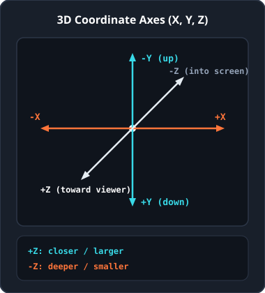
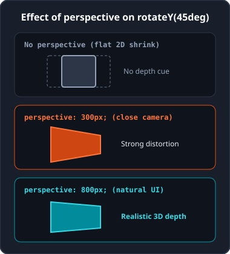
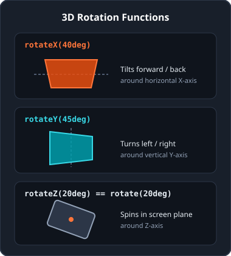
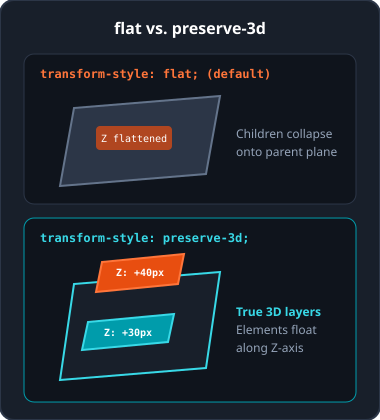
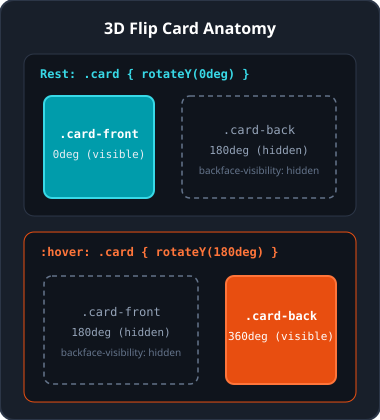

<!-- _class: lead -->

# Bonus: 3D-transformaties in CSS

<p class="subtitle">&lt;Diepte creëren met de Z-as, perspectief en 3D-ruimte /&gt;</p>

<div class="meta-box">
  <strong>Thomas More Hogeschool</strong> - Toegepaste Informatica (ITF)<br>
  <strong>Vak:</strong> Web Essentials | <strong>Module:</strong> Bonus - 3D-transformaties
</div>

---

## Het 3D-assenstelsel: X, Y en Z

<div class="split-2-1">

<div>

Een webbrowser voegt aan de bekende X- en Y-as een derde dimensie toe: de **Z-as**.

- **X-as (horizontaal):** positief naar rechts, negatief naar links.
- **Y-as (verticaal):** positief naar beneden, negatief naar boven.
- **Z-as (loodrecht op scherm):**
  - **Positief (`+Z`):** komt naar de kijker toe.
  - **Negatief (`-Z`):** gaat dieper het scherm in.

</div>

<div class="img-box">



</div>

</div>

---

## Perspectief toevoegen: `perspective`

<div class="split-2-1">

<div>

Zonder perspectief lijkt een 3D-rotatie vlak, alsof het element alleen smaller wordt geschaald. `perspective` stelt de virtuele afstand tussen het oog en het scherm in.

- **200px - 400px (dichtbij):** extreem groothoekeffect met sterke vervorming.
- **600px - 1000px (natuurlijk):** realistische diepte voor kaarten en interfaces.
- **1500px - 2500px (veraf):** heel subtiel, bijna vlak resultaat.

</div>

<div class="img-box">



</div>

</div>

---

## Container vs. element & `perspective-origin`

<div class="grid-2">

<div class="card">

### Container vs. eigen element

Plaats `perspective` bij voorkeur op het ouderelement (`.scene`): alle kinderen delen dan één verdwijnpunt.

```css
/* Aanbevolen: gedeeld verdwijnpunt */
.scene { perspective: 800px; }

/* Individueel per element */
.kaart { transform: perspective(800px) rotateY(45deg); }
```

</div>

<div class="card card-cyan">

### Kijkpunt: `perspective-origin`

Standaard kijkt de virtuele camera recht naar het midden (`50% 50%`).

```css
.scene {
  perspective: 800px;
  perspective-origin: top right;
}
```

Aanvaardbare waarden: sleutelwoorden (`left`, `right`, `top`, `bottom`, `center`), lengtes of percentages.

</div>

</div>

---

## Roteren in 3D: `rotateX()`, `rotateY()`, `rotateZ()`

<div class="split-2-1">

<div>

- `rotateX(hoek)`: kantelt voorover of achterover rond de horizontale as (garagedeur).
- `rotateY(hoek)`: draait linksom of rechtsom rond de verticale as (draaideur).
- `rotateZ(hoek)`: draait in het schermvlak, identiek aan 2D `rotate()`.
- `rotate3d(x, y, z, hoek)`: draait rond een vrije vectoras.

```css
.paneel-a { transform: rotateX(40deg); }
.paneel-b { transform: rotateY(45deg); }
```

</div>

<div class="img-box">



</div>

</div>

---

## Diepteverplaatsing & schalen op de Z-as

<div class="grid-2">

<div class="card">

### `translateZ()` en `translate3d()`

- Positieve Z (`translateZ(60px)`): brengt het element dichter bij de kijker (oogt groter met `perspective`).
- Negatieve Z (`translateZ(-60px)`): duwt het element verder naar achteren (oogt kleiner).

```css
.badge {
  transform: translate3d(10px, 20px, 50px);
}
```

</div>

<div class="card card-accent">

### `scaleZ()` en `scale3d()`

Een standaard HTML-element is een plat vlak van 0 pixels dik.

`scaleZ()` toont daardoor alleen effect wanneer het samenwerkt met kindelementen die via `translateZ()` in een gedeelde 3D-ruimte liggen.

</div>

</div>

---

## De 3D-ruimte bewaren: `preserve-3d`

<div class="split-2-1">

<div>

Standaard gebruikt de browser `transform-style: flat`: kindelementen worden platgedrukt op het vlak van de ouder.

Met `transform-style: preserve-3d` op het roterende tussenelement behouden kinderen hun eigen Z-diepte.

```css
.card { transform-style: preserve-3d; }
.badge { transform: translateZ(40px); }
.knop  { transform: translateZ(30px); }
```

</div>

<div class="img-box">



</div>

</div>

---

## Achterkant verbergen: `backface-visibility`

<div class="grid-2">

<div class="card">

### Wat zie je bij 180 graden draaien?

- **`visible` (standaard):** de browser toont de achterkant als spiegelbeeld van de voorkant.
- **`hidden`:** zodra het vlak meer dan 90 graden weggedraaid is, wordt het volledig onzichtbaar.

</div>

<div class="card card-cyan">

### Toepassing op kaartvlakken

Onmisbaar voor ondoorschijnende objecten zoals een 3D flip card met aparte voor- en achterzijde:

```css
.card-face {
  backface-visibility: hidden;
}
```

</div>

</div>

---

## Praktijkvoorbeeld: 3D Flip Card (opbouw)

<div class="split-2-1">

<div>

Een dubbelzijdige kaart combineert vier bouwstenen:

- `.scene`: vaste grootte + `perspective: 800px`.
- `.card`: `transform-style: preserve-3d` + `transition`, draait bij `:hover` naar `rotateY(180deg)`.
- `.card-face`: gedeeld vlak met `position: absolute` en `backface-visibility: hidden`.
- `.card-back`: start al omgeklapt met `rotateY(180deg)`.

</div>

<div class="img-box">



</div>

</div>

---

## Praktijkvoorbeeld: 3D Flip Card (CSS)

<div class="grid-2">

<div class="card">

### Scène en roterende kaart

```css
.scene {
  width: 240px; height: 320px;
  perspective: 800px;
}
.card {
  width: 100%; height: 100%;
  position: relative;
  transform-style: preserve-3d;
  transition: transform 0.6s ease;
}
.scene:hover .card {
  transform: rotateY(180deg);
}
```

</div>

<div class="card card-accent">

### Voor- en achterzijde

```css
.card-face {
  position: absolute;
  width: 100%; height: 100%;
  backface-visibility: hidden;
}
.card-front {
  transform: rotateY(0deg);
}
.card-back {
  transform: rotateY(180deg);
}
```

</div>

</div>

---

## Valkuilen, tips & Emmet (3D)

<div class="grid-2">

<div class="card card-accent">

### Valkuilen & tips

- **`perspective` vergeten:** dan lijken `rotateX()`/`rotateY()` plat.
- **`preserve-3d` vergeten:** dan verliezen kinderen hun `translateZ()`.
- **`.card-back` niet vooraf `rotateY(180deg)` geven:** dan verdwijnt de achterkant bij omdraaien.
- **Richtwaarde:** kies `perspective: 800px` tot `1000px` en subtiele `translateZ(20px-40px)`.

</div>

<div>

### Emmet in PhpStorm

| Sneltoets | Resultaat |
| :--- | :--- |
| `pe:800` | `perspective: 800px;` |
| `po:c` / `po:t` | `perspective-origin: center / top;` |
| `trf:ry(180deg)` | `transform: rotateY(180deg);` |
| `trf:rx(45deg)` | `transform: rotateX(45deg);` |
| `trf:tz(50px)` | `transform: translateZ(50px);` |
| `ts:p3d` | `transform-style: preserve-3d;` |
| `bv:h` | `backface-visibility: hidden;` |

</div>

</div>

