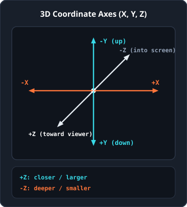
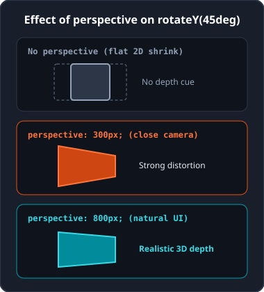
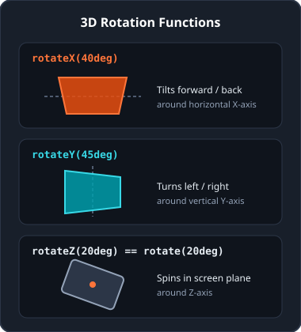
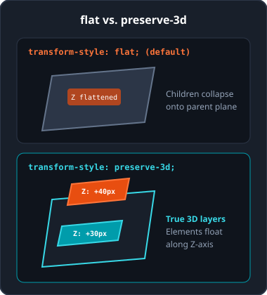
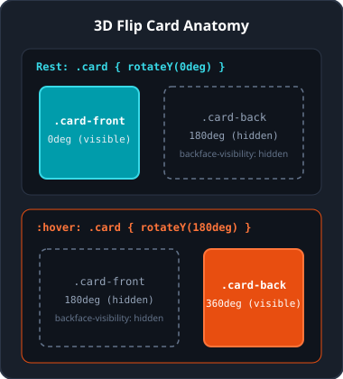

<!-- _class: lead -->

# Bonus: 3D Transforms in CSS

<p class="subtitle">&lt;Creating depth with the Z-axis, perspective, and 3D space /&gt;</p>

<div class="meta-box">
  <strong>Thomas More Hogeschool</strong> - Applied Computer Science (ITF)<br>
  <strong>Course:</strong> Web Essentials | <strong>Module:</strong> Bonus - 3D Transforms
</div>

---

## The 3D coordinate system: X, Y, and Z

<div class="split-2-1">

<div>

A web browser adds a third dimension to the familiar X and Y axes: the **Z-axis**.

- **X-axis (horizontal):** positive to the right, negative to the left.
- **Y-axis (vertical):** positive downward, negative upward.
- **Z-axis (perpendicular to screen):**
  - **Positive (`+Z`):** comes toward the viewer.
  - **Negative (`-Z`):** goes deeper into the screen.

</div>

<div class="img-box">



</div>

</div>

---

## Adding depth: `perspective`

<div class="split-2-1">

<div>

Without perspective, a 3D rotation looks flat, as if the element merely shrinks in width. `perspective` sets the virtual distance between the viewer's eye and the screen.

- **200px - 400px (close):** extreme wide-angle effect with strong distortion.
- **600px - 1000px (natural):** realistic depth for cards and interfaces.
- **1500px - 2500px (far):** very subtle, nearly orthographic result.

</div>

<div class="img-box">



</div>

</div>

---

## Container vs. element & `perspective-origin`

<div class="grid-2">

<div class="card">

### Container vs. individual element

Prefer placing `perspective` on the parent container (`.scene`): all children share one vanishing point.

```css
/* Recommended: shared vanishing point */
.scene { perspective: 800px; }

/* Individual per element */
.card { transform: perspective(800px) rotateY(45deg); }
```

</div>

<div class="card card-cyan">

### Viewpoint: `perspective-origin`

By default, the virtual camera looks straight at the center (`50% 50%`).

```css
.scene {
  perspective: 800px;
  perspective-origin: top right;
}
```

Accepted values: keywords (`left`, `right`, `top`, `bottom`, `center`), lengths, or percentages.

</div>

</div>

---

## Rotating in 3D: `rotateX()`, `rotateY()`, `rotateZ()`

<div class="split-2-1">

<div>

- `rotateX(angle)`: tilts forward or backward around the horizontal axis (garage door).
- `rotateY(angle)`: turns left or right around the vertical axis (revolving door).
- `rotateZ(angle)`: rotates in the screen plane, identical to 2D `rotate()`.
- `rotate3d(x, y, z, angle)`: rotates around an arbitrary 3D vector axis.

```css
.panel-a { transform: rotateX(40deg); }
.panel-b { transform: rotateY(45deg); }
```

</div>

<div class="img-box">



</div>

</div>

---

## Depth offset & scaling along the Z-axis

<div class="grid-2">

<div class="card">

### `translateZ()` and `translate3d()`

- Positive Z (`translateZ(60px)`): brings the element closer to the viewer (appears larger with `perspective`).
- Negative Z (`translateZ(-60px)`): pushes the element deeper into the screen (appears smaller).

```css
.badge {
  transform: translate3d(10px, 20px, 50px);
}
```

</div>

<div class="card card-accent">

### `scaleZ()` and `scale3d()`

A standard HTML element is a flat plane with 0 pixels of thickness.

As a result, `scaleZ()` only shows an effect when combined with child elements positioned in a shared 3D space via `translateZ()`.

</div>

</div>

---

## Preserving 3D space: `preserve-3d`

<div class="split-2-1">

<div>

By default, browsers use `transform-style: flat`: child elements are flattened onto their parent's plane.

With `transform-style: preserve-3d` on the rotating wrapper, children keep their own Z-depth.

```css
.card  { transform-style: preserve-3d; }
.badge { transform: translateZ(40px); }
.btn   { transform: translateZ(30px); }
```

</div>

<div class="img-box">



</div>

</div>

---

## Hiding the back face: `backface-visibility`

<div class="grid-2">

<div class="card">

### What happens when rotated 180 degrees?

- **`visible` (default):** the browser displays the back face as a mirrored image of the front.
- **`hidden`:** once a plane turns more than 90 degrees away from the viewer, it becomes completely invisible.

</div>

<div class="card card-cyan">

### Applying it to card faces

Essential for opaque objects such as a 3D flip card with distinct front and back sides:

```css
.card-face {
  backface-visibility: hidden;
}
```

</div>

</div>

---

## Practical example: 3D Flip Card (structure)

<div class="split-2-1">

<div>

A double-sided card combines four building blocks:

- `.scene`: fixed dimensions + `perspective: 800px`.
- `.card`: `transform-style: preserve-3d` + `transition`, rotates to `rotateY(180deg)` on `:hover`.
- `.card-face`: shared face styling with `position: absolute` and `backface-visibility: hidden`.
- `.card-back`: pre-rotated by `rotateY(180deg)`.

</div>

<div class="img-box">



</div>

</div>

---

## Practical example: 3D Flip Card (CSS)

<div class="grid-2">

<div class="card">

### Scene and rotating card

```css
.scene {
  width: 240px; height: 320px;
  perspective: 800px;
}
.card {
  width: 100%; height: 100%;
  position: relative;
  transform-style: preserve-3d;
  transition: transform 0.6s ease;
}
.scene:hover .card {
  transform: rotateY(180deg);
}
```

</div>

<div class="card card-accent">

### Front and back faces

```css
.card-face {
  position: absolute;
  width: 100%; height: 100%;
  backface-visibility: hidden;
}
.card-front {
  transform: rotateY(0deg);
}
.card-back {
  transform: rotateY(180deg);
}
```

</div>

</div>

---

## Pitfalls, tips & Emmet (3D)

<div class="grid-2">

<div class="card card-accent">

### Pitfalls & tips

- **Forgetting `perspective`:** `rotateX()` / `rotateY()` will look flat.
- **Forgetting `preserve-3d`:** children lose their `translateZ()` offset.
- **Forgetting initial `rotateY(180deg)` on `.card-back`:** the back face disappears when flipped.
- **Guideline:** pick `perspective: 800px` to `1000px` and subtle `translateZ(20px-40px)`.

</div>

<div>

### Emmet in PhpStorm

| Shortcut | Output |
| :--- | :--- |
| `pe:800` | `perspective: 800px;` |
| `po:c` / `po:t` | `perspective-origin: center / top;` |
| `trf:ry(180deg)` | `transform: rotateY(180deg);` |
| `trf:rx(45deg)` | `transform: rotateX(45deg);` |
| `trf:tz(50px)` | `transform: translateZ(50px);` |
| `ts:p3d` | `transform-style: preserve-3d;` |
| `bv:h` | `backface-visibility: hidden;` |

</div>

</div>

