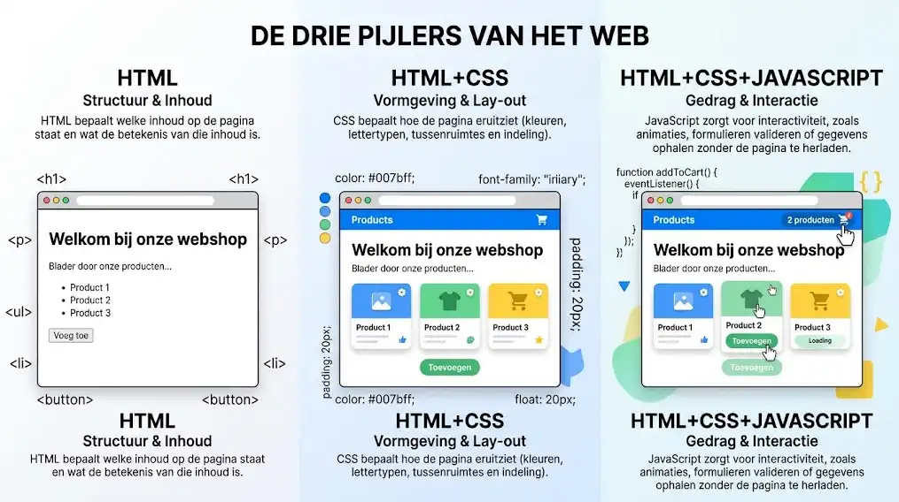
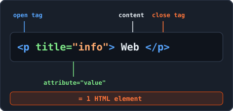
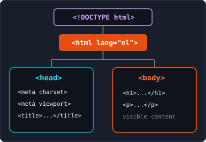
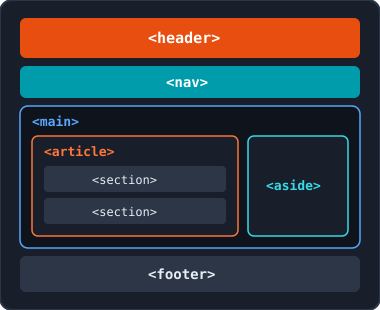

<!-- _class: lead -->

# Week 1: Introductie HTML5 & Basistags

<p class="subtitle">&lt;De bouwstenen van het World Wide Web /&gt;</p>

<div class="meta-box">
  <strong>Thomas More Hogeschool</strong> - Toegepaste Informatica (ITF)<br>
  <strong>Vak:</strong> Web Essentials | <strong>Module:</strong> Week 1
</div>

---

## Agenda & Leerdoelen

<div class="grid-2">
<div class="card card-accent">

#### 1. Introductie in HTML5

- Rol van HTML en webstandaarden (W3C)
- Korte geschiedenis en de drie pijlers
- Tags, elementen en attributen
- Basisstructuur van een HTML5-document

</div>
<div class="card card-cyan">

#### 2. Basistags & Semantiek

- Commentaar (`<!-- ... -->`) in HTML
- Blok- vs. inline-elementen (`div` en `span`)
- Koppen, alinea's, onderbrekingen en nadruk
- Code tonen en semantische structuurtags

</div>
</div>

---

## 1. Wat is HTML en waarom?

<div class="grid-2">
<div class="card card-accent">

#### HyperText Markup Language

- **Opmaaktaal**, geen programmeertaal (geen lussen of logica)
- Markeert tekst met tags om de functie aan te duiden
- Bepaalt uitsluitend **inhoud en structuur** (vormgeving gebeurt met CSS)
- Consistente weergave in alle browsers en op elk schermformaat

</div>
<div class="card card-cyan">

#### W3C Standaarden & Validatie <span class="badge">Must-Do</span>

- **W3C** (World Wide Web Consortium) bepaalt de officiële webstandaarden ([w3.org](https://www.w3.org))
- Geldige code voorkomt weergavefouten en helpt zoekmachines en schermlezers
- Controleer elke pagina met de **W3C HTML5 Validator** of de Chrome-extensie **Validify**

</div>
</div>

---

## 1. Geschiedenis & De drie pijlers van het web

<div class="split-2-1">
<div>

### Van 1991 naar HTML5

- **1991 (CERN):** Tim Berners-Lee bedenkt HTML met 18 tags voor hypertext
- **1993 - 1999:** Evolutie van HTML 1.0 tot HTML 4.01 (W3C Recommendation)
- **2014 - heden (HTML5):** *Living Standard* (WHATWG & W3C) met semantiek en native media

### De drie pijlers

- **HTML:** Structuur en inhoud
- **CSS:** Vormgeving en lay-out
- **JavaScript:** Gedrag en interactie

</div>
<div class="img-box">
  
  <p class="caption">De drie pijlers van elke moderne webpagina</p>
</div>
</div>

---

## 1. Tags, elementen en attributen

<div class="split-2-1">
<div>

```html
<!-- Element = openende tag + inhoud + sluitende tag -->
<p title="Extra toelichting">Beweeg je muis over deze alinea.</p>

<!-- Leeg element (void element): geen inhoud en geen sluitende tag -->
<br>
```

- Tags staan tussen punthaken (`<p>` en `</p>`); schrijf altijd in **kleine letters**
- Plaats attributen in de openende tag (`naam="waarde"`)
- Sluit geneste tags in omgekeerde volgorde (LIFO)

</div>
<div class="img-box">
  
  <p class="caption">Opbouw van een HTML-element</p>
</div>
</div>

---

## 1. Basisstructuur van een HTML5-document

<div class="split-2-1">
<div>

```html
<!DOCTYPE html>
<html lang="nl">
  <head>
    <meta charset="UTF-8">
    <meta name="viewport" content="width=device-width, initial-scale=1.0">
    <title>Mijn eerste webpagina</title>
  </head>
  <body>
    <h1>Welkom bij Web Essentials</h1>
    <p>Dit is de zichtbare inhoud van mijn webpagina.</p>
  </body>
</html>
```

> **Emmet-tip in PhpStorm:** Typ `!` of `html:5` in een leeg `.html`-bestand en druk op `Tab`.

</div>
<div class="img-box">
  
  <p class="caption">Metadata in head, zichtbare inhoud in body</p>
</div>
</div>

---

## 1. Het `<head>`-gedeelte & `index.html`

<div class="grid-2">
<div class="card card-accent">

#### Onzichtbare metadata in `<head>`

- `<!DOCTYPE html>`: Activeert de moderne HTML5-standaardmodus
- `<html lang="nl">`: Geeft de hoofdtaal aan (SEO & schermlezers)
- `<meta charset="UTF-8">`: Voorkomt vreemde leestekens
- `<meta name="viewport" ...>`: Schaling op mobiele apparaten
- `<title>`: Tekst op het browsertabblad

</div>
<div class="card card-cyan">

#### Bestanden & veelgemaakte fouten

- Noem je startpagina altijd **`index.html`** (kleine letters, geen spaties)
- Verwar `<title>` (in `<head>`) niet met `<h1>` (in `<body>`)
- Zet nooit zichtbare inhoud binnen `<head>`
- Vergeet `<!DOCTYPE html>` niet (voorkomt *Quirks Mode*)

</div>
</div>

---

## 2. Commentaar & Blok vs. Inline-elementen

```html
<!-- Enkele regel commentaar (PhpStorm sneltoets: Ctrl + / of Cmd + /) -->
```

<div class="grid-2">
<div class="card card-accent">

#### Blokelementen (`block-level`)

- Starten altijd op een **nieuwe regel**
- Nemen de **volledige breedte** in beslag
- Mogen andere blok- en inline-elementen bevatten
- Voorbeelden: `<h1>`-`<h6>`, `<p>`, `<hr>`, `<header>`, `<div>`

</div>
<div class="card card-cyan">

#### Inline-elementen (`inline`)

- Blijven in de **lopende tekststroom** staan
- Nemen enkel de strikt nodige breedte in
- Mogen **geen** blokelementen bevatten
- Voorbeelden: `<strong>`, `<em>`, `<br>`, `<code>`, `<span>`

</div>
</div>

---

## 2. Neutrale containers: `<div>` en `<span>`

HTML5 kent twee algemene containers zonder eigen betekenis of visuele stijl:

<div class="grid-2">
<div class="card card-accent">

#### `<div>` (division)

- Neutraal **blokelement**
- Bundelt een groep elementen samen
- Gebruik als kapstok voor CSS-lay-out of JavaScript

</div>
<div class="card card-cyan">

#### `<span>`

- Neutraal **inline-element**
- Omvat een specifiek stukje tekst binnen een zin
- Voor gerichte opmaak zonder nieuwe regel

</div>
</div>

> **Belangrijk:** Gebruik `<div>` en `<span>` pas wanneer er geen geschikte semantische HTML5-tag (zoals `<article>`, `<nav>` of `<strong>`) bestaat.

---

## 2. Koppen (`<h1>` t/m `<h6>`) & Hiërarchie

<div class="split-1-2">
<div>

```html
<h1>Hoofdtitel (niveau 1)</h1>
<h2>Tussentitel (niveau 2)</h2>
<h3>Deeltitel (niveau 3)</h3>
<h4>Subtitel (niveau 4)</h4>
<h5>Laag niveau (niveau 5)</h5>
<h6>Laagste niveau (niveau 6)</h6>
```

</div>
<div class="card card-cyan">

#### Regels voor een logische structuur

- **Maximaal een `<h1>` per pagina:** beschrijft het hoofdonderwerp
- **Sla geen niveaus over:** ga van `<h1>` naar `<h2>`, daarna pas `<h3>`
- **Nooit voor lay-out:** kies geen `<h1>` om tekst groot te maken (gebruik CSS)
- **Praktisch:** meestal volstaan `<h1>` t/m `<h4>`
- **Emmet-tip:** typ `h1{Mijn titel}` + `Tab` in PhpStorm

</div>
</div>

---

## 2. Alinea's (`<p>`) & Onderbrekingen (`<hr>`, `<br>`)

<div class="grid-2">
<div class="card card-accent">

#### Alinea's & Dummytekst

- `<p>` bakent een alinea af (blokelement met standaardmarge)
- **Emmet-tip:** `p*2>lorem` + `Tab` genereert twee alinea's voorbeeldtekst

```html
<p>Eerste deel van het verslag.</p>
<hr>
<p>Tweede deel van het verslag.</p>
```

</div>
<div class="card card-cyan">

#### `<hr>` vs. `<br>` (void elements)

- `<hr>`: Thematische overgang (horizontale lijn)
- `<br>`: Gedwongen regeleinde in adres of gedicht

```html
<p>
  Kleinhoefstraat 4<br>
  2440 Geel
</p>
```

</div>
</div>

> **Verboden:** Gebruik nooit `<br><br><br>` om witruimte te maken. Witruimte hoort thuis in CSS (`margin` en `padding`).

---

## 2. Tekstnadruk: `<strong>` vs. `<em>`

```html
<p>Je moet je inschrijving voltooien <strong>voor 1 oktober</strong>.</p>
<p>Ik zei dat <em>jij</em> het bestand moest opslaan, niet je buurman.</p>
```

<div class="grid-2">
<div class="card card-accent">

#### `<strong>` (belangrijk / dringend)

- Standaard weergave in het **vet**
- Voorleessoftware leest dit met nadrukkelijkere toon

</div>
<div class="card card-cyan">

#### `<em>` (emphasis / klemtoon)

- Standaard weergave in *cursief*
- Legt klemtoon die de zinsbetekenis nuanceert

</div>
</div>

> **Semantiek boven uiterlijk:** Vermijd verouderde tags zoals `<b>` en `<i>`; die hebben geen betekenis voor zoekmachines of schermlezers.

---

## 2. Computercode: `<code>` en `<pre>`

<div class="grid-2">
<div class="card card-accent">

#### Inline code: `<code>`

- Inline-element voor tags, bestandsnamen of commando's
- Browser gebruikt automatisch een **monospace**-lettertype

```html
<p>Start met <code>npm run dev</code>.</p>
```

</div>
<div class="card card-cyan">

#### Codeblokken: `<pre><code>`

- `<pre>` (blokelement) behoudt alle spaties en enters
- Combineer `<pre>` en `<code>` voor meerdere regels code

```html
<pre><code>function begroet(naam) {
  console.log("Welkom " + naam);
}</code></pre>
```

</div>
</div>

> **Tip:** Wil je letterlijk `<h1>` tonen op een webpagina? Vervang `<` en `>` door `&lt;` en `&gt;` zodat de browser ze niet als tag uitvoert.

---

## 2. Semantische HTML5-structuurtags

Semantische tags geven aan welk doel een gedeelte van de pagina heeft:

| Tag | Beschrijving | Typisch gebruik |
| :--- | :--- | :--- |
| `<header>` | Inleidende informatie van pagina of artikel | Logo, hoofdtitel of datum |
| `<nav>` | Navigatieblok | Lijst met hyperlinks naar pagina's |
| `<main>` | Unieke hoofdinhoud van het document | Slechts **1 keer** per pagina |
| `<article>` | Zelfstandig, losstaand stuk inhoud | Nieuwsbericht, blogpost, productfiche |
| `<section>` | Thematisch onderdeel met eigen tussentitel | Hoofdstuk of sectie in een artikel |
| `<aside>` | Aanvullende info los van de hoofdtekst | Zijbalk, citaat of gerelateerde links |
| `<footer>` | Afsluiting van pagina of artikel | Copyright, contactgegevens, colofon |

---

## 2. Semantische pagina in de praktijk

<div class="split-2-1">
<div>

```html
<body>
  <header><h1>Thomas More IT Factory</h1></header>
  <nav><h2>Navigatie</h2></nav>
  <main>
    <article>
      <h2>Start van het academiejaar</h2>
      <section>
        <h3>Welkom eerstejaars</h3>
        <p>Het jaar wordt <strong>uitdagend</strong>.</p>
      </section>
    </article>
    <aside>
      <h3>Wist je dat?</h3>
      <p>Meer dan 1000 actieve studenten.</p>
    </aside>
  </main>
  <footer><p>&copy; Thomas More - IT Factory</p></footer>
</body>
```

</div>
<div class="img-box">
  
  <p class="caption">1x &lt;main&gt;, logische h2/h3 en controle via Semantiscope</p>
</div>
</div>

---

## Samenvatting, valkuilen & labo-oefeningen

<div class="grid-2">
<div class="card card-accent">

#### Top-4 fouten om te vermijden

- Meerdere keren `<br><br><br>` gebruiken voor witruimte
- Meerdere `<h1>`-tags of niveaus overslaan (`<h1>` -> `<h3>`)
- Een blokelement (`<p>`, `<div>`) in een inline-element nesten
- Vergeten te valideren met **Validify** en **Semantiscope**

</div>
<div class="card card-cyan">

#### Zelf aan de slag in het labo

- **Labo 1 (`index.html`):** Je eerste profielpagina + foutzoeken
- **Blog (`blog.html`):** Semantische pagina met `header`, `main`, `article`, `section`, `footer`
- **Contactfiche (`contact.html`):** Gebruik van `<br>`, `<hr>` en `<strong>`

</div>
</div>

---

<!-- _class: lead -->

# Vragen & Aan de Slag!

<p class="subtitle">&lt;Succes met je eerste HTML5-pagina's /&gt;</p>

<div class="meta-box">
  <strong>Volgende stap:</strong> Bouw en valideer de oefeningen uit Week 1 in PhpStorm
</div>
