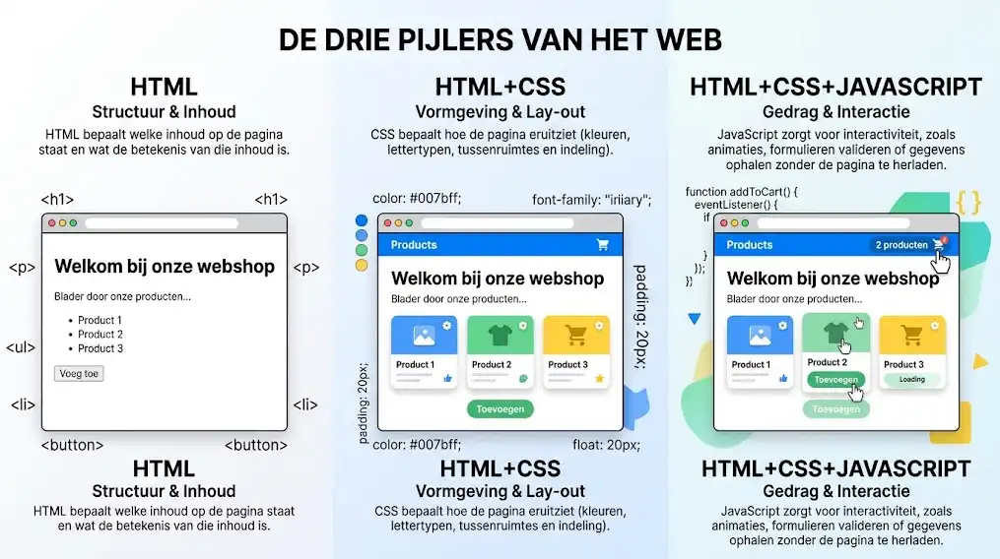
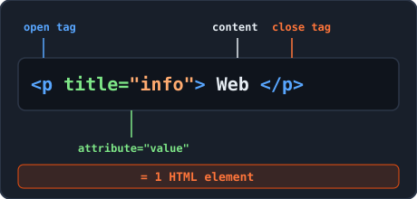
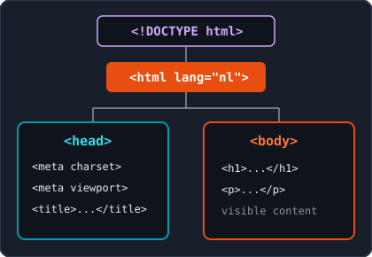
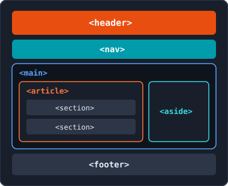

<!-- _class: lead -->

# Week 1: Introduction to HTML5 & Basic Tags

<p class="subtitle">&lt;The building blocks of the World Wide Web /&gt;</p>

<div class="meta-box">
  <strong>Thomas More Hogeschool</strong> - Applied Computer Science (ITF)<br>
  <strong>Course:</strong> Web Essentials | <strong>Module:</strong> Week 1
</div>

---

## Agenda & Learning Objectives

<div class="grid-2">
<div class="card card-accent">

#### 1. Introduction to HTML5

- Role of HTML and web standards (W3C)
- Brief history and the three pillars
- Tags, elements, and attributes
- Basic structure of an HTML5 document

</div>
<div class="card card-cyan">

#### 2. Basic Tags & Semantics

- Comments (`<!-- ... -->`) in HTML
- Block vs. inline elements (`div` and `span`)
- Headings, paragraphs, breaks, and emphasis
- Displaying code and semantic structure tags

</div>
</div>

---

## 1. What Is HTML and Why Use It?

<div class="grid-2">
<div class="card card-accent">

#### HyperText Markup Language

- **Markup language**, not a programming language (no loops or logic)
- Marks text with tags to indicate its purpose
- Defines **content and structure** only (styling is handled by CSS)
- Consistent rendering across all browsers and screen sizes

</div>
<div class="card card-cyan">

#### W3C Standards & Validation <span class="badge">Must-Do</span>

- **W3C** (World Wide Web Consortium) defines official web standards ([w3.org](https://www.w3.org))
- Valid code prevents display errors and helps search engines and screen readers
- Check every page with the **W3C HTML5 Validator** or the **Validify** Chrome extension

</div>
</div>

---

## 1. History & The Three Pillars of the Web

<div class="split-2-1">
<div>

### From 1991 to HTML5

- **1991 (CERN):** Tim Berners-Lee invents HTML with 18 tags for hypertext
- **1993 - 1999:** Evolution from HTML 1.0 to HTML 4.01 (W3C Recommendation)
- **2014 - present (HTML5):** *Living Standard* (WHATWG & W3C) with semantics and native media

### The Three Pillars

- **HTML:** Structure and content
- **CSS:** Styling and layout
- **JavaScript:** Behavior and interaction

</div>
<div class="img-box">
  
  <p class="caption">The three pillars of every modern web page</p>
</div>
</div>

---

## 1. Tags, Elements, and Attributes

<div class="split-2-1">
<div>

```html
<!-- Element = opening tag + content + closing tag -->
<p title="Extra explanation">Hover your mouse over this paragraph.</p>

<!-- Empty element (void element): no content and no closing tag -->
<br>
```

- Tags are enclosed in angle brackets (`<p>` and `</p>`); always write in **lowercase**
- Place attributes inside the opening tag (`name="value"`)
- Close nested tags in reverse order (LIFO)

</div>
<div class="img-box">
  
  <p class="caption">Structure of an HTML element</p>
</div>
</div>

---

## 1. Basic Structure of an HTML5 Document

<div class="split-2-1">
<div>

```html
<!DOCTYPE html>
<html lang="en">
  <head>
    <meta charset="UTF-8">
    <meta name="viewport" content="width=device-width, initial-scale=1.0">
    <title>My first web page</title>
  </head>
  <body>
    <h1>Welcome to Web Essentials</h1>
    <p>This is the visible content of my web page.</p>
  </body>
</html>
```

> **Emmet tip in PhpStorm:** Type `!` or `html:5` in an empty `.html` file and press `Tab`.

</div>
<div class="img-box">
  
  <p class="caption">Metadata in head, visible content in body</p>
</div>
</div>

---

## 1. The `<head>` Section & `index.html`

<div class="grid-2">
<div class="card card-accent">

#### Invisible Metadata in `<head>`

- `<!DOCTYPE html>`: Enables modern HTML5 standards mode
- `<html lang="en">`: Specifies the primary language (SEO & screen readers)
- `<meta charset="UTF-8">`: Prevents broken special characters
- `<meta name="viewport" ...>`: Scaling on mobile devices
- `<title>`: Text shown on the browser tab

</div>
<div class="card card-cyan">

#### Files & Common Mistakes

- Always name your home page **`index.html`** (lowercase, no spaces)
- Do not confuse `<title>` (in `<head>`) with `<h1>` (in `<body>`)
- Never put visible content inside `<head>`
- Never omit `<!DOCTYPE html>` (prevents *Quirks Mode*)

</div>
</div>

---

## 2. Comments & Block vs. Inline Elements

```html
<!-- Single-line comment (PhpStorm shortcut: Ctrl + / or Cmd + /) -->
```

<div class="grid-2">
<div class="card card-accent">

#### Block Elements (`block-level`)

- Always start on a **new line**
- Take up the **full available width**
- May contain other block and inline elements
- Examples: `<h1>`-`<h6>`, `<p>`, `<hr>`, `<header>`, `<div>`

</div>
<div class="card card-cyan">

#### Inline Elements (`inline`)

- Stay within the **running text flow**
- Only take up as much width as needed
- May **not** contain block elements
- Examples: `<strong>`, `<em>`, `<br>`, `<code>`, `<span>`

</div>
</div>

---

## 2. Neutral Containers: `<div>` and `<span>`

HTML5 provides two generic containers with no inherent meaning or visual styling:

<div class="grid-2">
<div class="card card-accent">

#### `<div>` (division)

- Neutral **block element**
- Groups a set of elements together
- Used as a hook for CSS layout or JavaScript

</div>
<div class="card card-cyan">

#### `<span>`

- Neutral **inline element**
- Wraps a specific piece of text within a sentence
- For targeted styling without starting a new line

</div>
</div>

> **Important:** Only use `<div>` and `<span>` when no suitable semantic HTML5 tag (such as `<article>`, `<nav>`, or `<strong>`) exists.

---

## 2. Headings (`<h1>` to `<h6>`) & Hierarchy

<div class="split-1-2">
<div>

```html
<h1>Main heading (level 1)</h1>
<h2>Section heading (level 2)</h2>
<h3>Sub-section (level 3)</h3>
<h4>Subheading (level 4)</h4>
<h5>Low level (level 5)</h5>
<h6>Lowest level (level 6)</h6>
```

</div>
<div class="card card-cyan">

#### Rules for a Logical Structure

- **At most one `<h1>` per page:** describes the main topic
- **Do not skip levels:** go from `<h1>` to `<h2>`, then `<h3>`
- **Never for layout:** do not pick `<h1>` just to make text larger (use CSS)
- **In practice:** `<h1>` through `<h4>` are usually sufficient
- **Emmet tip:** type `h1{My title}` + `Tab` in PhpStorm

</div>
</div>

---

## 2. Paragraphs (`<p>`) & Breaks (`<hr>`, `<br>`)

<div class="grid-2">
<div class="card card-accent">

#### Paragraphs & Dummy Text

- `<p>` defines a paragraph (block element with default margin)
- **Emmet tip:** `p*2>lorem` + `Tab` generates two sample paragraphs

```html
<p>First part of the report.</p>
<hr>
<p>Second part of the report.</p>
```

</div>
<div class="card card-cyan">

#### `<hr>` vs. `<br>` (void elements)

- `<hr>`: Thematic break (horizontal line)
- `<br>`: Forced line break in an address or poem

```html
<p>
  Kleinhoefstraat 4<br>
  2440 Geel
</p>
```

</div>
</div>

> **Forbidden:** Never use `<br><br><br>` to create whitespace. Whitespace belongs in CSS (`margin` and `padding`).

---

## 2. Text Emphasis: `<strong>` vs. `<em>`

```html
<p>You must complete your registration <strong>before October 1</strong>.</p>
<p>I said <em>you</em> had to save the file, not your neighbor.</p>
```

<div class="grid-2">
<div class="card card-accent">

#### `<strong>` (important / urgent)

- Rendered in **bold** by default
- Screen readers read this with a more emphatic tone

</div>
<div class="card card-cyan">

#### `<em>` (emphasis / stress)

- Rendered in *italics* by default
- Adds stress that subtly changes sentence meaning

</div>
</div>

> **Semantics over appearance:** Avoid outdated tags like `<b>` and `<i>`; they carry no meaning for search engines or screen readers.

---

## 2. Computer Code: `<code>` and `<pre>`

<div class="grid-2">
<div class="card card-accent">

#### Inline Code: `<code>`

- Inline element for tags, file names, or commands
- Browsers automatically use a **monospace** font

```html
<p>Start with <code>npm run dev</code>.</p>
```

</div>
<div class="card card-cyan">

#### Code Blocks: `<pre><code>`

- `<pre>` (block element) preserves all spaces and line breaks
- Combine `<pre>` and `<code>` for multi-line code blocks

```html
<pre><code>function greet(name) {
  console.log("Welcome " + name);
}</code></pre>
```

</div>
</div>

> **Tip:** Want to display `<h1>` literally on a web page? Replace `<` and `>` with `&lt;` and `&gt;` so the browser does not parse them as a tag.

---

## 2. Semantic HTML5 Structure Tags

Semantic tags indicate the purpose of each section of the page:

| Tag | Description | Typical Usage |
| :--- | :--- | :--- |
| `<header>` | Introductory content of a page or article | Logo, main heading, or date |
| `<nav>` | Navigation block | List of hyperlinks to other pages |
| `<main>` | Unique main content of the document | Only **1 time** per page |
| `<article>` | Self-contained, standalone piece of content | News item, blog post, product card |
| `<section>` | Thematic part with its own subheading | Chapter or section in an article |
| `<aside>` | Supplementary info separate from main text | Sidebar, quote, or related links |
| `<footer>` | Closing section of a page or article | Copyright, contact details, colophon |

---

## 2. Semantic Page in Practice

<div class="split-2-1">
<div>

```html
<body>
  <header><h1>Thomas More IT Factory</h1></header>
  <nav><h2>Navigation</h2></nav>
  <main>
    <article>
      <h2>Start of the academic year</h2>
      <section>
        <h3>Welcome first-year students</h3>
        <p>The year will be <strong>challenging</strong>.</p>
      </section>
    </article>
    <aside>
      <h3>Did you know?</h3>
      <p>More than 1000 active students.</p>
    </aside>
  </main>
  <footer><p>&copy; Thomas More - IT Factory</p></footer>
</body>
```

</div>
<div class="img-box">
  
  <p class="caption">1x &lt;main&gt;, logical h2/h3 and check with Semantiscope</p>
</div>
</div>

---

## Summary, Pitfalls & Lab Exercises

<div class="grid-2">
<div class="card card-accent">

#### Top 4 Mistakes to Avoid

- Using multiple `<br><br><br>` tags for whitespace
- Using multiple `<h1>` tags or skipping levels (`<h1>` -> `<h3>`)
- Nesting a block element (`<p>`, `<div>`) inside an inline element
- Forgetting to validate with **Validify** and **Semantiscope**

</div>
<div class="card card-cyan">

#### Get Hands-On in the Lab

- **Lab 1 (`index.html`):** Your first profile page + debugging
- **Blog (`blog.html`):** Semantic page with `header`, `main`, `article`, `section`, `footer`
- **Contact card (`contact.html`):** Using `<br>`, `<hr>`, and `<strong>`

</div>
</div>

---

<!-- _class: lead -->

# Questions & Let's Get Started!

<p class="subtitle">&lt;Good luck with your first HTML5 pages /&gt;</p>

<div class="meta-box">
  <strong>Next step:</strong> Build and validate the Week 1 exercises in PhpStorm
</div>

