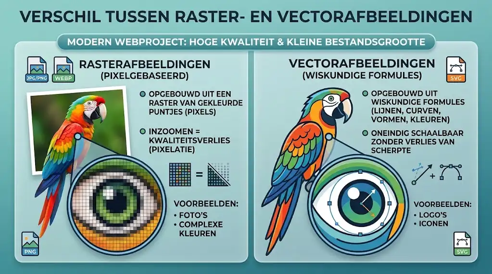
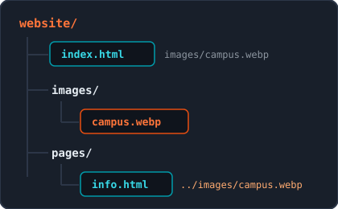
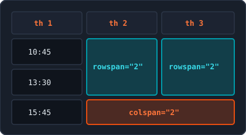

<!-- _class: lead -->

# Week 2: Afbeeldingen, Links, Tekens, Lijsten & Tabellen

<p class="subtitle">&lt;Rijke inhoud en structuur in HTML5 /&gt;</p>

<div class="meta-box">
  <strong>Thomas More Hogeschool</strong> - Toegepaste Informatica (ITF)<br>
  <strong>Vak:</strong> Web Essentials | <strong>Module:</strong> Week 2
</div>

---

## Agenda

<div class="grid-2">
<div class="card card-accent">

#### Media & Navigatie

1. **Afbeeldingen** - ``, attributen, formaten & paden
2. **Hyperlinks** - `<a>`, paden, `target`, ankers & schema's

</div>
<div class="card card-cyan">

#### Tekens & Datastructuren

3. **Speciale Tekens** - UTF-8, entiteiten & `&nbsp;`
4. **Lijsten** - `<ul>`, `<ol>`, geneste lijsten & `<dl>`
5. **Tabellen** - `<table>`, `scope`, `colspan`/`rowspan` & groepering

</div>
</div>

---

## 1. Afbeeldingen: Het ``-element & kernattributen

```html

```

<div class="grid-2">
<div class="card card-accent">

#### Eigenschappen van ``

- **Leeg element (void):** geen sluitingstag
- **Inline & replaced:** afmetingen komen uit het bestand
- Plaats bij voorkeur in `<p>` of `<figure>`
- **PhpStorm-tip:** typ `img` + `Tab`

</div>
<div class="card card-cyan">

#### `src` & `alt` (beide verplicht)

- `src`: relatief pad of externe URL naar bestand
- `alt`: beschrijving voor **screenreaders**, SEO en fouten
- Vermijd "Foto van..." in `alt`
- Decoratieve afbeelding? Gebruik leeg `alt=""`

</div>
</div>

---

## 1. Afbeeldingen: `width`, `height` & `loading="lazy"`

```html
<!-- Boven de vouw: laadt direct, zonder loading="lazy" -->


<!-- Onder de vouw: pas laden bij scrollen -->

```

<div class="grid-2">
<div class="card card-accent">

#### `width` & `height` (zonder `px`)

- Browser reserveert vooraf exact de juiste ruimte
- Voorkomt verspringende pagina's (**CLS**)
- Check afmetingen in PhpStorm of Chrome-tabblad

</div>
<div class="card card-cyan">

#### Uitgesteld laden (`loading="lazy"`)

- Versnelt de eerste weergave van de pagina
- Bespaart mobiele data bij lange pagina's
- Gebruik **nooit** op de eerste hero-afbeelding

</div>
</div>

---

## 1. Afbeeldingen: Raster vs. Vector

<div class="split-2-1">
<div>

### Twee categorieen op het web

- **Rasterafbeeldingen:** opgebouwd uit pixels; bij inzoomen treedt kwaliteitsverlies op (`WebP`, `PNG`, `JPEG`, `GIF`)
- **Vectorafbeeldingen:** opgebouwd uit wiskundige formules; oneindig schaalbaar zonder verlies van scherpte (`SVG`)

### Richtlijnen bestandsgrootte

- **Grote banners / hero:** max. 100 - 150 kB
- **Artikelfoto's:** max. 50 - 80 kB
- **Kleine illustraties / logo's:** max. 10 - 30 kB

</div>
<div class="img-box">
  
  <p class="caption">Pixelraster tegenover wiskundige vectorlijnen</p>
</div>
</div>

---

## 1. Afbeeldingen: Formaten vergelijken

| Formaat | Categorie | Transparantie | Compressie | Ideaal voor |
| :--- | :---: | :---: | :---: | :--- |
| **WebP** | Raster | Ja (Alpha) | Lossy & Lossless | Foto's, banners, webillustraties |
| **SVG** | Vector | Ja (Alpha) | Wiskundig / Lossless | Logo's, iconen, pictogrammen |
| **PNG** | Raster | Ja (Alpha) | Lossless | Screenshots, fijne tekst |
| **JPEG** | Raster | Nee | Lossy | Klassiek fotoformaat (vervang door WebP) |
| **GIF** | Raster | Beperkt (1 kleur) | Lossless (max. 256) | Korte animaties (historisch) |

> **Moderne standaard:** Gebruik **WebP** voor foto's (25-35% kleiner dan JPEG/PNG bij gelijke kwaliteit) en **SVG** voor logo's en iconen.

---

## 1. Afbeeldingen: WebP, `<picture>` & SVG

<div class="grid-2">
<div class="card card-accent">

#### WebP & `<picture>` fallback

- Ondersteunt lossy, lossless, alpha en animaties
- Biedt met `<picture>` een JPG/PNG-fallback

```html
<picture>
  <source srcset="campus.webp" type="image/webp">
  
</picture>
```

</div>
<div class="card card-cyan">

#### SVG & `viewBox`

- Te gebruiken via `` of inline `<svg>`
- `viewBox="min-x min-y b h"` bewaakt verhouding
- Vormen: `<rect />`, `<circle />`, `<ellipse />`, `<line />`

```html
<svg viewBox="0 0 100 100" width="80" height="80">
  <circle cx="50" cy="50" r="40" fill="#00283c" stroke="#e87722" stroke-width="6" />
</svg>
```

</div>
</div>

---

## 1. Afbeeldingen: Paden, Hotlinking & `<figure>`

<div class="grid-2">
<div class="card card-accent">

#### Relatieve paden & Linux-regels

- Submap: `images/campus.webp` of `./images/campus.webp`
- Map omhoog: `../images/campus.webp`
- **Linux-servers:** alleen kleine letters, geen spaties, gebruik `/` (nooit `\`)
- **Geen hotlinking:** download vrije beelden (Unsplash, Pexels) lokaal

</div>
<div class="card card-cyan">

#### Semantiek: `<figure>` & `<figcaption>`

- Groepeert zelfstandig beeld met optioneel bijschrift
- `<figcaption>` staat als eerste of laatste kind

```html
<figure>
  
  <figcaption>Figuur 1: Thomas More Campus Geel.</figcaption>
</figure>
```

</div>
</div>

---

## 1. Afbeeldingen: Favicon & Beeldverhouding

<div class="grid-2">
<div class="card card-accent">

#### Favicon in `<head>`

- Pictogram op browsertabblad en bladwijzers
- Combineer `.ico` (`sizes="any"`), `.svg` en `.png`

```html
<link rel="icon" href="favicon.ico" sizes="any">
<link rel="icon" type="image/svg+xml" href="favicon.svg">
<link rel="icon" type="image/png" sizes="32x32" href="favicon-32x32.png">
```

</div>
<div class="card card-cyan">

#### Beeldverhouding & Tools

- Respecteer steeds de originele **aspect ratio** (16:9, 4:3, 1:1)
- Vervorm geen foto's via willekeurige `width`/`height`
- **AspectSnap:** meet beeldverhouding in Chrome
- **Photo Edit Pro:** bijsnijden, herschalen en exporteren naar WebP

</div>
</div>

---

## 2. Hyperlinks: `<a>`, `href` & Paden

<div class="split-2-1">
<div>

```html
<!-- Absolute URL (extern: altijd met https://) -->
<a href="https://www.thomasmore.be">Thomas More</a>

<!-- Document-relatief pad (eigen project) -->
<a href="contact.html">Contact</a> | <a href="../index.html">Home</a>
```

- `<a>` (anchor) is een inline-element; `href` bepaalt het doel (`a` + `Tab`)
- **Absoluut:** voor externe websites; vergeet `https://` nooit (voorkomt 404)
- **Relatief:** voor eigen pagina's (`./`, `map/`, `../`) zodat lokaal en online werken

</div>
<div class="img-box">
  
  <p class="caption">Relatieve paden vertrekken vanuit het huidige bestand</p>
</div>
</div>

---

## 2. Hyperlinks: `target`, Veiligheid & Ankers (`#id`)

<div class="grid-2">
<div class="card card-accent">

#### Nieuw tabblad & beveiliging

- Standaard is `target="_self"` (zelfde tabblad)
- Gebruik `target="_blank"` spaarzaam (enkel extern/PDF)
- Voeg altijd `rel="noopener noreferrer"` toe tegen *reverse tabnabbing*

```html
<a href="https://www.w3.org" target="_blank" rel="noopener noreferrer">W3C</a>
```

</div>
<div class="card card-cyan">

#### Ankers (`#id`) op dezelfde of andere pagina

- Geef het doel een uniek `id`-attribuut
- Link ernaar met `#id`, of naar `#` voor bovenkant

```html
<section id="contact"><h2>Contact</h2></section>
<a href="#contact">Naar contact</a>
<a href="campus.html#bereikbaarheid">Route</a>
```

</div>
</div>

> **Wat is reverse tabnabbing?** Zonder `noopener` kan het nieuwe tabblad via JavaScript (`window.opener`) het oorspronkelijke tabblad ongemerkt doorsturen naar een phishingpagina.

---

## 2. Hyperlinks: Communicatieschema's & `download`

```html
<a href="mailto:info@thomasmore.be?subject=Vraag%20Web%20Essentials">Mail ons</a>
<a href="tel:+3214562310">014 56 23 10</a>
<a href="https://wa.me/3214562310" target="_blank" rel="noopener noreferrer">WhatsApp</a>
<a href="downloads/cp_v2.pdf" download="campusplan-geel.pdf">Download plan (PDF)</a>
```

<div class="grid-2">
<div class="card card-accent">

#### Speciale URL-schema's

- `mailto:` (spaties als `%20` in `subject`/`body`)
- `tel:` en `sms:` (altijd internationaal formaat `+32...`)
- **WhatsApp (`https://wa.me/32...`):** officiële korte link voor WhatsApp-app & Web (zonder `+` of `0`, optioneel `?text=...`)
- `geo:51.1610,4.9608` (of Google Maps URL voor desktop)

</div>
<div class="card card-cyan">

#### Bestanden downloaden (`download`)

- Dwingt opslaan af in plaats van openen in tabblad
- Optionele waarde stelt een nette bestandsnaam voor
- Werkt uit veiligheidsoverwegingen **enkel same-origin** (eigen domein)

</div>
</div>

---

## 2. Hyperlinks: Toegankelijkheid (A11y) & Linkteksten

Schermlezers lezen vaak een lijst van alle links op een pagina voor. Maak elke linktekst zelfstandig duidelijk:

| Slecht voorbeeld | Goed voorbeeld | Waarom? |
| :--- | :--- | :--- |
| `<a href="rooster.html">Klik hier</a>` | `<a href="rooster.html">Lessenrooster Campus Geel</a>` | Beschrijft zelfstandig de bestemming |
| `<a href="contact.html">deze pagina</a>` | `<a href="contact.html">contactpagina</a>` | Compact en direct scanbaar |
| `<a href="inschrijven.html">Lees meer</a>` | `<a href="inschrijven.html">Schrijf je in voor de infodag</a>` | Maakt de exacte actie duidelijk |

> **Bestandsinfo & `title`:** Vermeld bestandstype en grootte bij zware downloads (bv. `(PDF, 2.4 MB)`). Gebruik `title` alleen voor extra context, niet als vervanging van duidelijke linktekst.

---

## 3. Speciale Tekens: UTF-8 & HTML-entiteiten

<div class="grid-2">
<div class="card card-accent">

#### Waarom coderen & rol van UTF-8

- Browsers parsen `<` als het begin van een HTML-tag (`5 < 8` kan de lay-out breken)
- Dankzij `<meta charset="UTF-8">` typ of plak je **accenten** (`café`), **valuta** (`€`) en **Unicode-symbolen** rechtstreeks

</div>
<div class="card card-cyan">

#### Opbouw van een HTML-entiteit

- Altijd drie delen: `&` + `naam` + `;`
- Voorbeeld: `&lt;` (`<`), `&gt;` (`>`), `&amp;` (`&`), `&copy;` (`©`)
- **Vergeet de puntkomma `;` nooit** (geeft fouten in W3C-validator)

</div>
</div>

---

## 3. Speciale Tekens: De 5 gereserveerde tekens

Wil je een gereserveerd teken als letterlijke tekst tonen, gebruik dan verplicht de entiteit:

| Teken | Betekenis | Entiteit | Waarom gereserveerd? |
| :---: | :--- | :---: | :--- |
| `<` | Kleiner dan | `&lt;` | Begint een HTML-tag (**L**ess **T**han) |
| `>` | Groter dan | `&gt;` | Sluit een HTML-tag (**G**reater **T**han) |
| `&` | Ampersand / En-teken | `&amp;` | Begint een HTML-entiteit |
| `"` | Dubbel aanhalingsteken | `&quot;` | Sluit attribuutwaarden in |
| `'` | Enkel aanhalingsteken | `&apos;` | Sluit attribuutwaarden in |

> **Bedrijfsnamen & code:** Schrijf `Thomas More &amp; Partners` en escape tags in `<code>&lt;img src="foto.webp"&gt;</code>`.

---

## 3. Speciale Tekens: Vaste spatie (`&nbsp;`) & Typografie

<div class="split-1-2">
<div class="card card-accent">

#### Vaste spatie (`&nbsp;`)

- *Non-breaking space*: voorkomt afbreking tussen woorden of getallen
- Wordt niet samengevoegd tot 1 spatie
- Code: `014&nbsp;56&nbsp;23&nbsp;10`, `€&nbsp;250`, `20&nbsp;°C`
- Resultaat: **014&nbsp;56&nbsp;23&nbsp;10**, **€&nbsp;250**, **20&nbsp;°C**
- **Nooit voor lay-out** (gebruik CSS)

</div>
<div>

| Symbool | Entiteit | Toepassing |
| :---: | :---: | :--- |
| `©` / `®` / `™` | `&copy;` / `&reg;` / `&trade;` | Footer & merknamen |
| `←` / `→` / `↑` / `↓` | `&larr;` / `&rarr;` / `&uarr;` / `&darr;` | Knoppen & navigatie |
| `•` | `&bull;` | Scheidingsteken in footer/menu |
| `…` | `&hellip;` | Beletselteken (beter dan `...`) |
| `×` | `&times;` | Sluitknoppen of vermenigvuldigen |

</div>
</div>

---

## 4. Lijsten: Ongeordend (`<ul>`) & Geordend (`<ol>`)

<div class="grid-2">
<div class="card card-accent">

#### `<ul>` (volgorde speelt geen rol)

- Standaard weergave met bolletjes (bullets)
- Standaardbasis voor menu's: `<nav><ul><li><a>...</a></li></ul></nav>`
- **Regel:** enkel `<li>` als direct kind

```html
<ul>
  <li>HTML5</li>
  <li>CSS3</li>
</ul>
```

</div>
<div class="card card-cyan">

#### `<ol>` (volgorde is cruciaal)

- Standaard genummerd (`1.`, `2.`, `3.`)
- `type`: `1`, `a`, `A`, `i`, `I` (enkel indien semantisch)
- `start="5"` en boolean `reversed`
- `<li value="10">` overschrijft nummering

```html
<ol start="5">
  <li>Open PhpStorm</li>
  <li>Maak index.html</li>
</ol>
```

</div>
</div>

---

## 4. Lijsten: Geneste lijsten & Beschrijvingslijsten (`<dl>`)

<div class="grid-2">
<div class="card card-accent">

#### Gouden regel voor geneste lijsten

- Een sublijst staat **altijd binnen `<li>`** van de bovenliggende lijst, nooit tussen `</li>` en `<li>`

```html
<ul>
  <li>België
    <ul>
      <li>Antwerpen</li>
      <li>Geel</li>
    </ul>
  </li>
  <li>Nederland</li>
</ul>
```

</div>
<div class="card card-cyan">

#### Beschrijvingslijst: `<dl>`, `<dt>`, `<dd>`

- Voor paren van term (`<dt>`) en uitleg (`<dd>`): woordenboek, specs, FAQ
- Meerdere `<dt>` of `<dd>` mogelijk; optioneel groeperen per `<div>`

```html
<dl>
  <dt>HTML5</dt>
  <dd>Opmaaktaal voor webstructuur.</dd>
</dl>
```

</div>
</div>

---

## 4. Lijsten: Keuzehulp, Emmet & Valkuilen

<div class="split-2-1">
<div>

| Emmet-afkorting | Resultaat na `Tab` |
| :--- | :--- |
| `ul>li*4` | Ongeordende lijst met 4 items |
| `ol>li*3{Stap $}` | Geordende lijst: Stap 1, Stap 2, Stap 3 |
| `ul>li*3>a` | Menu met 3 links |
| `dl>(dt{Term $}+dd{Uitleg $})*3` | Beschrijvingslijst met 3 paren |

</div>
<div class="card card-accent">

#### Keuze & Valkuilen

- **Volgorde belangrijk?** `<ol>`
- **Term + waarde?** `<dl>`
- **Anders?** `<ul>`
- Typ in `<ol>` nooit zelf `1.`, `2.` in `<li>`
- Gebruik geen lijst louter om tekst te laten inspringen

</div>
</div>

---

## 5. Tabellen: Doel & Basisstructuur

```html
<table>
  <caption>Prijslijst Dranken</caption>
  <tr>
    <th scope="col">Drank</th><th scope="col">Prijs</th>
  </tr>
  <tr>
    <td>Koffie</td><td>€ 2,20</td>
  </tr>
</table>
```

<div class="grid-2">
<div class="card card-accent">

#### Alleen voor 2D-datatabellen

- Enkel voor gegevens die in rijen én kolommen passen (zoals Excel)
- **Nooit voor paginalay-out** (slecht voor A11y & niet responsief)

</div>
<div class="card card-cyan">

#### Kernelementen & `scope`

- `<caption>` moet **altijd eerst** na `<table>` staan
- `<tr>` = rij, `<th>` = kopcel, `<td>` = datacel
- Gebruik `scope="col"` of `scope="row"` op `<th>` voor screenreaders

</div>
</div>

---

## 5. Tabellen: Cellen samenvoegen (`colspan` & `rowspan`)

<div class="split-2-1">
<div>

```html
<table>
  <caption>Lesrooster ICT</caption>
  <tr>
    <th scope="col">Tijdstip</th><th scope="col">Lokaal</th><th scope="col">Onderdeel</th>
  </tr>
  <tr>
    <td>10.45 - 12.45</td>
    <td rowspan="2">Lokaal 2.15</td>
    <td rowspan="2">Projectwerk ICT</td>
  </tr>
  <tr><td>13.30 - 15.30</td></tr>
  <tr>
    <td>15.45 - 17.15</td>
    <td colspan="2">Zelfstandige studietijd</td>
  </tr>
</table>
```

</div>
<div class="img-box">
  
  <p class="caption">Laat bij samenvoegen telkens n-1 cellen weg in rij/kolom</p>
</div>
</div>

---

## 5. Tabellen: Semantische zones, Kolommen & Emmet

<div class="grid-2">
<div class="card card-accent">

#### `<thead>`, `<tbody>`, `<tfoot>`

- `<thead>` (max. 1x): kolomhoofdingen
- `<tbody>` (1 of meer): feitelijke gegevensrijen
- `<tfoot>`: totalen of samenvatting
- Nut: toegankelijkheid, sticky header via CSS en herhaalde koppen bij printen

</div>
<div class="card card-cyan">

#### `<colgroup>`, `<col>` & Emmet

- `<colgroup>` + `<col span="n">` groeperen kolommen na `<caption>` en vóór `<thead>` (handig voor CSS-kolomstijlen)
- **Emmet met `^` (niveau omhoog):**
  `table>thead>tr>th*3^^tbody>tr*3>td*3`

</div>
</div>

---

## Samenvatting & Best Practices

<div class="grid-2">
<div class="card card-accent">

#### Media, Links & Tekens

- **Afbeeldingen:** `src`, `alt`, `width`/`height`, `loading="lazy"`, WebP/SVG en relatieve paden
- **Hyperlinks:** `https://` extern, `rel="noopener noreferrer"` bij `_blank`, duidelijke linktekst
- **Tekens:** `&lt;`, `&gt;`, `&amp;` verplichte entiteiten; `&nbsp;` niet voor lay-out

</div>
<div class="card card-cyan">

#### Lijsten & Tabellen

- **Lijsten:** kies `<ul>`, `<ol>` of `<dl>` op basis van betekenis; sublijst altijd binnen `<li>`
- **Tabellen:** nooit voor lay-out; `<caption>` eerst, `scope` op `<th>` en logische zones (`thead`/`tbody`/`tfoot`)
- Blijf altijd valideren via **Validify** en **Semantiscope**

</div>
</div>

---

<!-- _class: lead -->

# Vragen & Aan de Slag!

<p class="subtitle">&lt;Klaar voor rijke HTML5-pagina's in Week 2 /&gt;</p>

<div class="meta-box">
  <strong>Volgende stap:</strong> Pas afbeeldingen, links, lijsten en tabellen toe in je labo-opdrachten
</div>
