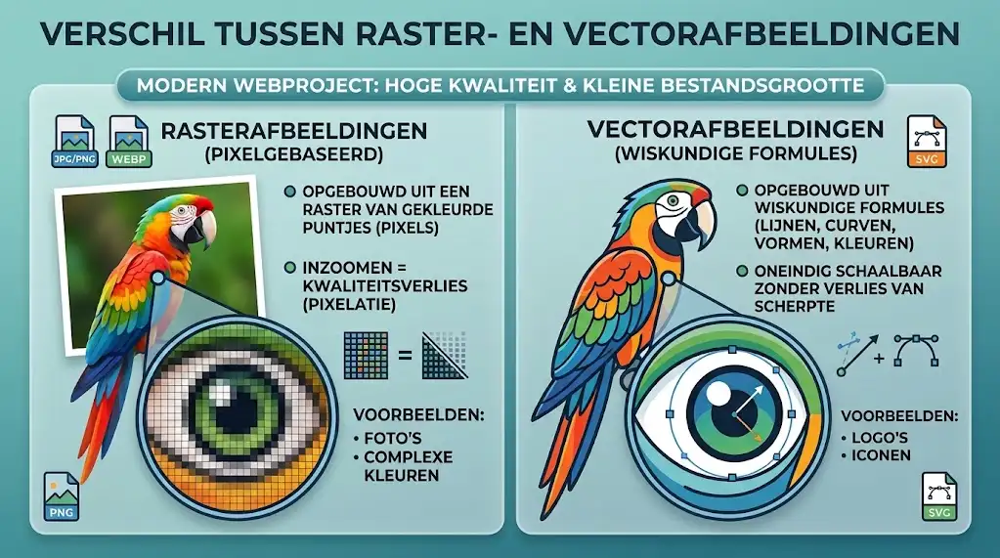
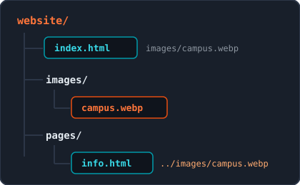
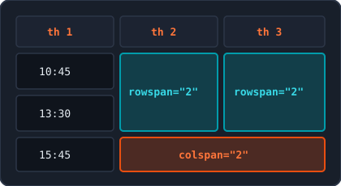

<!-- _class: lead -->

# Week 2: Images, Links, Characters, Lists & Tables

<p class="subtitle">&lt;Rich content and structure in HTML5 /&gt;</p>

<div class="meta-box">
  <strong>Thomas More Hogeschool</strong> - Applied Computer Science (ITF)<br>
  <strong>Course:</strong> Web Essentials | <strong>Module:</strong> Week 2
</div>

---

## Agenda

<div class="grid-2">
<div class="card card-accent">

#### Media & Navigation

1. **Images** - ``, attributes, formats & paths
2. **Hyperlinks** - `<a>`, paths, `target`, anchors & URI schemes

</div>
<div class="card card-cyan">

#### Characters & Data Structures

3. **Special Characters** - UTF-8, entities & `&nbsp;`
4. **Lists** - `<ul>`, `<ol>`, nested lists & `<dl>`
5. **Tables** - `<table>`, `scope`, `colspan`/`rowspan` & grouping

</div>
</div>

---

## 1. Images: The `` Element & Core Attributes

```html

```

<div class="grid-2">
<div class="card card-accent">

#### Properties of ``

- **Empty element (void):** no closing tag
- **Inline & replaced:** dimensions come from the file
- Preferably place inside `<p>` or `<figure>`
- **PhpStorm tip:** type `img` + `Tab`

</div>
<div class="card card-cyan">

#### `src` & `alt` (both required)

- `src`: relative path or external URL to the file
- `alt`: description for **screen readers**, SEO, and load errors
- Avoid "Photo of..." in `alt`
- Decorative image? Use empty `alt=""`

</div>
</div>

---

## 1. Images: `width`, `height` & `loading="lazy"`

```html
<!-- Above the fold: loads immediately, without loading="lazy" -->


<!-- Below the fold: load only when scrolling -->

```

<div class="grid-2">
<div class="card card-accent">

#### `width` & `height` (without `px`)

- Browser reserves the exact space in advance
- Prevents jumping page layouts (**CLS**)
- Check dimensions in PhpStorm or a Chrome tab

</div>
<div class="card card-cyan">

#### Lazy Loading (`loading="lazy"`)

- Speeds up the initial page display
- Saves mobile data on long pages
- **Never** use on the first hero image

</div>
</div>

---

## 1. Images: Raster vs. Vector

<div class="split-2-1">
<div>

### Two Categories on the Web

- **Raster images:** built from pixels; zooming in causes quality loss (`WebP`, `PNG`, `JPEG`, `GIF`)
- **Vector images:** built from mathematical formulas; infinitely scalable without losing sharpness (`SVG`)

### File Size Guidelines

- **Large banners / hero:** max. 100 - 150 kB
- **Article photos:** max. 50 - 80 kB
- **Small illustrations / logos:** max. 10 - 30 kB

</div>
<div class="img-box">
  
  <p class="caption">Pixel grid versus mathematical vector paths</p>
</div>
</div>

---

## 1. Images: Comparing Formats

| Format | Category | Transparency | Compression | Ideal For |
| :--- | :---: | :---: | :---: | :--- |
| **WebP** | Raster | Yes (Alpha) | Lossy & Lossless | Photos, banners, web illustrations |
| **SVG** | Vector | Yes (Alpha) | Math / Lossless | Logos, icons, pictograms |
| **PNG** | Raster | Yes (Alpha) | Lossless | Screenshots, crisp text |
| **JPEG** | Raster | No | Lossy | Classic photo format (replace with WebP) |
| **GIF** | Raster | Limited (1 color) | Lossless (max. 256) | Short animations (historical) |

> **Modern standard:** Use **WebP** for photos (25-35% smaller than JPEG/PNG at equal quality) and **SVG** for logos and icons.

---

## 1. Images: WebP, `<picture>` & SVG

<div class="grid-2">
<div class="card card-accent">

#### WebP & `<picture>` Fallback

- Supports lossy, lossless, alpha, and animations
- Provide a JPG/PNG fallback with `<picture>`

```html
<picture>
  <source srcset="campus.webp" type="image/webp">
  
</picture>
```

</div>
<div class="card card-cyan">

#### SVG & `viewBox`

- Usable via `` or inline `<svg>`
- `viewBox="min-x min-y w h"` preserves aspect ratio
- Shapes: `<rect />`, `<circle />`, `<ellipse />`, `<line />`

```html
<svg viewBox="0 0 100 100" width="80" height="80">
  <circle cx="50" cy="50" r="40" fill="#00283c" stroke="#e87722" stroke-width="6" />
</svg>
```

</div>
</div>

---

## 1. Images: Paths, Hotlinking & `<figure>`

<div class="grid-2">
<div class="card card-accent">

#### Relative Paths & Linux Rules

- Subfolder: `images/campus.webp` or `./images/campus.webp`
- Parent folder: `../images/campus.webp`
- **Linux servers:** lowercase only, no spaces, use `/` (never `\`)
- **No hotlinking:** download free images (Unsplash, Pexels) locally

</div>
<div class="card card-cyan">

#### Semantics: `<figure>` & `<figcaption>`

- Groups standalone visual media with an optional caption
- `<figcaption>` must be the first or last child

```html
<figure>
  
  <figcaption>Figure 1: Thomas More Campus Geel.</figcaption>
</figure>
```

</div>
</div>

---

## 1. Images: Favicon & Aspect Ratio

<div class="grid-2">
<div class="card card-accent">

#### Favicon in `<head>`

- Icon displayed in browser tabs and bookmarks
- Combine `.ico` (`sizes="any"`), `.svg`, and `.png`

```html
<link rel="icon" href="favicon.ico" sizes="any">
<link rel="icon" type="image/svg+xml" href="favicon.svg">
<link rel="icon" type="image/png" sizes="32x32" href="favicon-32x32.png">
```

</div>
<div class="card card-cyan">

#### Aspect Ratio & Tools

- Always preserve the original **aspect ratio** (16:9, 4:3, 1:1)
- Never distort photos with arbitrary `width`/`height`
- **AspectSnap:** measures aspect ratios in Chrome
- **Photo Edit Pro:** crop, resize, and export to WebP

</div>
</div>

---

## 2. Hyperlinks: `<a>`, `href` & Paths

<div class="split-2-1">
<div>

```html
<!-- Absolute URL (external: always include https://) -->
<a href="https://www.thomasmore.be">Thomas More</a>

<!-- Document-relative path (own project) -->
<a href="contact.html">Contact</a> | <a href="../index.html">Home</a>
```

- `<a>` (anchor) is an inline element; `href` sets the target (`a` + `Tab`)
- **Absolute:** for external websites; never omit `https://` (avoids 404)
- **Relative:** for internal pages (`./`, `folder/`, `../`) so local and live both work

</div>
<div class="img-box">
  
  <p class="caption">Relative paths start from the current HTML file</p>
</div>
</div>

---

## 2. Hyperlinks: `target`, Security & Anchors (`#id`)

<div class="grid-2">
<div class="card card-accent">

#### New Tab & Security

- Default is `target="_self"` (same tab)
- Use `target="_blank"` sparingly (only external/PDF)
- Always add `rel="noopener noreferrer"` against *reverse tabnabbing*

```html
<a href="https://www.w3.org" target="_blank" rel="noopener noreferrer">W3C</a>
```

</div>
<div class="card card-cyan">

#### Anchors (`#id`) on Same or Other Page

- Give the target a unique `id` attribute
- Link to it with `#id`, or to `#` for top of page

```html
<section id="contact"><h2>Contact</h2></section>
<a href="#contact">Go to contact</a>
<a href="campus.html#directions">Directions</a>
```

</div>
</div>

> **What is reverse tabnabbing?** Without `noopener`, the newly opened tab can use JavaScript (`window.opener`) to silently redirect the original tab to a phishing page.

---

## 2. Hyperlinks: Communication Schemes & `download`

```html
<a href="mailto:info@thomasmore.be?subject=Web%20Essentials%20Question">Email us</a>
<a href="tel:+3214562310">014 56 23 10</a>
<a href="https://wa.me/3214562310" target="_blank" rel="noopener noreferrer">WhatsApp</a>
<a href="downloads/cp_v2.pdf" download="campus-map-geel.pdf">Download map (PDF)</a>
```

<div class="grid-2">
<div class="card card-accent">

#### Special URI Schemes

- `mailto:` (spaces as `%20` in `subject`/`body`)
- `tel:` and `sms:` (always international format `+32...`)
- **WhatsApp (`https://wa.me/32...`):** official short link for WhatsApp app & Web (no `+` or `0`, optional `?text=...`)
- `geo:51.1610,4.9608` (or Google Maps URL for desktop)

</div>
<div class="card card-cyan">

#### Downloading Files (`download`)

- Forces saving instead of opening in a tab
- Optional value suggests a clean file name
- For security reasons, **only works same-origin** (your own domain)

</div>
</div>

---

## 2. Hyperlinks: Accessibility (A11y) & Link Text

Screen readers often read out a list of all links on a page. Make every link text clear on its own:

| Bad Example | Good Example | Why? |
| :--- | :--- | :--- |
| `<a href="schedule.html">Click here</a>` | `<a href="schedule.html">Campus Geel class schedule</a>` | Describes the destination independently |
| `<a href="contact.html">this page</a>` | `<a href="contact.html">contact page</a>` | Compact and immediately scannable |
| `<a href="register.html">Read more</a>` | `<a href="register.html">Register for the info day</a>` | Clarifies the exact action on click |

> **File info & `title`:** Mention file type and size for large downloads (e.g. `(PDF, 2.4 MB)`). Only use `title` for extra context, not to replace clear link text.

---

## 3. Special Characters: UTF-8 & HTML Entities

<div class="grid-2">
<div class="card card-accent">

#### Why Encode & Role of UTF-8

- Browsers parse `<` as the start of an HTML tag (`5 < 8` can break the layout)
- With `<meta charset="UTF-8">`, you can type or paste **accents** (`café`), **currency** (`€`), and **Unicode symbols** directly

</div>
<div class="card card-cyan">

#### Structure of an HTML Entity

- Always three parts: `&` + `name` + `;`
- Examples: `&lt;` (`<`), `&gt;` (`>`), `&amp;` (`&`), `&copy;` (`©`)
- **Never forget the semicolon `;`** (causes W3C validator errors)

</div>
</div>

---

## 3. Special Characters: The 5 Reserved Characters

When displaying a reserved character as literal text, you must use its entity:

| Character | Meaning | Entity | Why Reserved? |
| :---: | :--- | :---: | :--- |
| `<` | Less than | `&lt;` | Starts an HTML tag (**L**ess **T**han) |
| `>` | Greater than | `&gt;` | Closes an HTML tag (**G**reater **T**han) |
| `&` | Ampersand | `&amp;` | Starts an HTML entity |
| `"` | Double quote | `&quot;` | Wraps attribute values |
| `'` | Single quote | `&apos;` | Wraps attribute values |

> **Company names & code:** Write `Thomas More &amp; Partners` and escape tags inside `<code>&lt;img src="photo.webp"&gt;</code>`.

---

## 3. Special Characters: Non-Breaking Space (`&nbsp;`) & Typography

<div class="split-1-2">
<div class="card card-accent">

#### Non-Breaking Space (`&nbsp;`)

- Prevents line breaks between words or numbers
- Not collapsed into a single space
- Code: `014&nbsp;56&nbsp;23&nbsp;10`, `€&nbsp;250`, `20&nbsp;°C`
- Result: **014&nbsp;56&nbsp;23&nbsp;10**, **€&nbsp;250**, **20&nbsp;°C**
- **Never for layout** (use CSS)

</div>
<div>

| Symbol | Entity | Usage |
| :---: | :---: | :--- |
| `©` / `®` / `™` | `&copy;` / `&reg;` / `&trade;` | Footers & brand names |
| `←` / `→` / `↑` / `↓` | `&larr;` / `&rarr;` / `&uarr;` / `&darr;` | Buttons & navigation |
| `•` | `&bull;` | Separator in footers/menus |
| `…` | `&hellip;` | Ellipsis (better than `...`) |
| `×` | `&times;` | Close buttons or multiplication |

</div>
</div>

---

## 4. Lists: Unordered (`<ul>`) & Ordered (`<ol>`)

<div class="grid-2">
<div class="card card-accent">

#### `<ul>` (order does not matter)

- Rendered with bullets by default
- Standard base for menus: `<nav><ul><li><a>...</a></li></ul></nav>`
- **Rule:** only `<li>` as direct child

```html
<ul>
  <li>HTML5</li>
  <li>CSS3</li>
</ul>
```

</div>
<div class="card card-cyan">

#### `<ol>` (order is crucial)

- Numbered by default (`1.`, `2.`, `3.`)
- `type`: `1`, `a`, `A`, `i`, `I` (only when semantic)
- `start="5"` and boolean `reversed`
- `<li value="10">` overrides numbering

```html
<ol start="5">
  <li>Open PhpStorm</li>
  <li>Create index.html</li>
</ol>
```

</div>
</div>

---

## 4. Lists: Nested Lists & Description Lists (`<dl>`)

<div class="grid-2">
<div class="card card-accent">

#### Golden Rule for Nested Lists

- A sublist **always goes inside `<li>`** of the parent list, never between `</li>` and `<li>`

```html
<ul>
  <li>Belgium
    <ul>
      <li>Antwerp</li>
      <li>Geel</li>
    </ul>
  </li>
  <li>Netherlands</li>
</ul>
```

</div>
<div class="card card-cyan">

#### Description List: `<dl>`, `<dt>`, `<dd>`

- For pairs of term (`<dt>`) and details (`<dd>`): glossary, specs, FAQ
- Multiple `<dt>` or `<dd>` allowed; optional grouping via `<div>`

```html
<dl>
  <dt>HTML5</dt>
  <dd>Markup language for web structure.</dd>
</dl>
```

</div>
</div>

---

## 4. Lists: Decision Guide, Emmet & Pitfalls

<div class="split-2-1">
<div>

| Emmet Abbreviation | Result After `Tab` |
| :--- | :--- |
| `ul>li*4` | Unordered list with 4 items |
| `ol>li*3{Step $}` | Ordered list: Step 1, Step 2, Step 3 |
| `ul>li*3>a` | Menu with 3 links |
| `dl>(dt{Term $}+dd{Info $})*3` | Description list with 3 pairs |

</div>
<div class="card card-accent">

#### Choice & Pitfalls

- **Order matters?** `<ol>`
- **Term + value?** `<dl>`
- **Otherwise?** `<ul>`
- Never type `1.`, `2.` manually inside `<ol>` `<li>`
- Never use a list purely to indent text

</div>
</div>

---

## 5. Tables: Purpose & Basic Structure

```html
<table>
  <caption>Drinks Price List</caption>
  <tr>
    <th scope="col">Drink</th><th scope="col">Price</th>
  </tr>
  <tr>
    <td>Coffee</td><td>€ 2.20</td>
  </tr>
</table>
```

<div class="grid-2">
<div class="card card-accent">

#### Only for 2D Data Tables

- Only for data that fits in both rows and columns (like Excel)
- **Never for page layout** (bad for A11y & not responsive)

</div>
<div class="card card-cyan">

#### Core Elements & `scope`

- `<caption>` must **always come first** after `<table>`
- `<tr>` = row, `<th>` = header cell, `<td>` = data cell
- Use `scope="col"` or `scope="row"` on `<th>` for screen readers

</div>
</div>

---

## 5. Tables: Merging Cells (`colspan` & `rowspan`)

<div class="split-2-1">
<div>

```html
<table>
  <caption>ICT Class Schedule</caption>
  <tr>
    <th scope="col">Time</th><th scope="col">Room</th><th scope="col">Subject</th>
  </tr>
  <tr>
    <td>10:45 - 12:45</td>
    <td rowspan="2">Room 2.15</td>
    <td rowspan="2">ICT Project</td>
  </tr>
  <tr><td>13:30 - 15:30</td></tr>
  <tr>
    <td>15:45 - 17:15</td>
    <td colspan="2">Independent study time</td>
  </tr>
</table>
```

</div>
<div class="img-box">
  
  <p class="caption">Omit n-1 cells when merging horizontally or vertically</p>
</div>
</div>

---

## 5. Tables: Semantic Sections, Columns & Emmet

<div class="grid-2">
<div class="card card-accent">

#### `<thead>`, `<tbody>`, `<tfoot>`

- `<thead>` (max. 1x): column headers
- `<tbody>` (1 or more): actual data rows
- `<tfoot>`: totals or summary
- Benefits: accessibility, sticky header via CSS, and repeated headers when printing

</div>
<div class="card card-cyan">

#### `<colgroup>`, `<col>` & Emmet

- `<colgroup>` + `<col span="n">` group columns after `<caption>` and before `<thead>` (useful for CSS column styling)
- **Emmet with `^` (climb up one level):**
  `table>thead>tr>th*3^^tbody>tr*3>td*3`

</div>
</div>

---

## Summary & Best Practices

<div class="grid-2">
<div class="card card-accent">

#### Media, Links & Characters

- **Images:** `src`, `alt`, `width`/`height`, `loading="lazy"`, WebP/SVG, and relative paths
- **Hyperlinks:** `https://` externally, `rel="noopener noreferrer"` for `_blank`, clear link text
- **Characters:** `&lt;`, `&gt;`, `&amp;` required entities; never `&nbsp;` for layout

</div>
<div class="card card-cyan">

#### Lists & Tables

- **Lists:** pick `<ul>`, `<ol>`, or `<dl>` based on meaning; sublist always inside `<li>`
- **Tables:** never for layout; `<caption>` first, `scope` on `<th>`, and semantic zones (`thead`/`tbody`/`tfoot`)
- Always validate with **Validify** and **Semantiscope**

</div>
</div>

---

<!-- _class: lead -->

# Questions & Let's Get Started!

<p class="subtitle">&lt;Ready for rich HTML5 pages in Week 2 /&gt;</p>

<div class="meta-box">
  <strong>Next step:</strong> Apply images, links, lists, and tables in your lab exercises
</div>

