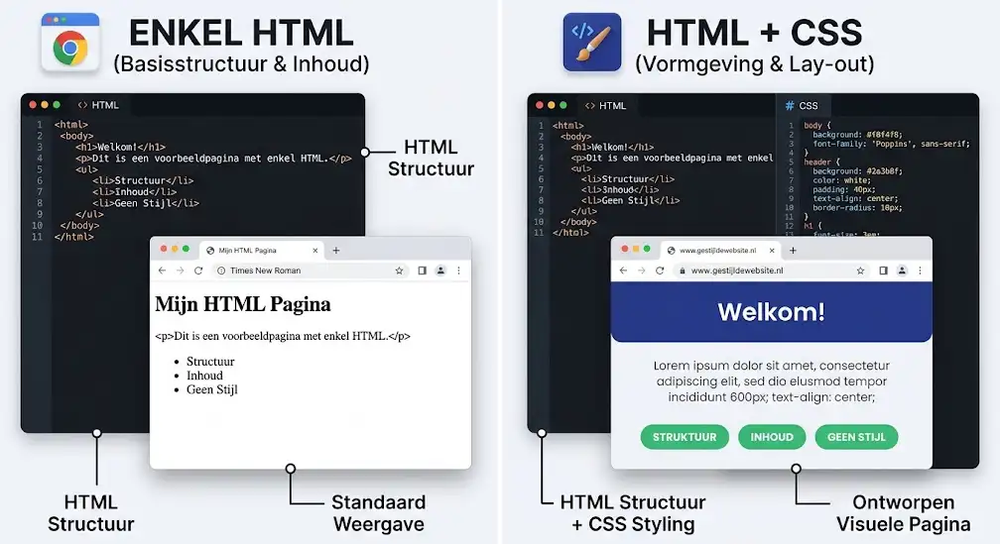
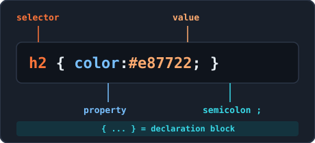
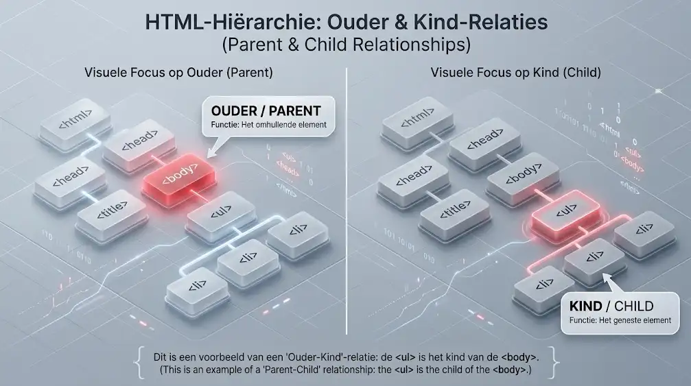
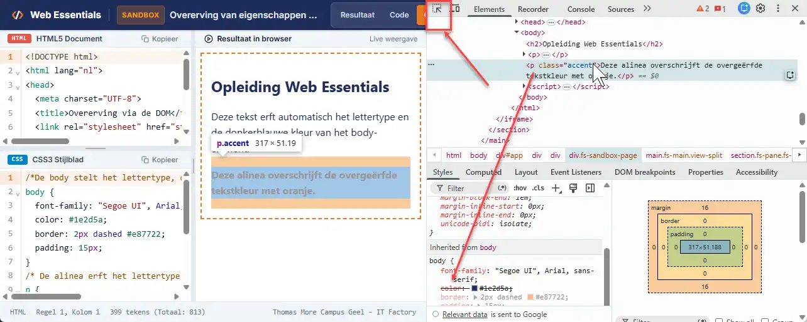
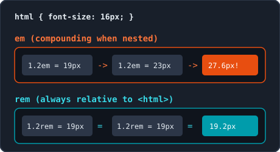
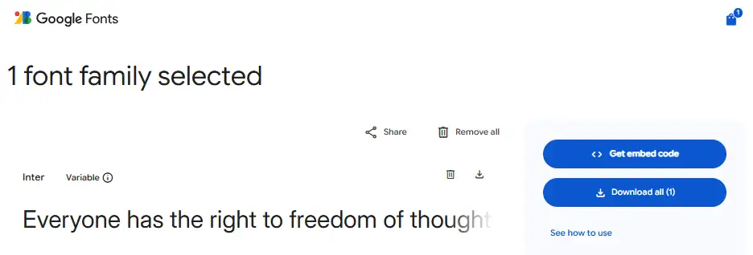
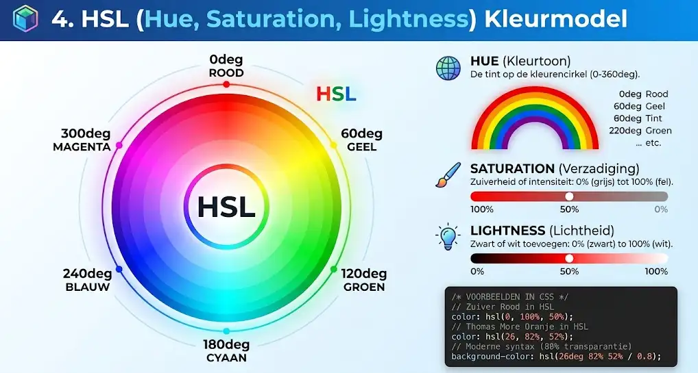
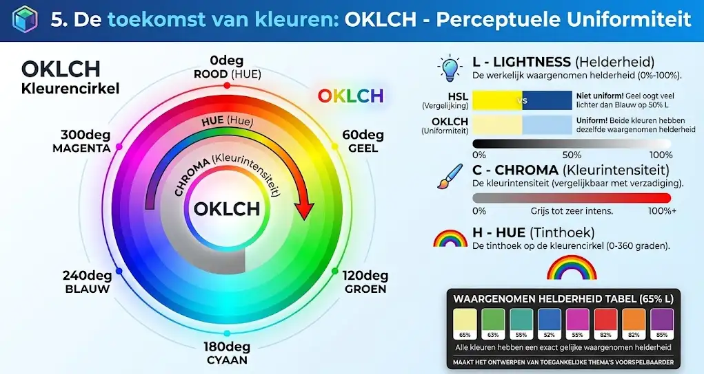
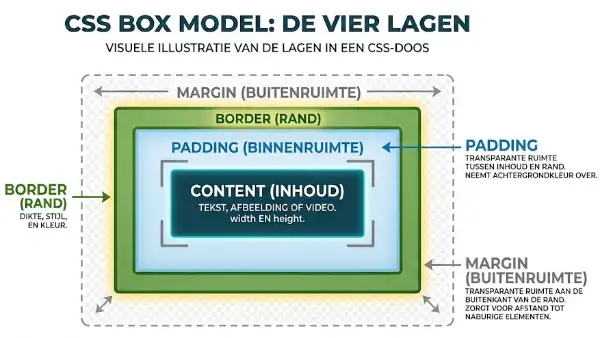
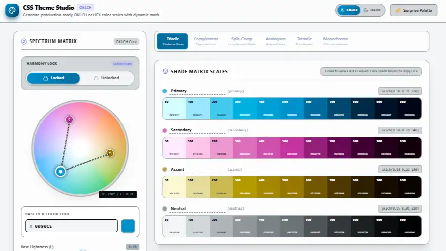

<!-- _class: lead -->

# Week 3: Introductie CSS3, Typografie, Kleuren, Box Model & Variabelen

<p class="subtitle">&lt;Vormgeving, lay-out en herbruikbare stijlen in CSS3 /&gt;</p>

<div class="meta-box">
  <strong>Thomas More Hogeschool</strong> - Toegepaste Informatica (ITF)<br>
  <strong>Vak:</strong> Web Essentials | <strong>Module:</strong> Week 3
</div>

---

## Agenda

<div class="grid-2">
<div class="card card-accent">

#### Basis & Typografie

1. **Introductie in CSS3** - Selectors, cascade, overerving & DevTools
2. **Lettertypen & Tekstopmaak** - Font-stacks, `rem`, `line-height` & tekst
3. **Webfonts & Iconen** - Google Fonts CSS2 API, Font Awesome & Lucide

</div>
<div class="card card-cyan">

#### Kleur, Ruimte & Variabelen

4. **Kleuren** - HEX, RGB, HSL, OKLCH, contrast & LVFHA
5. **Box Model & Randen** - `padding`, `margin`, `border` & `border-box`
6. **CSS Variabelen** - `:root`, `var()`, scope & `calc()`

</div>
</div>

---

## 1. Introductie CSS3: Wat is CSS & Scheiding

<div class="split-2-1">
<div>

### Cascading Style Sheets

- **HTML** bepaalt inhoud en structuur; **CSS** bepaalt vormgeving en lay-out
- **Voordelen:** centraal beheer, browsercaching (snellere laadtijd) en betere toegankelijkheid
- **Evolutie (W3C):** CSS1 (1996) -> CSS2 (1998) -> **CSS3 (modulair)** zonder monolithische "CSS4"
- Valideer stijlbladen via de **W3C CSS Validator**

</div>
<div class="img-box">
  
  <p class="caption">HTML als structuur, CSS als vormgeving</p>
</div>
</div>

---

## 1. Introductie CSS3: Waar schrijf je CSS?

```html
<!-- In <head> van je HTML-document (Emmet-sneltoets: link:css + Tab) -->
<link rel="stylesheet" href="css/stijl.css">
```

<div class="grid-2">
<div class="card card-accent">

#### 1. Extern stijlblad <span class="badge">Standaard</span>

- Apart `.css`-bestand voor de hele website
- Maximaal hergebruik en centraal onderhoud
- **Gouden regel:** werk in projecten altijd met externe CSS

</div>
<div class="card card-cyan">

#### 2. Intern & 3. Inline CSS

- **Intern (`<style>` in `<head>`):** geldt enkel voor 1 pagina (prototypes / e-mails)
- **Inline (`style="..."` op tag):** mengt inhoud en opmaak; vermijd dit in professionele code

</div>
</div>

---

## 1. Introductie CSS3: Anatomie & Commentaar

<div class="split-2-1">
<div>

```css
/* Dit is CSS-commentaar (sneltoets: Ctrl + / of Cmd + /) */
h2 {
  color: #e87722;           /* Eigenschap: waarde; */
  font-family: "Times New Roman", Times, serif;
}
```

- **Selector (`h2`):** kiest HTML-element; `{ ... }` is het declaratieblok
- **Puntkomma (`;`):** sluit elke declaratie verplicht af
- Meervoudige waarden met komma's; gebruik in CSS **enkel `/* ... */`**

</div>
<div class="img-box">
  
  <p class="caption">Onderdelen van een CSS-stijlregel</p>
</div>
</div>

---

## 1. Introductie CSS3: Basisselectors & Combinaties

<div class="split-2-1">
<div>

| Selector | Voorbeeld | Selecteert |
| :--- | :--- | :--- |
| **Type** | `p { }` | Alle `<p>`-elementen |
| **Class** | `.opvallend { }` | Elk element met `class="opvallend"` |
| **ID** | `#hoofdmenu { }` | Het unieke element met `id="hoofdmenu"` |
| **Gegroepeerd** | `h1, h2, h3 { }` | Meerdere selectors met dezelfde stijl |
| **Met klasse** | `p.belangrijk { }` | Alleen `<p>` met `class="belangrijk"` |
| **Afstammeling** | `article p { }` | Alle `<p>` binnen een `<article>` |

</div>
<div class="card card-cyan">

#### Best Practices

- Gebruik voor vormgeving vrijwel altijd **klassen** (`.klasse`)
- Vergeet de punt (`.`) niet in CSS; zet nooit `#` of `.` in het HTML `class`-attribuut
- Beperk `#id` wegens de hoge specificiteit

</div>
</div>

---

## 1. Introductie CSS3: De Cascade & `!important`

```css
p { color: green !important; } /* Wint altijd, ook al staat deze regel eerst! */
p { color: blue; }
p { color: red; }              /* Normaal wint de laatste regel, behalve bij !important */
```

<div class="grid-2">
<div class="card card-accent">

#### De 3 bronnen (hoog -> laag)

- **1. Author Stylesheet:** jouw CSS (wint standaard)
- **2. User Stylesheet:** browserinstellingen van bezoeker
- **3. User Agent:** standaard browserstijlen (bv. 8px `body`-marge)

</div>
<div class="card card-cyan">

#### Conflicten & `!important`

- Bij gelijke prioriteit wint de **laatst gelezen regel** (bronvolgorde)
- Vermijd `!important` als snelle oplossing: het maakt stijlbladen ononderhoudbaar

</div>
</div>

---

## 1. Introductie CSS3: Overerving (Inheritance) & DOM

<div class="split-2-1">
<div>

### Parent -> Child in de DOM-boom

- **Erven WEL over (tekst & typografie):** `font-family`, `font-size`, `font-weight`, `color`, `line-height`, `text-align`, `list-style-type`
- **Erven NIET over (box model & lay-out):** `margin`, `padding`, `border`, `background-color`, `width`, `height`
- Stel basistekst eenmalig in op `body`: alle kindelementen nemen die automatisch over

</div>
<div class="img-box">
  
  <p class="caption">Eigenschappen erven over van ouder naar kind</p>
</div>
</div>

---

## 1. Introductie CSS3: Inspecteren met DevTools

<div class="split-1-2">
<div class="card card-accent">

#### Snel debuggen (`F12`)

- Rechtermuisklik -> **Inspecteren** -> tabblad **Elements**
- Paneel **Styles** toont bestandsnaam en regelnummer
- **Doorgestreepte regels:** overschreven door hogere prioriteit
- **Inherited from...:** overgeerfde stijlen
- Vink eigenschappen aan/uit om live te testen

</div>
<div class="img-box">
  
  <p class="caption">Stijlregels en cascade controleren in Chrome DevTools</p>
</div>
</div>

---

## 2. Lettertypen: `font-family` & 5 Generieke families

```css
body { font-family: -apple-system, BlinkMacSystemFont, "Segoe UI", Roboto, Arial, sans-serif; }
h1   { font-family: Georgia, "Times New Roman", serif; }
code { font-family: Consolas, "Courier New", monospace; }
```

| Generieke familie | Kenmerken | Typisch gebruik |
| :--- | :--- | :--- |
| `sans-serif` | Zonder schreef, strak & scherp op schermen | Lopende tekst, UI |
| `serif` | Met schreef (dwarsstreepjes), klassiek | Titels, artikels, drukwerk |
| `monospace` | Elk teken even breed | Codeblokken, tabellen met cijfers |
| `cursive` / `fantasy` | Handgeschreven / decoratief | Citaten / speelse posters (spaarzaam) |

> **Regel:** Eindig elke font-stack altijd met een van de 5 generieke families als terugvaloptie.

---

## 2. Lettertypen: Maateenheden (`px`, `em`, `rem`)

<div class="split-2-1">
<div>

```css
html { font-size: 16px; }       /* Standaard (1rem = 16px) */
h1   { font-size: 2.5rem; }     /* 2.5 x 16px = 40px */
p    { font-size: 1rem; }       /* Schaalt met voorkeur */
```

- **`px` (absoluut):** vast aantal pixels; negeert browserinstellingen
- **`em` (relatief aan ouder):** stapelt op bij nesting (*compounding*)
- **`rem` (root em):** altijd relatief aan `<html>`; respecteert voorkeur bezoeker (**gouden regel voor `font-size`**)

</div>
<div class="img-box">
  
  <p class="caption">em stapelt op bij nesting, rem blijft stabiel</p>
</div>
</div>

---

## 2. Lettertypen: Gewicht, Stijl, `line-height` & `font`

<div class="grid-2">
<div class="card card-accent">

#### `font-weight`, `style` & `variant`

- `font-weight`: `normal` (`400`), `bold` (`700`), of `100` t/m `900`
- `font-style`: `normal` of `italic`
- `font-variant`: `small-caps` (kleinkapitalen)
- **Shorthand `font`:** verplichte `font-size` en `font-family` (bv. `font: italic bold 1rem/1.6 Arial, sans-serif;`)

</div>
<div class="card card-cyan">

#### `line-height` zonder eenheid

- Gebruik een factor zonder eenheid: `line-height: 1.6;`
- Berekent `font-size x factor` (werkt ook bij overerving naar `<h1>`)
- **Alinea's:** `1.5` tot `1.7`
- **Koppen:** `1.1` tot `1.3`

</div>
</div>

---

## 2. Lettertypen: Uitlijning, Transformatie & Decoratie

<div class="grid-2">
<div class="card card-accent">

#### `text-align` & `text-transform`

- `text-align`: `left`, `center`, `right`, `justify`
- **Vermijd `justify`:** geen woordafbreking zorgt voor "witte rivieren" (lastig bij dyslexie)
- `text-transform`: `uppercase`, `lowercase`, `capitalize` (HTML zelf blijft gewone tekst)

</div>
<div class="card card-cyan">

#### `text-decoration` & `text-shadow`

- Hyperlinks in tekst behouden onderlijning of minstens **3:1 kleurcontrast** + duidelijke `:hover`/`:focus` (WCAG)
- `text-shadow: 2px 2px 4px rgba(0, 0, 0, 0.25);` (subtiel en deels transparant)
- **Emmet:** `fz1.25rem`, `fwb`, `lh1.6`, `tac`, `ttu`, `tdn`

</div>
</div>

---

## 3. Webfonts & Iconen: Google Fonts & CSS2 API

<div class="split-2-1">
<div>

- **Webfonts:** identiek op elk OS; max. **2 families** en enkel nodige gewichten laden
- **Variable Fonts:** 1 bestand voor alle gewichten (`100..900`, ook `550`)
- **Optical Sizing (`opsz`):** past dikte automatisch aan op `font-size`
- **Wat is een CDN?** *Content Delivery Network* (wereldwijd netwerk van servers dicht bij de bezoeker voor snelle laadtijden en caching)

</div>
<div class="img-box">
  
  <p class="caption">Lettertype ophalen via Google Fonts CSS2 API</p>
</div>
</div>

---

## 3. Webfonts & Iconen: CSS2 URL, `@import` vs. `<link>`

```css
/* Methode 1: In CSS via @import (verplicht op regel 1) - ideaal voor centraal beheer */
@import url('https://fonts.googleapis.com/css2?family=Inter:ital,opsz,wght@0,14..32,100..900&display=swap');
```

```html
<!-- Methode 2: In HTML <head> met preconnect - snelste laadtijd (parallel, geen waterval) -->
<link rel="preconnect" href="https://fonts.googleapis.com">
<link rel="preconnect" href="https://fonts.gstatic.com" crossorigin>
<link href="https://fonts.googleapis.com/css2?family=Inter:wght@400..700&display=swap" rel="stylesheet">
```

<div class="grid-2">
<div class="card card-accent">

#### `&display=swap`

- Toont direct een reservefont en wisselt zodra het webfont klaar is (geen onzichtbare tekst / FOIT)

</div>
<div class="card card-cyan">

#### Welke kiezen?

- **`@import`:** handig voor kleinere sites (1 centrale plek)
- **`<link>` + `preconnect`:** beste keuze voor snelle productiewebsites

</div>
</div>

---

## 3. Webfonts & Iconen: Font Awesome & Lucide via CDN

<div class="grid-2">
<div class="card card-accent">

#### Font Awesome (gevuld, omlijnd, merken)

- Klassen: `fa-solid`, `fa-regular`, `fa-brands` + `fa-naam`
- Stijlen als tekst via `font-size` en `color`

```html
<i class="fa-solid fa-envelope"></i>
<i class="fa-brands fa-github"></i>
```

</div>
<div class="card card-cyan">

#### Lucide Icons (strakke lijniconen)

- Importeer `lucide.min.css` via jsDelivr CDN
- Alle klassen starten met `icon-`

```html
<i class="icon-mail"></i>
<i class="icon-map-pin"></i>
```

</div>
</div>

---

## 3. Webfonts & Iconen: Toegankelijkheid (WCAG)

```html
<!-- 1. Decoratief icoon naast zichtbare tekst: verberg het icoon voor screenreaders -->
<a href="mailto:info@thomasmore.be">
  <i class="fa-solid fa-envelope" aria-hidden="true"></i> E-mail ons
</a>

<!-- 2. Functioneel icoon zonder tekst: voeg aria-label toe op de knop/link -->
<button type="button" aria-label="Zoeken in de website">
  <i class="fa-solid fa-magnifying-glass" aria-hidden="true"></i>
</button>
```

<div class="grid-2">
<div class="card card-accent">

#### Met zichtbare tekst ernaast

- Zet `aria-hidden="true"` op `<i>` zodat de screenreader het icoon overslaat

</div>
<div class="card card-cyan">

#### Zonder zichtbare tekst

- Geef een `aria-label="..."` aan de knop of link én `aria-hidden="true"` op `<i>`

</div>
</div>

---

## 4. Kleuren: Basis, Kleurnamen & HEX

```css
body { color: #1e2d5a; background-color: #f8fafc; }
.badge { background-color: #ff000080; } /* 8-cijferige HEX met 50% dekking */
```

<div class="grid-2">
<div class="card card-accent">

#### `color` & `background-color`

- `color`: voorgrondkleur (tekst & iconen)
- `background-color`: achtergrondkleur (`transparent` of `inherit`)
- **147 benoemde kleuren** (bv. `tomato`, `navy`): leuk voor testen, zelden voor huisstijl

</div>
<div class="card card-cyan">

#### Hexadecimale notatie (`#RRGGBB`)

- 3 paren van `00` (0%) tot `ff` (100% / 255)
- **3-teken notatie (`#RGB`):** alleen als elk paar dubbele cijfers heeft (`#fff`, `#369`; niet `#e87722`)
- **8-teken (`#RRGGBBAA`):** laatste 2 tekens regelen transparantie (`00` tot `ff`)

</div>
</div>

---

## 4. Kleuren: RGB, RGBA & Moderne Spatiesyntax

```css
/* Klassieke notatie (met komma's) */
.kaart-oud { background-color: rgba(232, 119, 34, 0.5); }

/* Moderne CSS Color Level 4 spatiesyntax (met schuine streep voor alfa) */
.kaart-nieuw { background-color: rgb(232 119 34 / 50%); }
```

<div class="grid-2">
<div class="card card-accent">

#### Decimale RGB (`0` tot `255`)

- Additief model: Rood, Groen, Blauw
- `rgb(0, 0, 0)` = zwart; `rgb(255, 255, 255)` = wit
- `rgb(232, 119, 34)` = Thomas More Oranje

</div>
<div class="card card-cyan">

#### Alfakanaal (`0.0` tot `1.0` of `%`)

- `0` / `0%` = volledig transparant
- `1` / `100%` = volledig dekkend
- In moderne CSS volstaat `rgb()` met spaties en `/` (geen aparte `rgba()` nodig)

</div>
</div>

---

## 4. Kleuren: HSL (Hue, Saturation, Lightness)

<div class="split-2-1">
<div>

### Kleuren aanpassen zoals een mens denkt

- **Hue (kleurtoon):** hoek op kleurencirkel (`0deg` rood, `120deg` groen, `240deg` blauw)
- **Saturation (verzadiging):** `0%` grijs tot `100%` fel
- **Lightness (lichtheid):** `0%` zwart, `50%` puur, `100%` wit
- **Groot voordeel:** maak lichtere of donkere tinten van dezelfde merkkleur door enkel de **lightness** te wijzigen (bv. `hsl(26, 82%, 90%)` -> `35%`)

</div>
<div class="img-box">
  
  <p class="caption">De HSL-kleurencirkel van 0 tot 360 graden</p>
</div>
</div>

---

## 4. Kleuren: OKLCH (Perceptuele uniformiteit)

<div class="split-2-1">
<div>

### Waarom OKLCH?

- **Nadeel van HSL:** geel met `50%` lightness oogt voor het oog veel lichter dan blauw met `50%` lightness
- **OKLCH lost dit op:** gelijke `L` = gelijke waargenomen helderheid
  - **L (Lightness):** waargenomen helderheid (`0%` - `100%`)
  - **C (Chroma):** kleurintensiteit
  - **H (Hue):** tinthoek (`0deg` - `360deg`)
- Voorbeeld: `oklch(65% 0.20 25deg)`

</div>
<div class="img-box">
  
  <p class="caption">Gelijke L-waarde in OKLCH geeft gelijke visuele helderheid</p>
</div>
</div>

---

## 4. Kleuren: Contrast (WCAG AA) & Hyperlinks (LVFHA)

<div class="grid-2">
<div class="card card-accent">

#### Kleurcontrast (WCAG 2.1 AA)

- **Normale tekst:** min. **4.5:1** contrastverhouding
- **Grote tekst (>= 24px / 18.5px bold):** min. **3:1**
- Controleer direct via de kleurenkiezer in Chrome DevTools (`F12` -> groen vinkje of rood uitroepteken)

</div>
<div class="card card-cyan">

#### Hyperlinks: LoVe Fears HAte (LVFHA)

Volgorde in CSS is bindend door de cascade:

```css
a:link    { color: #1e2d5a; }
a:visited { color: #475569; }
a:focus   { background-color: #fef08a; }
a:hover   { color: #e87722; }
a:active  { color: #c2410c; }
```

</div>
</div>

---

## 5. Box Model: De 4 lagen & Afmetingen

<div class="split-2-1">
<div>

### Van binnen naar buiten

- **Content:** tekst/beeld (`width`, `max-width`, `min-height`)
- **Padding:** transparante binnenruimte (neemt achtergrondkleur mee)
- **Border:** rand rond padding en content
- **Margin:** transparante buitenruimte tussen elementen
- **Responsief:** kies `max-width` i.p.v. vaste `width` en `min-height` i.p.v. vaste `height` (voorkomt schuifbalken en overflow)

</div>
<div class="img-box">
  
  <p class="caption">De vier lagen van elk HTML-element (inspecteerbaar in DevTools)</p>
</div>
</div>

---

## 5. Box Model: `padding`, `margin` & `margin: auto`

```css
.kaart     { padding: 1rem 1.5rem; }        /* 2 waarden: boven/onder | links/rechts */
.container { max-width: 37.5rem; margin: 0 auto; } /* Horizontaal centreren */
```

<div class="grid-2">
<div class="card card-accent">

#### Klokwijzervolgorde (TRBL)

- **1 waarde:** alle 4 zijden gelijk
- **2 waarden:** boven/onder | links/rechts
- **3 waarden:** boven | links/rechts | onder
- **4 waarden:** Top, Right, Bottom, Left

</div>
<div class="card card-cyan">

#### Centreren & Margin Collapse

- `margin: 0 auto;` centreert een blok met breedte
- **Margin Collapse:** rakende verticale marges (`margin-bottom: 2rem` + `margin-top: 1rem`) tellen niet op, de **grootste (`2rem`)** wint

</div>
</div>

---

## 5. Box Model: `border`, `border-radius` & `box-shadow`

<div class="grid-2">
<div class="card card-accent">

#### Randen & Afgeronde hoeken

- `border: 2px solid #EC6639;` (dikte, stijl, kleur)
- Stijlen: `solid`, `dashed`, `dotted`, `double`, `none`
- Specifieke zijde: `border-left: 5px solid ...;`
- `border-radius: 8px;` (en `50%` maakt een vierkant tot cirkel)

</div>
<div class="card card-cyan">

#### Schaduwen (`box-shadow`)

- Volgorde: `X-offset Y-offset blur spread kleur`
- `box-shadow: 4px 6px 12px 2px rgba(0, 0, 0, 0.15);`
- Voeg `inset` toe voor een inwendige schaduw (bv. invoervelden)

</div>
</div>

> **Blur vs. Spread:** `blur` bepaalt hoe **zacht/vaag** de rand van de schaduw uitwaaiert (`0` = harde rand); `spread` maakt het schaduwvlak zelf **groter (`+`) of kleiner (`-`)**.

---

## 5. Box Model: `box-sizing: border-box` & Reset

```css
/* Universele CSS-reset bovenaan elk stijlblad */
* {
  box-sizing: border-box;
  margin: 0;
  padding: 0;
}
```

<div class="grid-2">
<div class="card card-accent">

#### `content-box` (browserstandaard)

- `width: 300px` + `padding: 20px` + `border: 5px` wordt **350px** breed!
- Twee kolommen van `50%` passen niet meer naast elkaar

</div>
<div class="card card-cyan">

#### `border-box` (moderne standaard)

- `width` omvat **content + padding + border**
- Totale breedte blijft exact `300px`
- `margin: 0; padding: 0;` wist browser-marges

</div>
</div>

---

## 5. Box Model: `overflow` & `outline` vs. `border`

<div class="grid-2">
<div class="card card-accent">

#### Overlopende inhoud (`overflow`)

- `visible` (standaard): loopt buiten het kader
- `hidden`: snijdt overlopende inhoud af
- `scroll`: toont altijd schuifbalken
- `auto` / `overflow-y: auto`: schuifbalk alleen als inhoud niet past

</div>
<div class="card card-cyan">

#### `outline` versus `border`

- `border` neemt ruimte in het box model in
- `outline` ligt bovenop en verschuift **niets**
- Ideaal voor toetsenbordfocus (`:focus`):

```css
button:focus { outline: 3px solid #EC6639; outline-offset: 2px; }
```

</div>
</div>

---

## 6. CSS Variabelen: Waarom & Syntaxis

```css
:root {
  --hoofdkleur: #1e2d5a;       /* Declareren met --naam (kebab-case, hoofdlettergevoelig) */
  --basis-ruimte: 1rem;
}

.badge {
  background-color: var(--badge-kleur, #1e2d5a); /* Oproepen met var() en optionele fallback */
  padding: var(--basis-ruimte);
}
```

<div class="grid-2">
<div class="card card-accent">

#### DRY-principe (*Don't Repeat Yourself*)

- Sla merkkleuren, fonts en afstanden op 1 centrale plek op
- Pas 1 waarde aan en de volledige website wijzigt mee

</div>
<div class="card card-cyan">

#### Regels voor syntaxis

- Begin altijd met twee koppeltekens (`--`)
- Gebruik kleine letters en streepjes (`kebab-case`)
- Geef in `var(--naam, fallback)` een reservewaarde mee

</div>
</div>

---

## 6. CSS Variabelen: Bereik (`:root` vs. Lokaal)

<div class="split-2-1">
<div>

```css
:root {                   /* Globaal: overal beschikbaar */
  --kleur-primair: #1e2d5a;
  --kaart-radius: 0.5rem;
}

.speciale-sectie {        /* Lokaal: enkel binnen deze selector */
  --tekst-kleur: #d97706;
  color: var(--tekst-kleur);
}
```

- **`:root`** selecteert `<html>`: variabelen erven door naar alle elementen
- **Lokaal:** enkel geldig binnen dat element en zijn kinderen

</div>
<div class="img-box">
  
  <p class="caption">Kleurenpalet beheren via globale :root variabelen</p>
</div>
</div>

---

## 6. CSS Variabelen: Modulaire componenten & `calc()`

<div class="grid-2">
<div class="card card-accent">

#### Componentvarianten overschrijven

- Basisklasse declareert structuur en standaardvariabelen
- Variantklassen overschrijven enkel de kleurvariabele

```css
.knop { background-color: var(--bg, #1e2d5a); }
.knop-primair { --bg: #EC6639; }
```

</div>
<div class="card card-cyan">

#### Rekenen met `calc()` & Naamgeving

- Gebruik `+`, `-`, `*`, `/` met variabelen: `padding: calc(var(--basis-ruimte) * 2);`
- **Verplicht:** spaties rond `+` en `-` (`calc(100% - 2rem)`)
- Kies semantische namen (`--kleur-primair`, niet `--oranje`)

</div>
</div>

---

## Samenvatting & Best Practices

<div class="grid-2">
<div class="card card-accent">

#### CSS-basis, Typografie & Kleuren

- Werk steeds met **externe `.css`** en check in **DevTools** (`F12`)
- Gebruik **`rem`** voor `font-size` en eenheidsloze `line-height`
- Koppel Google Fonts met `&display=swap`; gebruik `aria-hidden="true"` bij decoratieve iconen
- Respecteer **WCAG AA** (4.5:1) en **LVFHA** bij links

</div>
<div class="card card-cyan">

#### Box Model & CSS Variabelen

- Start elk stijlblad met `* { box-sizing: border-box; margin: 0; padding: 0; }`
- Gebruik `max-width`, `min-height`, en `outline` voor `:focus`
- Beheer thema's centraal in `:root` met semantische `--variabelen`
- Valideer altijd via de **W3C CSS Validator**

</div>
</div>

---

<!-- _class: lead -->

# Vragen & Aan de Slag!

<p class="subtitle">&lt;Op naar aantrekkelijke en onderhoudbare CSS3-stijlbladen /&gt;</p>

<div class="meta-box">
  <strong>Volgende stap:</strong> Bouw je externe stijlblad met webfonts, kleurenpalet, box model en CSS-variabelen
</div>

