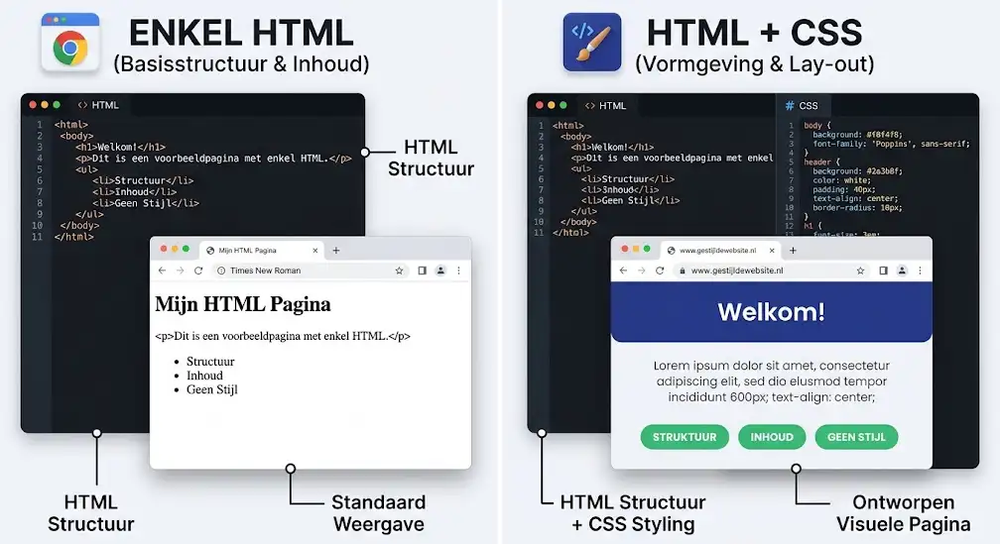
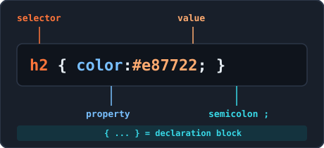
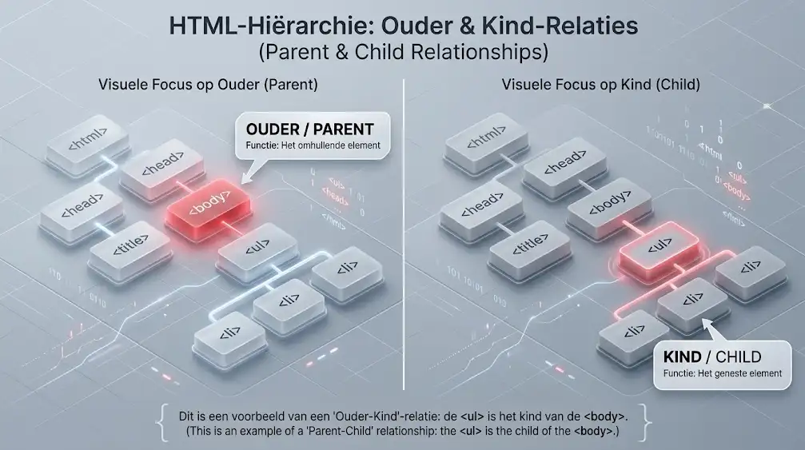
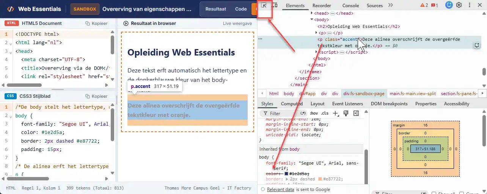
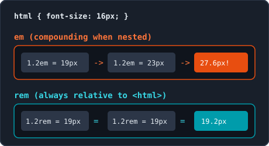
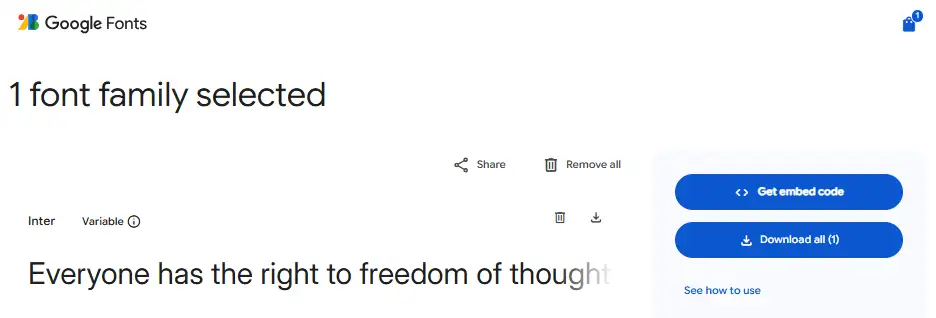
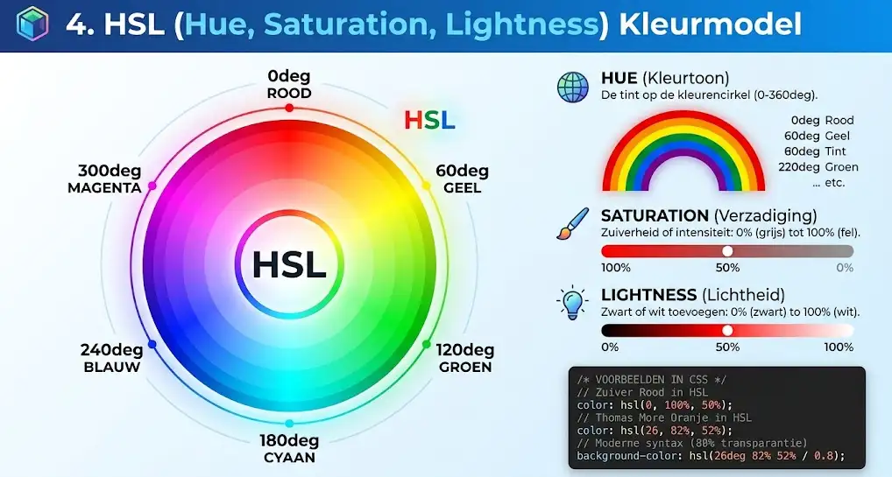
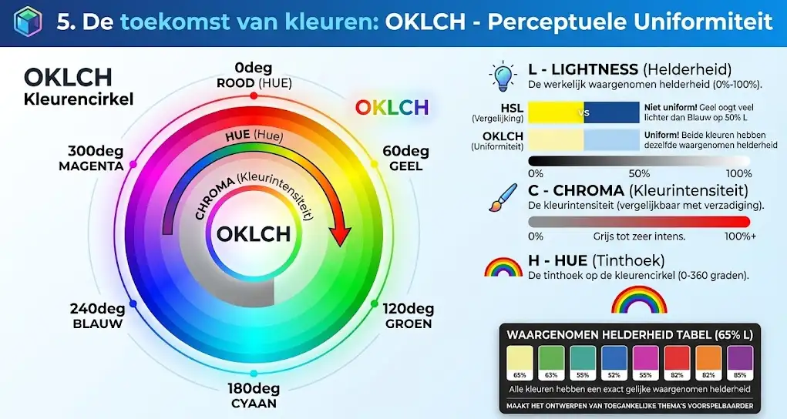
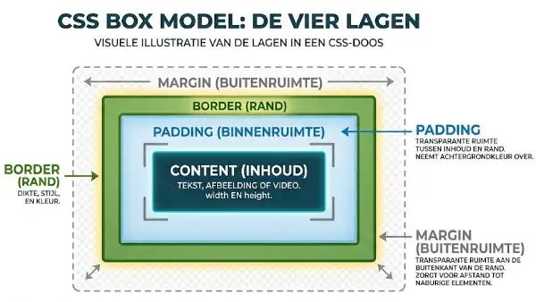
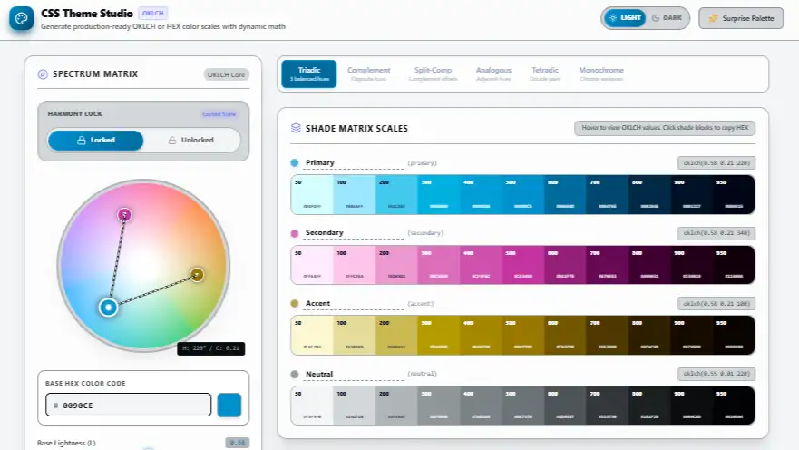

<!-- _class: lead -->

# Week 3: CSS3 Introduction, Typography, Colors, Box Model & Variables

<p class="subtitle">&lt;Styling, layout, and reusable rules in CSS3 /&gt;</p>

<div class="meta-box">
  <strong>Thomas More Hogeschool</strong> - Applied Computer Science (ITF)<br>
  <strong>Course:</strong> Web Essentials | <strong>Module:</strong> Week 3
</div>

---

## Agenda

<div class="grid-2">
<div class="card card-accent">

#### Basics & Typography

1. **Introduction to CSS3** - Selectors, cascade, inheritance & DevTools
2. **Fonts & Text Styling** - Font stacks, `rem`, `line-height` & text
3. **Webfonts & Icons** - Google Fonts CSS2 API, Font Awesome & Lucide

</div>
<div class="card card-cyan">

#### Color, Spacing & Variables

4. **Colors** - HEX, RGB, HSL, OKLCH, contrast & LVFHA
5. **Box Model & Borders** - `padding`, `margin`, `border` & `border-box`
6. **CSS Variables** - `:root`, `var()`, scope & `calc()`

</div>
</div>

---

## 1. CSS3 Intro: What Is CSS & Separation

<div class="split-2-1">
<div>

### Cascading Style Sheets

- **HTML** defines content and structure; **CSS** defines styling and layout
- **Benefits:** centralized management, browser caching (faster loads), and better accessibility
- **Evolution (W3C):** CSS1 (1996) -> CSS2 (1998) -> **CSS3 (modular)** with no monolithic "CSS4"
- Validate stylesheets using the **W3C CSS Validator**

</div>
<div class="img-box">
  
  <p class="caption">HTML for structure, CSS for presentation</p>
</div>
</div>

---

## 1. CSS3 Intro: Where Do You Write CSS?

```html
<!-- In the <head> of your HTML document (Emmet shortcut: link:css + Tab) -->
<link rel="stylesheet" href="css/style.css">
```

<div class="grid-2">
<div class="card card-accent">

#### 1. External Stylesheet <span class="badge">Standard</span>

- Separate `.css` file for the entire website
- Maximum reuse and centralized maintenance
- **Golden rule:** always use external CSS in projects

</div>
<div class="card card-cyan">

#### 2. Internal & 3. Inline CSS

- **Internal (`<style>` in `<head>`):** applies to 1 page only (prototypes / emails)
- **Inline (`style="..."` on tag):** mixes content and styling; avoid in professional code

</div>
</div>

---

## 1. CSS3 Intro: Rule Anatomy & Comments

<div class="split-2-1">
<div>

```css
/* This is a CSS comment (shortcut: Ctrl + / or Cmd + /) */
h2 {
  color: #e87722;           /* Property: value; */
  font-family: "Times New Roman", Times, serif;
}
```

- **Selector (`h2`):** targets HTML element; `{ ... }` is the declaration block
- **Semicolon (`;`):** must terminate every declaration
- Separate multiple values with commas; in CSS, use **`/* ... */` only**

</div>
<div class="img-box">
  
  <p class="caption">Parts of a CSS style rule</p>
</div>
</div>

---

## 1. CSS3 Intro: Basic Selectors & Combinations

<div class="split-2-1">
<div>

| Selector | Example | Targets |
| :--- | :--- | :--- |
| **Type** | `p { }` | All `<p>` elements |
| **Class** | `.highlight { }` | Any element with `class="highlight"` |
| **ID** | `#main-menu { }` | The unique element with `id="main-menu"` |
| **Grouped** | `h1, h2, h3 { }` | Multiple selectors sharing the same style |
| **With class** | `p.important { }` | Only `<p>` with `class="important"` |
| **Descendant** | `article p { }` | All `<p>` inside an `<article>` |

</div>
<div class="card card-cyan">

#### Best Practices

- Almost always use **classes** (`.class`) for styling
- Do not forget the dot (`.`) in CSS; never put `#` or `.` inside the HTML `class` attribute
- Limit `#id` due to high specificity

</div>
</div>

---

## 1. CSS3 Intro: The Cascade & `!important`

```css
p { color: green !important; } /* Always wins, even when placed first! */
p { color: blue; }
p { color: red; }              /* Normally the last rule wins, except against !important */
```

<div class="grid-2">
<div class="card card-accent">

#### The 3 Sources (high -> low)

- **1. Author Stylesheet:** your CSS (wins by default)
- **2. User Stylesheet:** visitor browser preferences
- **3. User Agent:** default browser styles (e.g. 8px `body` margin)

</div>
<div class="card card-cyan">

#### Conflicts & `!important`

- At equal priority, the **last read rule** wins (source order)
- Avoid `!important` as a quick fix: it makes stylesheets unmaintainable

</div>
</div>

---

## 1. CSS3 Intro: Inheritance & the DOM

<div class="split-2-1">
<div>

### Parent -> Child in the DOM Tree

- **Inherited (text & typography):** `font-family`, `font-size`, `font-weight`, `color`, `line-height`, `text-align`, `list-style-type`
- **NOT inherited (box model & layout):** `margin`, `padding`, `border`, `background-color`, `width`, `height`
- Set base text styles once on `body`: all child elements inherit them automatically

</div>
<div class="img-box">
  
  <p class="caption">Properties inherit from parent to child</p>
</div>
</div>

---

## 1. CSS3 Intro: Inspecting with DevTools

<div class="split-1-2">
<div class="card card-accent">

#### Fast Debugging (`F12`)

- Right-click -> **Inspect** -> **Elements** tab
- **Styles** pane shows file name and line number
- **Strikethrough rules:** overridden by higher priority
- **Inherited from...:** inherited styles
- Toggle properties on/off to test live

</div>
<div class="img-box">
  
  <p class="caption">Inspecting style rules and the cascade in Chrome DevTools</p>
</div>
</div>

---

## 2. Fonts: `font-family` & 5 Generic Families

```css
body { font-family: -apple-system, BlinkMacSystemFont, "Segoe UI", Roboto, Arial, sans-serif; }
h1   { font-family: Georgia, "Times New Roman", serif; }
code { font-family: Consolas, "Courier New", monospace; }
```

| Generic Family | Characteristics | Typical Use |
| :--- | :--- | :--- |
| `sans-serif` | Without serifs, clean & sharp on screens | Body copy, UI |
| `serif` | With serifs (decorative strokes), classic | Headings, articles, print |
| `monospace` | Every character has equal width | Code blocks, numeric tables |
| `cursive` / `fantasy` | Handwritten / decorative | Quotes / playful posters (sparingly) |

> **Rule:** Always end every font stack with one of the 5 generic families as a fallback.

---

## 2. Fonts: Units (`px`, `em`, `rem`)

<div class="split-2-1">
<div>

```css
html { font-size: 16px; }       /* Default (1rem = 16px) */
h1   { font-size: 2.5rem; }     /* 2.5 x 16px = 40px */
p    { font-size: 1rem; }       /* Scales with preference */
```

- **`px` (absolute):** fixed pixel size; ignores browser preferences
- **`em` (relative to parent):** compounds when nested
- **`rem` (root em):** always relative to `<html>`; respects user preferences (**golden rule for `font-size`**)

</div>
<div class="img-box">
  
  <p class="caption">em compounds when nested, rem stays consistent</p>
</div>
</div>

---

## 2. Fonts: Weight, Style, `line-height` & `font`

<div class="grid-2">
<div class="card card-accent">

#### `font-weight`, `style` & `variant`

- `font-weight`: `normal` (`400`), `bold` (`700`), or `100` to `900`
- `font-style`: `normal` or `italic`
- `font-variant`: `small-caps`
- **Shorthand `font`:** requires `font-size` and `font-family` (e.g. `font: italic bold 1rem/1.6 Arial, sans-serif;`)

</div>
<div class="card card-cyan">

#### Unitless `line-height`

- Use a unitless multiplier: `line-height: 1.6;`
- Computes `font-size x multiplier` (works cleanly when inherited by `<h1>`)
- **Paragraphs:** `1.5` to `1.7`
- **Headings:** `1.1` to `1.3`

</div>
</div>

---

## 2. Fonts: Alignment, Transform & Decoration

<div class="grid-2">
<div class="card card-accent">

#### `text-align` & `text-transform`

- `text-align`: `left`, `center`, `right`, `justify`
- **Avoid `justify`:** no auto-hyphenation creates "white rivers" (hard to read, especially with dyslexia)
- `text-transform`: `uppercase`, `lowercase`, `capitalize` (HTML text stays normal)

</div>
<div class="card card-cyan">

#### `text-decoration` & `text-shadow`

- Links inside text keep underlines or at least **3:1 color contrast** + clear `:hover`/`:focus` (WCAG)
- `text-shadow: 2px 2px 4px rgba(0, 0, 0, 0.25);` (subtle and semi-transparent)
- **Emmet:** `fz1.25rem`, `fwb`, `lh1.6`, `tac`, `ttu`, `tdn`

</div>
</div>

---

## 3. Webfonts & Icons: Google Fonts & CSS2 API

<div class="split-2-1">
<div>

- **Webfonts:** consistent on every OS; use at most **2 families** and load only needed weights
- **Variable Fonts:** 1 compact file for all weights (`100..900`, even `550`)
- **Optical Sizing (`opsz`):** automatically adapts stroke weight to `font-size`
- **What is a CDN?** *Content Delivery Network* (global network of servers close to the visitor for fast loads and caching)

</div>
<div class="img-box">
  
  <p class="caption">Fetching fonts via the Google Fonts CSS2 API</p>
</div>
</div>

---

## 3. Webfonts & Icons: CSS2 URL, `@import` vs. `<link>`

```css
/* Method 1: In CSS via @import (must be on line 1) - great for centralized management */
@import url('https://fonts.googleapis.com/css2?family=Inter:ital,opsz,wght@0,14..32,100..900&display=swap');
```

```html
<!-- Method 2: In HTML <head> with preconnect - fastest load (parallel, no waterfall) -->
<link rel="preconnect" href="https://fonts.googleapis.com">
<link rel="preconnect" href="https://fonts.gstatic.com" crossorigin>
<link href="https://fonts.googleapis.com/css2?family=Inter:wght@400..700&display=swap" rel="stylesheet">
```

<div class="grid-2">
<div class="card card-accent">

#### `&display=swap`

- Shows a fallback font immediately and swaps once the webfont is ready (no invisible text / FOIT)

</div>
<div class="card card-cyan">

#### Which to Choose?

- **`@import`:** convenient for smaller sites (1 central place)
- **`<link>` + `preconnect`:** best choice for fast production websites

</div>
</div>

---

## 3. Webfonts & Icons: Font Awesome & Lucide via CDN

<div class="grid-2">
<div class="card card-accent">

#### Font Awesome (solid, regular, brands)

- Classes: `fa-solid`, `fa-regular`, `fa-brands` + `fa-name`
- Style like text with `font-size` and `color`

```html
<i class="fa-solid fa-envelope"></i>
<i class="fa-brands fa-github"></i>
```

</div>
<div class="card card-cyan">

#### Lucide Icons (crisp outline icons)

- Import `lucide.min.css` via jsDelivr CDN
- All classes start with `icon-`

```html
<i class="icon-mail"></i>
<i class="icon-map-pin"></i>
```

</div>
</div>

---

## 3. Webfonts & Icons: Accessibility (WCAG)

```html
<!-- 1. Decorative icon next to visible text: hide the icon from screen readers -->
<a href="mailto:info@thomasmore.be">
  <i class="fa-solid fa-envelope" aria-hidden="true"></i> Email us
</a>

<!-- 2. Functional icon without text: add aria-label to the button/link -->
<button type="button" aria-label="Search the website">
  <i class="fa-solid fa-magnifying-glass" aria-hidden="true"></i>
</button>
```

<div class="grid-2">
<div class="card card-accent">

#### With Visible Text Next to It

- Put `aria-hidden="true"` on `<i>` so the screen reader skips the icon

</div>
<div class="card card-cyan">

#### Without Visible Text

- Add `aria-label="..."` on the button or link and `aria-hidden="true"` on `<i>`

</div>
</div>

---

## 4. Colors: Basics, Named Colors & HEX

```css
body { color: #1e2d5a; background-color: #f8fafc; }
.badge { background-color: #ff000080; } /* 8-digit HEX with 50% opacity */
```

<div class="grid-2">
<div class="card card-accent">

#### `color` & `background-color`

- `color`: foreground color (text & icons)
- `background-color`: background color (`transparent` or `inherit`)
- **147 named colors** (e.g. `tomato`, `navy`): great for quick tests, rarely for branding

</div>
<div class="card card-cyan">

#### Hexadecimal Notation (`#RRGGBB`)

- 3 pairs from `00` (0%) to `ff` (100% / 255)
- **3-digit shorthand (`#RGB`):** only if every pair has identical digits (`#fff`, `#369`; not `#e87722`)
- **8-digit (`#RRGGBBAA`):** last 2 digits set opacity (`00` to `ff`)

</div>
</div>

---

## 4. Colors: RGB, RGBA & Modern Space Syntax

```css
/* Classic syntax (with commas) */
.card-old { background-color: rgba(232, 119, 34, 0.5); }

/* Modern CSS Color Level 4 space syntax (with slash for alpha) */
.card-new { background-color: rgb(232 119 34 / 50%); }
```

<div class="grid-2">
<div class="card card-accent">

#### Decimal RGB (`0` to `255`)

- Additive model: Red, Green, Blue
- `rgb(0, 0, 0)` = black; `rgb(255, 255, 255)` = white
- `rgb(232, 119, 34)` = Thomas More Orange

</div>
<div class="card card-cyan">

#### Alpha Channel (`0.0` to `1.0` or `%`)

- `0` / `0%` = fully transparent
- `1` / `100%` = fully opaque
- In modern CSS, `rgb()` with spaces and `/` suffices (no separate `rgba()` needed)

</div>
</div>

---

## 4. Colors: HSL (Hue, Saturation, Lightness)

<div class="split-2-1">
<div>

### Adjusting Colors Intuitively

- **Hue:** angle on the color wheel (`0deg` red, `120deg` green, `240deg` blue)
- **Saturation:** `0%` gray to `100%` vivid
- **Lightness:** `0%` black, `50%` pure, `100%` white
- **Big benefit:** create lighter or darker shades of the same brand color by changing **lightness** only (e.g. `hsl(26, 82%, 90%)` -> `35%`)

</div>
<div class="img-box">
  
  <p class="caption">The HSL color wheel from 0 to 360 degrees</p>
</div>
</div>

---

## 4. Colors: OKLCH (Perceptual Uniformity)

<div class="split-2-1">
<div>

### Why OKLCH?

- **Limitation of HSL:** yellow at `50%` lightness looks much brighter to the eye than blue at `50%` lightness
- **OKLCH solves this:** equal `L` = equal perceived brightness
  - **L (Lightness):** perceived brightness (`0%` - `100%`)
  - **C (Chroma):** color intensity
  - **H (Hue):** hue angle (`0deg` - `360deg`)
- Example: `oklch(65% 0.20 25deg)`

</div>
<div class="img-box">
  
  <p class="caption">Equal L value in OKLCH produces equal visual brightness</p>
</div>
</div>

---

## 4. Colors: Contrast (WCAG AA) & Hyperlinks (LVFHA)

<div class="grid-2">
<div class="card card-accent">

#### Color Contrast (WCAG 2.1 AA)

- **Normal text:** min. **4.5:1** contrast ratio
- **Large text (>= 24px / 18.5px bold):** min. **3:1**
- Check directly via the color picker in Chrome DevTools (`F12` -> green checkmark or red warning)

</div>
<div class="card card-cyan">

#### Hyperlinks: LoVe Fears HAte (LVFHA)

Order in CSS is binding due to the cascade:

```css
a:link    { color: #1e2d5a; }
a:visited { color: #475569; }
a:focus   { background-color: #fef08a; }
a:hover   { color: #e87722; }
a:active  { color: #c2410c; }
```

</div>
</div>

---

## 5. Box Model: The 4 Layers & Dimensions

<div class="split-2-1">
<div>

### From Inside Out

- **Content:** text/media (`width`, `max-width`, `min-height`)
- **Padding:** transparent inner space (inherits background color)
- **Border:** outline wrapping padding and content
- **Margin:** transparent outer space between elements
- **Responsive:** prefer `max-width` over fixed `width` and `min-height` over fixed `height` (avoids scrollbars and overflow)

</div>
<div class="img-box">
  
  <p class="caption">The four layers of every HTML element (inspectable in DevTools)</p>
</div>
</div>

---

## 5. Box Model: `padding`, `margin` & `margin: auto`

```css
.card      { padding: 1rem 1.5rem; }        /* 2 values: top/bottom | left/right */
.container { max-width: 37.5rem; margin: 0 auto; } /* Horizontal centering */
```

<div class="grid-2">
<div class="card card-accent">

#### Clockwise Order (TRBL)

- **1 value:** all 4 sides equal
- **2 values:** top/bottom | left/right
- **3 values:** top | left/right | bottom
- **4 values:** Top, Right, Bottom, Left

</div>
<div class="card card-cyan">

#### Centering & Margin Collapse

- `margin: 0 auto;` centers a block with a width
- **Margin Collapse:** touching vertical margins (`margin-bottom: 2rem` + `margin-top: 1rem`) do not add up; the **larger (`2rem`)** wins

</div>
</div>

---

## 5. Box Model: `border`, `border-radius` & `box-shadow`

<div class="grid-2">
<div class="card card-accent">

#### Borders & Rounded Corners

- `border: 2px solid #EC6639;` (width, style, color)
- Styles: `solid`, `dashed`, `dotted`, `double`, `none`
- Specific side: `border-left: 5px solid ...;`
- `border-radius: 8px;` (and `50%` turns a square into a circle)

</div>
<div class="card card-cyan">

#### Shadows (`box-shadow`)

- Order: `X-offset Y-offset blur spread color`
- `box-shadow: 4px 6px 12px 2px rgba(0, 0, 0, 0.15);`
- Add `inset` for an inner shadow (e.g. input fields)

</div>
</div>

> **Blur vs. Spread:** `blur` controls how **soft/diffuse** the shadow edge fades (`0` = sharp edge); `spread` makes the shadow box itself **larger (`+`) or smaller (`-`)**.

---

## 5. Box Model: `box-sizing: border-box` & Reset

```css
/* Universal CSS reset at the top of every stylesheet */
* {
  box-sizing: border-box;
  margin: 0;
  padding: 0;
}
```

<div class="grid-2">
<div class="card card-accent">

#### `content-box` (browser default)

- `width: 300px` + `padding: 20px` + `border: 5px` becomes **350px** wide!
- Two `50%` columns no longer fit side by side

</div>
<div class="card card-cyan">

#### `border-box` (modern standard)

- `width` includes **content + padding + border**
- Total width stays exactly `300px`
- `margin: 0; padding: 0;` clears browser margins

</div>
</div>

---

## 5. Box Model: `overflow` & `outline` vs. `border`

<div class="grid-2">
<div class="card card-accent">

#### Overflowing Content (`overflow`)

- `visible` (default): spills outside the box
- `hidden`: clips overflowing content
- `scroll`: always shows scrollbars
- `auto` / `overflow-y: auto`: scrollbar only if content overflows

</div>
<div class="card card-cyan">

#### `outline` versus `border`

- `border` takes up space in the box model
- `outline` sits on top and shifts **nothing**
- Ideal for keyboard focus (`:focus`):

```css
button:focus { outline: 3px solid #EC6639; outline-offset: 2px; }
```

</div>
</div>

---

## 6. CSS Variables: Why & Syntax

```css
:root {
  --main-color: #1e2d5a;       /* Declare with --name (kebab-case, case-sensitive) */
  --base-space: 1rem;
}

.badge {
  background-color: var(--badge-color, #1e2d5a); /* Use with var() and optional fallback */
  padding: var(--base-space);
}
```

<div class="grid-2">
<div class="card card-accent">

#### DRY Principle (*Don't Repeat Yourself*)

- Store brand colors, fonts, and spacing in 1 central place
- Change 1 value and the entire website updates

</div>
<div class="card card-cyan">

#### Syntax Rules

- Always start with two hyphens (`--`)
- Use lowercase letters and hyphens (`kebab-case`)
- Pass a fallback value in `var(--name, fallback)`

</div>
</div>

---

## 6. CSS Variables: Scope (`:root` vs. Local)

<div class="split-2-1">
<div>

```css
:root {                   /* Global: available everywhere */
  --color-primary: #1e2d5a;
  --card-radius: 0.5rem;
}

.special-section {        /* Local: inside this selector only */
  --text-color: #d97706;
  color: var(--text-color);
}
```

- **`:root`** targets `<html>`: variables inherit down to all elements
- **Local:** valid only inside that element and its children

</div>
<div class="img-box">
  
  <p class="caption">Managing a color palette via global :root variables</p>
</div>
</div>

---

## 6. CSS Variables: Modular Components & `calc()`

<div class="grid-2">
<div class="card card-accent">

#### Overriding Component Variants

- Base class defines layout and default variables
- Variant classes override only the color variable

```css
.btn { background-color: var(--bg, #1e2d5a); }
.btn-primary { --bg: #EC6639; }
```

</div>
<div class="card card-cyan">

#### Computing with `calc()` & Naming

- Use `+`, `-`, `*`, `/` with variables: `padding: calc(var(--base-space) * 2);`
- **Required:** spaces around `+` and `-` (`calc(100% - 2rem)`)
- Pick semantic names (`--color-primary`, not `--orange`)

</div>
</div>

---

## Summary & Best Practices

<div class="grid-2">
<div class="card card-accent">

#### CSS Basics, Typography & Colors

- Always work with **external `.css`** and inspect in **DevTools** (`F12`)
- Use **`rem`** for `font-size` and unitless `line-height`
- Load Google Fonts with `&display=swap`; add `aria-hidden="true"` on decorative icons
- Follow **WCAG AA** (4.5:1) and **LVFHA** for links

</div>
<div class="card card-cyan">

#### Box Model & CSS Variables

- Start every stylesheet with `* { box-sizing: border-box; margin: 0; padding: 0; }`
- Prefer `max-width`, `min-height`, and `outline` for `:focus`
- Manage themes centrally in `:root` with semantic `--variables`
- Always validate with the **W3C CSS Validator**

</div>
</div>

---

<!-- _class: lead -->

# Questions & Let's Get Started!

<p class="subtitle">&lt;Toward attractive and maintainable CSS3 stylesheets /&gt;</p>

<div class="meta-box">
  <strong>Next step:</strong> Build your external stylesheet with webfonts, color palette, box model, and CSS variables
</div>

