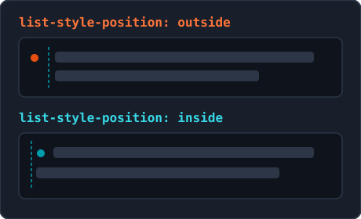
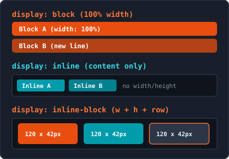
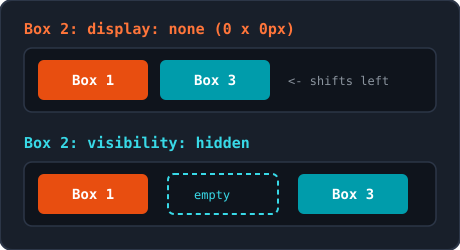
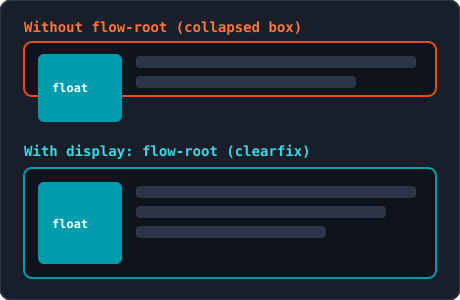

<!-- _class: lead -->

# Week 4: CSS Lijsten, Tabellen, Display & Afbeeldingen

<p class="subtitle">&lt;Stijlen voor lijsten, datatabellen, weergave en media /&gt;</p>

<div class="meta-box">
  <strong>Thomas More Hogeschool</strong> - Toegepaste Informatica (ITF)<br>
  <strong>Vak:</strong> Web Essentials | <strong>Module:</strong> Week 4
</div>

---

## Agenda

<div class="grid-2">
<div class="card card-accent">

#### Lijsten & Tabellen

1. **CSS Lijsten** - `list-style`, `::marker` & navigatie-reset
2. **CSS Tabellen** - `border-collapse`, zebra-striping & `<col>`

</div>
<div class="card card-cyan">

#### Display & Afbeeldingen

3. **Display** - `block`, `inline`, `inline-block` & verbergen
4. **Afbeeldingen & Achtergronden** - `object-fit`, gradients & `float`

</div>
</div>

---

## 1. CSS Lijsten: `list-style-type`

```css
ul { list-style-type: square; }
ol { list-style-type: upper-roman; }
ul.checklist { list-style-type: "✓ "; } /* Eigen Unicode-teken */
```

<div class="grid-2">
<div class="card card-accent">

#### Waarden voor `<ul>`

- `disc`: standaard gevuld bolletje
- `circle`: open cirkel
- `square`: gevuld vierkantje
- `none`: geen markering (voor menu's)

</div>
<div class="card card-cyan">

#### Waarden voor `<ol>`

- `decimal` / `decimal-leading-zero` (`01`, `02`)
- `lower-alpha` (`a, b`) / `upper-alpha` (`A, B`)
- `lower-roman` (`i, ii`) / `upper-roman` (`I, II`)
- Overerft van `<ul>`/`<ol>` naar `<li>`

</div>
</div>

---

## 1. CSS Lijsten: `position`, `image` & Shorthand

<div class="split-2-1">
<div>

```css
ul.binnen { list-style-position: inside; }
ul.icoon  { list-style: square inside; } /* Shorthand */
```

- **`outside` (standaard):** markering hangt links buiten tekst; regels lijnen strak uit
- **`inside`:** markering staat in de tekst; volgende regels springen terug naar links
- **`list-style-image: url("vinkje.png");`:** niet schaalbaar in CSS (sla exact op in bv. `16x16px`, en zet `list-style-type` fallback)
- Shorthand `list-style: none;` schakelt alles uit

</div>
<div class="img-box">
  
  <p class="caption">Uitlijning bij outside vs. inside</p>
</div>
</div>

---

## 1. CSS Lijsten: `::marker`, Navigatie-Reset & Emmet

<div class="grid-2">
<div class="card card-accent">

#### Opsommingstekens stijlen (`::marker`)

- Stijlt enkel `color`, `font-size`, `font-weight`, `font-family` en `content` (geen `margin`/`padding`)

```css
li::marker {
  color: #EC6639;
  font-size: 1.2rem;
  font-weight: bold;
}
```

</div>
<div class="card card-cyan">

#### De 3-regelige Navigatie-Reset

Verwijdert bolletjes én de ~40px browserpadding:

```css
ul.hoofdmenu {
  list-style: none;
  margin: 0;
  padding: 0;
}
```

- **Emmet:** `list:n` (`none`), `list:s`, `lisp:i`

</div>
</div>

---

## 2. CSS Tabellen: `border-collapse` & `spacing`

```css
table { border-collapse: collapse; }           /* Moderne standaard: 1 strakke lijn */
table.tegels { border-collapse: separate; border-spacing: 0.5rem 0.25rem; empty-cells: hide; }
```

| Eigenschap / Model | `border-collapse: collapse` | `border-collapse: separate` (standaard) |
| :--- | :--- | :--- |
| **Visueel resultaat** | Aangrenzende randen smelten samen | Elke cel behoudt een eigen kader |
| **`border-spacing`** | Heeft **geen** effect | Regelt horizontale en verticale tussenruimte |
| **`empty-cells: hide`** | Heeft geen effect | Verbergt rand en achtergrond van lege cellen |
| **`border-radius` op cel** | Niet ondersteund | Wel ondersteund per cel |

---

## 2. CSS Tabellen: `caption-side`, `padding` & Uitlijning

<div class="grid-2">
<div class="card card-accent">

#### `caption-side` & Celruimte

- `<caption>` blijft in HTML altijd **eerst** na `<table>`
- Verplaats visueel naar onder met `caption-side: bottom;`
- Geef cellen lucht met `th, td { padding: 0.75rem 1rem; }`
- **Let op:** `margin` werkt niet op `<th>`, `<td>` of `<tr>`

</div>
<div class="card card-cyan">

#### Horizontale & Verticale uitlijning

- **Tekst:** `text-align: left;` (namen, steden)
- **Getallen / prijzen:** `text-align: right;` (cijfers loodrecht onder elkaar)
- **Codes / status:** `text-align: center;`
- **Verticaal:** `vertical-align: top | middle | bottom;`

</div>
</div>

---

## 2. CSS Tabellen: Zebra-striping, `:hover` & Kolommen

```css
tbody tr:nth-child(even) { background-color: #f8f9fa; } /* Zebra-striping enkel in tbody! */
tbody tr:hover           { background-color: #e8f0fe; } /* Leesliniaal bij hover */
td:last-child            { text-align: right; font-weight: bold; }
```

| Selector | Selecteert | Typische toepassing |
| :--- | :--- | :--- |
| `tbody tr:nth-child(even)` | Even rijen in `<tbody>` | Zebra-striping (zonder `<thead>`/`<tfoot>` mee te tellen) |
| `tbody tr:first-child` / `:last-child` | Eerste / laatste gegevensrij | Extra bovenrand of afronding onderaan |
| `td:first-child`, `th:first-child` | Eerste cel in elke rij | Eerste sleutelkolom benadrukken |
| `td:nth-child(2)` | Tweede cel in elke rij | Specifieke kolombreedte of uitlijning |

---

## 2. CSS Tabellen: `table-layout`, `<col>` & Responsief

<div class="grid-2">
<div class="card card-accent">

#### `table-layout` & `<colgroup>` / `<col>`

- `auto` (standaard) vs. `fixed` (sneller; gelijke kolommen bij roosters)
- Op `<col>` werken **enkel 4 eigenschappen:** `background-color`, `width`, `border` (bij `collapse`) en `visibility: collapse`
- `color` en `text-align` werken **niet** op `<col>`

</div>
<div class="card card-cyan">

#### Responsieve wrapper & Emmet

Voorkom dat brede tabellen de pagina uitrekken:

```css
.tabel-container {
  width: 100%;
  overflow-x: auto;
}
```

- **Emmet:** `bdcl:c` (`border-collapse: collapse;`)

</div>
</div>

---

## 3. Display: Documentstroom (`block` vs. `inline`)

| Kenmerk in normal flow | `display: block` | `display: inline` | `display: inline-block` |
| :--- | :---: | :---: | :---: |
| **Start op nieuwe regel?** | Ja | Nee | Nee |
| **Standaard breedte** | 100% van ouder | Breedte van inhoud | Breedte van inhoud |
| **Luistert naar `width`/`height`?** | Ja | **Nee (genegeerd)** | Ja |
| **Verticale `margin`/`padding`** | Duwt regels weg | Duwt regels **niet** weg | Duwt regels weg |

> **Uitzondering (``):** Een afbeelding vloeit inline mee tussen tekst, maar is een *replaced element* en luistert wél naar `width`, `height` en verticale marges.

---

## 3. Display: `display: block` & `display: inline-block`

<div class="split-2-1">
<div>

```css
.zijbalk a { display: block; padding: 0.75rem 1rem; }
.knop      { display: inline-block; padding: 0.6rem 1.2rem; }
```

- **`display: block` (mobiele knoppen):** maakt een `<a>` over de hele containerbreedte klikbaar (niet alleen het tekstje)
- **`display: inline-block` (beste van twee):** vloeit aan de buitenkant mee op 1 regel, maar gehoorzaamt aan `width`, `height`, `padding` en `margin` (voorkomt overlap bij knoppen)

</div>
<div class="img-box">
  
  <p class="caption">Gedrag van block, inline en inline-block</p>
</div>
</div>

---

## 3. Display: `vertical-align` & Witruimtekloof

```css
.opleiding-kaart {
  display: inline-block;
  vertical-align: top; /* Voorkomt verspringen bij ongelijke tekstlengte */
  width: 31%;
}
```

<div class="grid-2">
<div class="card card-accent">

#### Uitlijnen met `vertical-align`

- Standaard is `baseline` (kaarten met meer tekst verspringen)
- `vertical-align: top;`: lijnt kaarten en kolommen strak gelijk bovenaan uit
- `vertical-align: middle;`: centreert iconen en knoppen op de regel

</div>
<div class="card card-cyan">

#### Witruimtekloof (~4px)

- `inline-block` elementen gedragen zich extern als teksttekens
- Elke spatie, tab of enter in de HTML-broncode tussen twee elementen verschijnt als een kleine spatie (~4px)

</div>
</div>

---

## 3. Display: `display: none` vs. `visibility: hidden`

<div class="split-2-1">
<div>

| Eigenschap | Zichtbaar? | Neemt ruimte in? | Effect op buren |
| :--- | :---: | :---: | :--- |
| `display: none;` | Nee | **Nee (0 x 0 px)** | Buren schuiven op |
| `visibility: hidden;` | Nee | **Ja (eigen maat)** | Laat een leeg gat |

- **Moderne lay-out:** `display: flex;` (1D) en `display: grid;` (2D) vervangen oude lay-outtrucs
- **Emmet:** `d:b`, `d:i`, `d:ib`, `d:n`, `v:h` (`visibility: hidden;`)

</div>
<div class="img-box">
  
  <p class="caption">Ruimte verdwijnt (none) vs. blijft behouden (hidden)</p>
</div>
</div>

---

## 4. CSS Afbeeldingen: Responsief & `aspect-ratio`

```css
/* Universele responsieve afbeeldingsformule (CSS overschrijft HTML width/height) */
img { max-width: 100%; height: auto; }

/* Vaste beeldverhouding bewaken zonder padding-trucs */
.videokaart { width: 100%; aspect-ratio: 16 / 9; }
```

<div class="grid-2">
<div class="card card-accent">

#### `max-width: 100%` & `height: auto`

- Krimpt automatisch mee op smalle schermen
- Groeit nooit voorbij de originele resolutie (geen korrelig beeld)
- `height: auto` behoudt exact de verhouding

</div>
<div class="card card-cyan">

#### Vaste verhouding (`aspect-ratio`)

- Handhaaf steeds `16 / 9` voor banners/video of `1 / 1` voor vierkante profielfoto's
- Browser berekent automatisch de juiste hoogte bij elke breedte

</div>
</div>

---

## 4. CSS Afbeeldingen: `object-fit` & `object-position`

| Waarde | Werking in vast kader | Verhouding? | Snijdt bij? | Toepassing |
| :--- | :--- | :---: | :---: | :--- |
| `fill` | Rekt/drukt beeld in kader (standaard) | Nee (vervormt) | Nee | Vermijden bij foto's |
| `cover` | Vult hele kader zonder vervorming | Ja | Ja | Nieuwskaarten, portretten, banners |
| `contain` | Volledig beeld zichtbaar; evt. lege randen | Ja | Nee | Logo's, schema's, grafieken |
| `none` / `scale-down` | Originele maat / kleinste van `none` & `contain` | Ja | Ja / Nee | Exacte uitsneden / iconen |

```css
.docent-portret img { width: 100%; height: 250px; object-fit: cover; object-position: top center; }
```

---

## 4. CSS Afbeeldingen: `background-image` & Paden

<div class="split-2-1">
<div>

```css
/* Relatief pad vertrekt vanuit het CSS-bestand (niet HTML!) */
.hero {
  background-color: #1e2d5a; /* Veilige terugvalkleur */
  background-image: url("../images/hero-campus.webp");
  color: #ffffff;
}
```

- **`` in HTML:** inhoudelijke afbeelding (verplicht `alt` voor screenreaders)
- **`background-image` in CSS:** puur decoratief (genegeerd door screenreaders)
- Gebruik steeds een passende `background-color` als fallback voor leesbaarheid

</div>
<div class="img-box">
  
  <p class="caption">Voorbeeldfoto voor hero-banners en object-fit</p>
</div>
</div>

---

## 4. CSS Afbeeldingen: `repeat`, `position`, `size` & Shorthand

```css
/* Shorthand: kleur url() positie / grootte repeat (schuine streep / is verplicht!) */
.banner {
  background: #1e2d5a url("campus.webp") center / cover no-repeat;
}
```

<div class="grid-2">
<div class="card card-accent">

#### `repeat`, `position` & `attachment`

- `background-repeat`: `no-repeat`, `repeat`, `repeat-x`, `repeat-y`
- `background-position`: `center center`, `left top`, `50% 50%`
- `background-attachment: fixed;` zet de achtergrond vast voor een parallax-effect

</div>
<div class="card card-cyan">

#### `background-size`

- `cover`: vult het hele element zonder balken (snijdt randen bij; standaard voor hero's)
- `contain`: toont volledige afbeelding binnen het kader
- **Let op:** in shorthand staat `/ cover` altijd direct achter `position`

</div>
</div>

---

## 4. CSS Afbeeldingen: Gradients & Donkere overlay

```css
.hero-banner {
  /* Meerdere lagen scheiden met komma: eerste laag (donkere gradient) ligt bovenop de foto */
  background:
    linear-gradient(rgba(30, 45, 90, 0.75), rgba(15, 23, 42, 0.85)),
    url("campus-hero.webp") center / cover no-repeat;
  color: #ffffff;
}
```

<div class="grid-2">
<div class="card card-accent">

#### `linear-gradient()`

- Richting: `to right`, `to top right`, of hoek `135deg`
- Ondersteunt meerdere kleurhalten (color stops), bv. `0%`, `50%`, `100%`

</div>
<div class="card card-cyan">

#### `radial-gradient()` & Overlay

- `radial-gradient(circle, #e87722, #1e2d5a)`: straalt vanuit het midden uit
- Een halftransparante gradientlaag over een foto maakt witte tekst altijd goed leesbaar

</div>
</div>

---

## 4. CSS Afbeeldingen: `float`, `clear` & `flow-root`

<div class="split-2-1">
<div>

```css
.artikel-foto      { float: left; margin: 0 1.5rem 1rem 0; }
.artikel-container { display: flow-root; } /* Moderne clearfix */
h2.volgende        { clear: both; }        /* Onder zwevend beeld */
```

- Gebruik `float` (`left`/`right`) **nooit voor lay-outs**, enkel voor tekstomloop rond afbeeldingen
- Zonder clearfix zakt de container in tot de teksthoogte; `display: flow-root;` lost dit schoon op
- **Emmet:** `mw100%`, `h:a`, `objf:c`, `bgi`, `bgr:n`, `bgp:c`

</div>
<div class="img-box">
  
  <p class="caption">Zonder vs. met display: flow-root</p>
</div>
</div>

---

## Samenvatting & Best Practices

<div class="grid-2">
<div class="card card-accent">

#### Lijsten & Tabellen

- **Lijsten:** reset menu's met `list-style: none; margin: 0; padding: 0;`; gebruik `::marker` voor gekleurde bullets
- **Tabellen:** gebruik `border-collapse: collapse;`, `tbody tr:nth-child(even)`, rechtse uitlijning voor cijfers en `overflow-x: auto;` op een wrapper

</div>
<div class="card card-cyan">

#### Display & Afbeeldingen

- **Display:** `inline-block` + `vertical-align: top;` voor kaarten; `display: none` verwijdert ruimte, `visibility: hidden` behoudt die
- **Afbeeldingen:** `max-width: 100%; height: auto;`, `object-fit: cover;`, gradients als overlay en `display: flow-root;` bij `float`

</div>
</div>

---

<!-- _class: lead -->

# Vragen & Aan de Slag!

<p class="subtitle">&lt;Klaar voor Bootstrap 5.3 Grid in de volgende module /&gt;</p>

<div class="meta-box">
  <strong>Volgende stap:</strong> Pas lijst-resets, gestylede tabellen, display-types en responsieve beelden toe in je projecten
</div>

