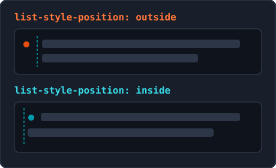
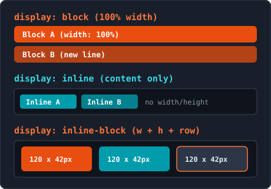
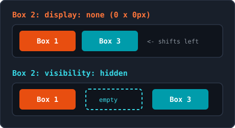
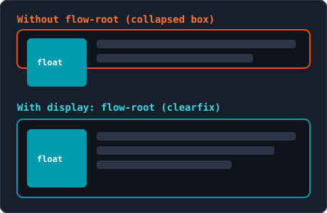

<!-- _class: lead -->

# Week 4: CSS Lists, Tables, Display & Images

<p class="subtitle">&lt;Styling lists, data tables, display modes, and media /&gt;</p>

<div class="meta-box">
  <strong>Thomas More Hogeschool</strong> - Applied Computer Science (ITF)<br>
  <strong>Course:</strong> Web Essentials | <strong>Module:</strong> Week 4
</div>

---

## Agenda

<div class="grid-2">
<div class="card card-accent">

#### Lists & Tables

1. **CSS Lists** - `list-style`, `::marker` & menu reset
2. **CSS Tables** - `border-collapse`, zebra-striping & `<col>`

</div>
<div class="card card-cyan">

#### Display & Images

3. **Display** - `block`, `inline`, `inline-block` & hiding
4. **Images & Backgrounds** - `object-fit`, gradients & `float`

</div>
</div>

---

## 1. CSS Lists: `list-style-type`

```css
ul { list-style-type: square; }
ol { list-style-type: upper-roman; }
ul.checklist { list-style-type: "✓ "; } /* Custom Unicode character */
```

<div class="grid-2">
<div class="card card-accent">

#### Values for `<ul>`

- `disc`: default solid bullet
- `circle`: hollow circle
- `square`: solid square
- `none`: no marker (for menus)

</div>
<div class="card card-cyan">

#### Values for `<ol>`

- `decimal` / `decimal-leading-zero` (`01`, `02`)
- `lower-alpha` (`a, b`) / `upper-alpha` (`A, B`)
- `lower-roman` (`i, ii`) / `upper-roman` (`I, II`)
- Inherited from `<ul>`/`<ol>` to `<li>`

</div>
</div>

---

## 1. CSS Lists: `position`, `image` & Shorthand

<div class="split-2-1">
<div>

```css
ul.inside-list { list-style-position: inside; }
ul.icon-list   { list-style: square inside; } /* Shorthand */
```

- **`outside` (default):** marker hangs left outside the text block; lines align cleanly
- **`inside`:** marker sits inside the text flow; wrapped lines jump back left
- **`list-style-image: url("check.png");`:** not scalable in CSS (save at exact size e.g. `16x16px`, and set `list-style-type` fallback)
- Shorthand `list-style: none;` disables all markers

</div>
<div class="img-box">
  
  <p class="caption">Alignment with outside vs. inside</p>
</div>
</div>

---

## 1. CSS Lists: `::marker`, Navigation Reset & Emmet

<div class="grid-2">
<div class="card card-accent">

#### Styling Markers (`::marker`)

- Styles only `color`, `font-size`, `font-weight`, `font-family`, and `content` (no `margin`/`padding`)

```css
li::marker {
  color: #EC6639;
  font-size: 1.2rem;
  font-weight: bold;
}
```

</div>
<div class="card card-cyan">

#### The 3-Line Navigation Reset

Removes bullets and the ~40px browser padding:

```css
ul.main-menu {
  list-style: none;
  margin: 0;
  padding: 0;
}
```

- **Emmet:** `list:n` (`none`), `list:s`, `lisp:i`

</div>
</div>

---

## 2. CSS Tables: `border-collapse` & `spacing`

```css
table { border-collapse: collapse; }           /* Modern default: single clean border */
table.tiles { border-collapse: separate; border-spacing: 0.5rem 0.25rem; empty-cells: hide; }
```

| Property / Model | `border-collapse: collapse` | `border-collapse: separate` (default) |
| :--- | :--- | :--- |
| **Visual result** | Adjacent borders merge together | Each cell keeps its own border box |
| **`border-spacing`** | Has **no** effect | Controls horizontal and vertical gap |
| **`empty-cells: hide`** | Has no effect | Hides borders and background of empty cells |
| **`border-radius` on cell** | Not supported | Supported per cell |

---

## 2. CSS Tables: `caption-side`, `padding` & Alignment

<div class="grid-2">
<div class="card card-accent">

#### `caption-side` & Cell Spacing

- `<caption>` always stays **first** after `<table>` in HTML
- Move visually to the bottom with `caption-side: bottom;`
- Add breathing room with `th, td { padding: 0.75rem 1rem; }`
- **Note:** `margin` has no effect on `<th>`, `<td>`, or `<tr>`

</div>
<div class="card card-cyan">

#### Horizontal & Vertical Alignment

- **Text:** `text-align: left;` (names, cities)
- **Numbers / prices:** `text-align: right;` (aligns digits vertically)
- **Codes / status:** `text-align: center;`
- **Vertical:** `vertical-align: top | middle | bottom;`

</div>
</div>

---

## 2. CSS Tables: Zebra-Striping, `:hover` & Columns

```css
tbody tr:nth-child(even) { background-color: #f8f9fa; } /* Zebra-striping inside tbody only! */
tbody tr:hover           { background-color: #e8f0fe; } /* Reading guide on hover */
td:last-child            { text-align: right; font-weight: bold; }
```

| Selector | Selects | Typical Use |
| :--- | :--- | :--- |
| `tbody tr:nth-child(even)` | Even rows in `<tbody>` | Zebra-striping (without counting `<thead>`/`<tfoot>`) |
| `tbody tr:first-child` / `:last-child` | First / last data row | Extra top border or bottom rounding |
| `td:first-child`, `th:first-child` | First cell in each row | Highlight key column |
| `td:nth-child(2)` | Second cell in each row | Specific column width or alignment |

---

## 2. CSS Tables: `table-layout`, `<col>` & Responsive

<div class="grid-2">
<div class="card card-accent">

#### `table-layout` & `<colgroup>` / `<col>`

- `auto` (default) vs. `fixed` (faster; equal columns for schedules)
- Only **4 properties** work on `<col>`: `background-color`, `width`, `border` (with `collapse`), and `visibility: collapse`
- `color` and `text-align` do **not** work on `<col>`

</div>
<div class="card card-cyan">

#### Responsive Wrapper & Emmet

Prevent wide tables from stretching the page:

```css
.table-container {
  width: 100%;
  overflow-x: auto;
}
```

- **Emmet:** `bdcl:c` (`border-collapse: collapse;`)

</div>
</div>

---

## 3. Display: Normal Flow (`block` vs. `inline`)

| Normal Flow Behavior | `display: block` | `display: inline` | `display: inline-block` |
| :--- | :---: | :---: | :---: |
| **Starts on a new line?** | Yes | No | No |
| **Default width** | 100% of parent | Content width | Content width |
| **Respects `width`/`height`?** | Yes | **No (ignored)** | Yes |
| **Vertical `margin`/`padding`** | Pushes lines away | Does **not** push lines | Pushes lines away |

> **Exception (``):** An image flows inline between text, but is a *replaced element* and respects `width`, `height`, and vertical margins.

---

## 3. Display: `display: block` & `display: inline-block`

<div class="split-2-1">
<div>

```css
.sidebar a { display: block; padding: 0.75rem 1rem; }
.btn       { display: inline-block; padding: 0.6rem 1.2rem; }
```

- **`display: block` (mobile buttons):** makes an `<a>` clickable across the entire container width (not just the text)
- **`display: inline-block` (best of both):** flows on the same line externally, while obeying `width`, `height`, `padding`, and `margin` (prevents button overlap)

</div>
<div class="img-box">
  
  <p class="caption">Behavior of block, inline, and inline-block</p>
</div>
</div>

---

## 3. Display: `vertical-align` & Whitespace Gap

```css
.program-card {
  display: inline-block;
  vertical-align: top; /* Prevents uneven alignment with varying text length */
  width: 31%;
}
```

<div class="grid-2">
<div class="card card-accent">

#### Aligning with `vertical-align`

- Default is `baseline` (cards with more text shift down)
- `vertical-align: top;`: aligns cards and columns cleanly at the top
- `vertical-align: middle;`: centers icons and buttons on the line

</div>
<div class="card card-cyan">

#### Whitespace Gap (~4px)

- `inline-block` elements behave externally like text characters
- Any space, tab, or newline in HTML source between two elements renders as a small ~4px gap

</div>
</div>

---

## 3. Display: `display: none` vs. `visibility: hidden`

<div class="split-2-1">
<div>

| Property | Visible? | Takes Space? | Effect on Neighbors |
| :--- | :---: | :---: | :--- |
| `display: none;` | No | **No (0 x 0 px)** | Neighbors shift over |
| `visibility: hidden;` | No | **Yes (own size)** | Leaves an empty gap |

- **Modern layout:** `display: flex;` (1D) and `display: grid;` (2D) replace legacy layout tricks
- **Emmet:** `d:b`, `d:i`, `d:ib`, `d:n`, `v:h` (`visibility: hidden;`)

</div>
<div class="img-box">
  
  <p class="caption">Space collapses (none) vs. space preserved (hidden)</p>
</div>
</div>

---

## 4. CSS Images: Responsive & `aspect-ratio`

```css
/* Universal responsive image formula (CSS overrides HTML width/height) */
img { max-width: 100%; height: auto; }

/* Enforce a fixed aspect ratio without padding hacks */
.video-card { width: 100%; aspect-ratio: 16 / 9; }
```

<div class="grid-2">
<div class="card card-accent">

#### `max-width: 100%` & `height: auto`

- Shrinks automatically on smaller screens
- Never scales past original resolution (no pixelation)
- `height: auto` preserves the exact aspect ratio

</div>
<div class="card card-cyan">

#### Fixed Ratio (`aspect-ratio`)

- Keep `16 / 9` for banners/video or `1 / 1` for square avatars
- Browser automatically computes the matching height for any width

</div>
</div>

---

## 4. CSS Images: `object-fit` & `object-position`

| Value | Behavior in Fixed Box | Keeps Ratio? | Crops? | Use Case |
| :--- | :--- | :---: | :---: | :--- |
| `fill` | Stretches/squishes image to fit (default) | No (distorts) | No | Avoid for photos |
| `cover` | Fills entire box without distortion | Yes | Yes | News cards, portraits, banners |
| `contain` | Shows full image; may leave empty bars | Yes | No | Logos, diagrams, charts |
| `none` / `scale-down` | Original size / smaller of `none` & `contain` | Yes | Yes / No | Exact crops / icons |

```css
.teacher-portrait img { width: 100%; height: 250px; object-fit: cover; object-position: top center; }
```

---

## 4. CSS Images: `background-image` & Paths

<div class="split-2-1">
<div>

```css
/* Relative path starts from the CSS file (not HTML!) */
.hero {
  background-color: #1e2d5a; /* Safe fallback color */
  background-image: url("../images/hero-campus.webp");
  color: #ffffff;
}
```

- **`` in HTML:** content image (requires `alt` for screen readers)
- **`background-image` in CSS:** purely decorative (ignored by screen readers)
- Always provide a matching `background-color` fallback for readability

</div>
<div class="img-box">
  
  <p class="caption">Sample photo for hero banners and object-fit</p>
</div>
</div>

---

## 4. CSS Images: `repeat`, `position`, `size` & Shorthand

```css
/* Shorthand: color url() position / size repeat (slash / is required!) */
.banner {
  background: #1e2d5a url("campus.webp") center / cover no-repeat;
}
```

<div class="grid-2">
<div class="card card-accent">

#### `repeat`, `position` & `attachment`

- `background-repeat`: `no-repeat`, `repeat`, `repeat-x`, `repeat-y`
- `background-position`: `center center`, `left top`, `50% 50%`
- `background-attachment: fixed;` pins the background for a parallax effect

</div>
<div class="card card-cyan">

#### `background-size`

- `cover`: fills the entire element with no bars (crops edges; standard for heroes)
- `contain`: fits the full image inside the container
- **Note:** in shorthand, `/ cover` must follow `position` directly

</div>
</div>

---

## 4. CSS Images: Gradients & Dark Overlay

```css
.hero-banner {
  /* Separate layers with a comma: first layer (dark gradient) sits on top of the photo */
  background:
    linear-gradient(rgba(30, 45, 90, 0.75), rgba(15, 23, 42, 0.85)),
    url("campus-hero.webp") center / cover no-repeat;
  color: #ffffff;
}
```

<div class="grid-2">
<div class="card card-accent">

#### `linear-gradient()`

- Direction: `to right`, `to top right`, or angle `135deg`
- Supports multiple color stops, e.g. `0%`, `50%`, `100%`

</div>
<div class="card card-cyan">

#### `radial-gradient()` & Overlay

- `radial-gradient(circle, #e87722, #1e2d5a)`: radiates from the center
- A semi-transparent gradient layer over a photo keeps white text readable

</div>
</div>

---

## 4. CSS Images: `float`, `clear` & `flow-root`

<div class="split-2-1">
<div>

```css
.article-photo     { float: left; margin: 0 1.5rem 1rem 0; }
.article-container { display: flow-root; } /* Modern clearfix */
h2.next-section    { clear: both; }        /* Below floated image */
```

- **Never use `float` (`left`/`right`) for page layouts**, only for wrapping text around images
- Without clearfix, the container collapses to text height; `display: flow-root;` fixes this cleanly
- **Emmet:** `mw100%`, `h:a`, `objf:c`, `bgi`, `bgr:n`, `bgp:c`

</div>
<div class="img-box">
  
  <p class="caption">Without vs. with display: flow-root</p>
</div>
</div>

---

## Summary & Best Practices

<div class="grid-2">
<div class="card card-accent">

#### Lists & Tables

- **Lists:** reset menus with `list-style: none; margin: 0; padding: 0;`; use `::marker` for colored bullets
- **Tables:** use `border-collapse: collapse;`, `tbody tr:nth-child(even)`, right-align numbers, and `overflow-x: auto;` on a wrapper

</div>
<div class="card card-cyan">

#### Display & Images

- **Display:** `inline-block` + `vertical-align: top;` for cards; `display: none` removes space, `visibility: hidden` keeps it
- **Images:** `max-width: 100%; height: auto;`, `object-fit: cover;`, gradient overlays, and `display: flow-root;` with `float`

</div>
</div>

---

<!-- _class: lead -->

# Questions & Let's Get Started!

<p class="subtitle">&lt;Ready for Bootstrap 5.3 Grid in the next module /&gt;</p>

<div class="meta-box">
  <strong>Next step:</strong> Apply list resets, styled tables, display modes, and responsive images in your projects
</div>

