<!-- _class: lead -->

# Week 5: CSS Positionering, Flexbox & Media Queries

<p class="subtitle">&lt;Exact plaatsen, flexibel uitlijnen en responsief schalen /&gt;</p>

<div class="meta-box">
  <strong>Thomas More Hogeschool</strong> - Toegepaste Informatica (ITF)<br>
  <strong>Vak:</strong> Web Essentials | <strong>Module:</strong> Week 5
</div>

---

## Agenda

<div class="grid-2">
<div class="card card-accent">

#### Positionering & Flexbox

1. **Positionering** - `static`, `relative`, `absolute`, `fixed`, `sticky` & `z-index`
2. **Flexbox (uitgebreid)** - Container vs. items, assen, verdeling & groei

</div>
<div class="card card-cyan">

#### Responsief Webdesign

3. **Media Queries** - Viewport-metatag, mobile-first (`min-width`), breekpunten & `@media print`

</div>
</div>

---

## 1. Positionering: `static` vs. `relative`

<div class="split-2-1">
<div>

```css
.aankondiging {
  position: relative;
  top: 18px;          /* Schuift t.o.v. eigen oorspronkelijke plek */
  left: 26px;
}
```

- **`static` (standaard):** normale stroom; `top`/`left`/`z-index` werken **niet**
- **`relative`:** verschuift t.o.v. zichzelf, maar **oorspronkelijke ruimte blijft open**
- **Grootste nut:** referentiekader (*positioneringscontext*) voor `absolute` kinderen

</div>
<div class="img-box">
  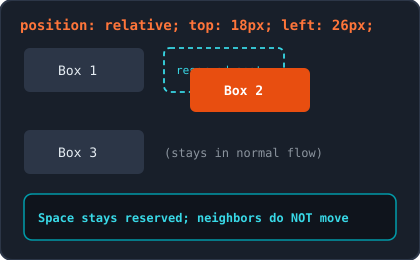
  <p class="caption">Oorspronkelijke plaats blijft gereserveerd in de stroom</p>
</div>
</div>

---

## 1. Positionering: `absolute` & Gouden combinatie

<div class="split-2-1">
<div>

```css
.kaart { position: relative; width: 320px; } /* 1. Ouder als context */
.badge { position: absolute; top: 12px; right: 12px; } /* 2. Kind */
```

- **Verlaat de documentstroom:** neemt geen ruimte meer in (buren schuiven op)
- **Krimpt naar inhoud:** tenzij je `width` (of `left: 0; right: 0;`) instelt
- **Gouden regel:** geef de ouder `position: relative` (zonder `top`/`left`), anders richt het kind zich op `<body>`

</div>
<div class="img-box">
  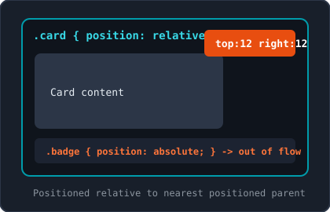
  <p class="caption">Gouden combinatie: relative ouder + absolute kind</p>
</div>
</div>

---

## 1. Positionering: `fixed` vs. `sticky`

<div class="split-2-1">
<div>

- **`fixed`:** richt zich altijd op de **viewport** en blijft staan bij scrollen (vaste menubalk, helpknop)
  - Verlaat stroom: compenseer met `padding-top` op `body`
- **`sticky`:** normale stroom tot drempelwaarde (verplicht `top: 0;`!), daarna vast **binnen zijn ouder**
  - **Valkuil:** werkt niet bij `overflow: hidden` op een voorouder!

</div>
<div class="img-box">
  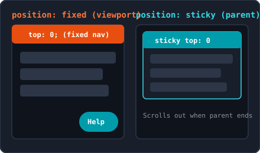
  <p class="caption">fixed t.o.v. scherm vs. sticky binnen oudercontainer</p>
</div>
</div>

---

## 1. Positionering: `z-index`, Emmet & Overzicht

```css
.achtergrond { position: absolute; z-index: 1; }
.voorgrond   { position: absolute; z-index: 10; } /* Alleen actief bij niet-static! */
```

| Waarde | Documentstroom | Referentiepunt | Typische toepassing |
| :--- | :--- | :--- | :--- |
| `static` | Normale ruimte | Geen (`top`/`z-index` genegeerd) | Standaardelementen |
| `relative` | Behoudt ruimte | Zichzelf | Oudercontext voor `absolute` |
| `absolute` | Verlaat stroom | Dichtstbijzijnde gepositioneerde ouder | Badges, sluitknop, overlays |
| `fixed` | Verlaat stroom | Viewport (scherm) | Vaste navbar, chatknop |
| `sticky` | Tot drempelwaarde | Viewport binnen ouder | Klevende sectietitels |

> **Emmet & Tip:** `pos:r`, `pos:a`, `pos:f`, `pos:s`, `z10`. Gebruik bescheiden `z-index`-getallen (`1`, `10`, `100`; ook `-1` kan).

---

## 2. Flexbox: Mentale model (Container vs. Items)

<div class="split-2-1">
<div>

```html
<nav class="navigatie"> <!-- 1. Flex-container (display: flex;) -->
  <a href="#">Home</a>  <!-- 2. Flex-item (direct kind) -->
  <div>
    <span>Info</span>   <!-- GEEN flex-item (kleinkind!) -->
  </div>
</nav>
```

- `display: flex;` op de ouder maakt **enkel directe kinderen** flex-items
- Kleinkinderen vallen niet onder de flex-context (tenzij hun ouder ook `display: flex` krijgt)
- `inline-flex`: zelfde werking, maar container neemt alleen inhoudsbreedte

</div>
<div class="img-box">
  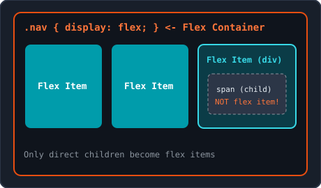
  <p class="caption">Alleen directe kinderen worden flex-items</p>
</div>
</div>

---

## 2. Flexbox: Hoofdas (Main Axis) & Dwarsas (Cross Axis)

<div class="split-2-1">
<div>

### Het belangrijkste inzicht van Flexbox

- Flexbox is **1-dimensionaal**: ordent items langs een hoofdas
- **Hoofdas (Main Axis):** richting waarin items naast/onder elkaar staan -> bestuurd door **`justify-content`**
- **Dwarsas (Cross Axis):** loodrecht op de hoofdas -> bestuurd door **`align-items`** & **`align-self`**
- **Onthoud:** eigenschappen zijn gekoppeld aan de **assen**, niet aan "horizontaal" of "verticaal"!

</div>
<div class="img-box">
  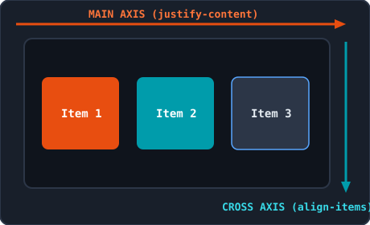
  <p class="caption">justify-content volgt de hoofdas, align-items de dwarsas</p>
</div>
</div>

---

## 2. Flexbox: Richting draaien (`flex-direction`)

<div class="split-2-1">
<div>

```css
.container {
  display: flex;
  flex-direction: column; /* Hoofdas wordt verticaal! */
}
```

- `row` (standaard): links -> rechts
- `row-reverse`: rechts -> links
- `column`: boven -> onder
- `column-reverse`: onder -> boven
- **Gevolg bij `column`:** `justify-content` stuurt nu **verticaal**, `align-items` stuurt **horizontaal**!

</div>
<div class="img-box">
  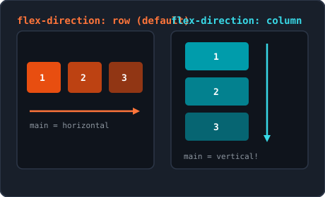
  <p class="caption">Bij flex-direction: column draaien beide assen 90 graden</p>
</div>
</div>

---

## 2. Flexbox: Verdelen langs hoofdas (`justify-content`)

<div class="split-2-1">
<div>

- `flex-start` (standaard): tegen begin van hoofdas
- `center`: gebundeld in het midden
- `flex-end`: tegen einde van hoofdas
- `space-between`: eerste vooraan, laatste achteraan, gelijke gaten ertussen
- `space-around`: gelijke marge links & rechts per item (buitenranden = half)
- `space-evenly`: alle ruimtes vóór, tussen en ná items exact gelijk

</div>
<div class="img-box">
  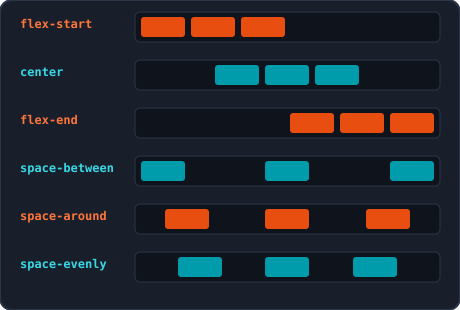
  <p class="caption">De 6 verdelingsopties langs de hoofdas</p>
</div>
</div>

---

## 2. Flexbox: Dwarsas (`align-items`) & `gap`

<div class="split-2-1">
<div>

```css
.rij { display: flex; align-items: center; gap: 1rem; }
```

- **`stretch` (standaard):** items rekken uit tot de volledige hoogte
- **`center`:** gecentreerd op de dwarsas
- **`flex-start` / `flex-end`:** tegen begin of einde van dwarsas
- **`baseline`:** lijnt uit op tekstbasislijn
- **`gap` (`row-gap`, `column-gap`):** tussenruimte **enkel tussen** items, nooit aan buitenranden

</div>
<div class="img-box">
  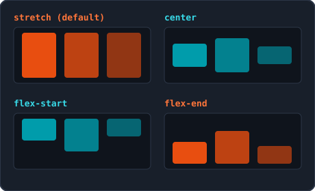
  <p class="caption">Uitlijnen op de dwarsas met align-items</p>
</div>
</div>

---

## 2. Flexbox: Navigatiebalk & Perfect 2D Centreren

<div class="grid-2">
<div class="card card-accent">

#### Klassieke navigatiebalk

Logo links, links rechts en verticaal netjes uitgelijnd:

```css
.hoofdbalk {
  display: flex;
  justify-content: space-between;
  align-items: center;
}
.nav-links {
  display: flex;
  gap: 1.25rem;
}
```

</div>
<div class="card card-cyan">

#### Perfect 2D Centreren

Het klassieke centreringsprobleem opgelost in 3 regels:

```css
.hero-banner {
  height: 240px;
  display: flex;
  justify-content: center; /* Hoofdas */
  align-items: center;     /* Dwarsas */
}
```

</div>
</div>

---

## 2. Flexbox: Meerregelig (`flex-wrap` & `align-content`)

<div class="split-2-1">
<div>

```css
.rooster { display: flex; flex-wrap: wrap; gap: 1.25rem; }
```

- **`nowrap` (standaard):** propt alles op 1 regel (items krimpen)
- **`wrap` / `wrap-reverse`:** springen naar nieuwe regel bij plaatsgebrek
- **`align-items` vs. `align-content`:**
  - `align-items`: lijnt items uit **binnen 1 regel**
  - `align-content`: verdeelt **meerdere regels** t.o.v. elkaar (`stretch`, `center`, `space-between`)

</div>
<div class="img-box">
  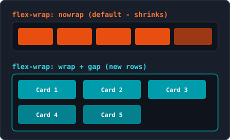
  <p class="caption">Automatisch doorlopen naar nieuwe rijen met flex-wrap</p>
</div>
</div>

---

## 2. Flexbox: Items (`grow`, `shrink` & `basis`)

<div class="split-2-1">
<div>

- **`flex-grow` (standaard `0`):** welk aandeel vrije ruimte het item pakt (`1` vs `2` = dubbel zoveel extra ruimte)
- **`flex-shrink` (standaard `1`):** mate van inkrimpen bij plaatsgebrek (`0` voorkomt krimpen van bv. een logo!)
- **`flex-basis` (standaard `auto`):** ideale startmaat vóór groei/krimp (`200px`, `20rem`, `30%`)

</div>
<div class="img-box">
  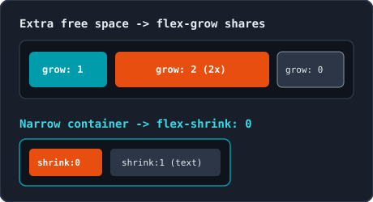
  <p class="caption">Ruimte verdelen met flex-grow en beschermen met flex-shrink: 0</p>
</div>
</div>

---

## 2. Flexbox: Shorthand `flex`, `align-self` & `order`

```css
.item  { flex: 1 1 200px; }       /* <flex-grow> <flex-shrink> <flex-basis> */
.knop  { align-self: flex-start; }/* Overschrijft align-items voor dit ene item */
.eerste { order: -1; }            /* Visuele volgorde wijzigen (standaard = 0) */
```

<div class="grid-2">
<div class="card card-accent">

#### Veelgebruikte `flex` shorthands

- `flex: 1;` (`1 1 0%`): alle items exact even breed
- `flex: auto;` (`1 1 auto`): groeit/krimpt op basis van inhoud
- `flex: 0 0 150px;`: vaste breedte van 150px (groeit en krimpt nooit)

</div>
<div class="card card-cyan">

#### `align-self` & `order` (WCAG)

- `align-self` overschrijft `align-items` voor 1 kind (bv. knop niet uitrekken)
- **Pas op met `order`:** verandert enkel weergave, niet de `Tab`-volgorde voor schermlezers!

</div>
</div>

---

## 2. Flexbox: Responsieve praktijkpatronen

<div class="grid-2">
<div class="card card-accent">

#### Kaartenrooster zonder media queries

```css
.kaarten {
  display: flex;
  flex-wrap: wrap;
  gap: 1.25rem;
}
.kaart {
  flex: 1 1 220px; /* Min. ~220px, groeit mee */
}
```

- Kaarten vloeien automatisch naar een nieuwe rij als het scherm versmalt

</div>
<div class="card card-cyan">

#### Asymmetrische 2-koloms layout

```css
.layout { display: flex; gap: 1.5rem; }
.hoofd  { flex: 2 1 280px; } /* 2/3 ruimte */
.zijbalk {
  flex: 1 1 180px;           /* 1/3 ruimte */
  display: flex; flex-direction: column;
}
.zijbalk .knop { margin-top: auto; align-self: flex-start; }
```

</div>
</div>

---

## 3. Media Queries: Viewport & Syntaxis (`@media`)

```html
<!-- Verplicht in <head>: anders simuleert mobiel ~980px en zoomt piepklein uit -->
<meta name="viewport" content="width=device-width, initial-scale=1.0">
```

```css
@media (min-width: 768px) {
  /* Actief zodra venster minstens 768px breed is (breekpunt / breakpoint) */
  body { background-color: #f8f9fa; }
}
```

<div class="grid-2">
<div class="card card-accent">

#### Viewport-metatag

- `width=device-width`: schermbreedte in CSS-pixels
- `initial-scale=1.0`: start op 100% zoom

</div>
<div class="card card-cyan">

#### Breekpunt (*Breakpoint*)

- Drempelwaarde waarop een `@media`-blok actief wordt
- Ook combinaties mogelijk: `(min-width: 768px) and (max-width: 991px)`

</div>
</div>

---

## 3. Media Queries: Mobile-First vs. Desktop-First

<div class="split-2-1">
<div>

- **Mobile-First (`min-width`):** schrijf eerst de mobiele basis buiten queries, en breid uit vanaf `768px`, `992px`, `1200px`
- **Waarom `max-width` (desktop-first) afraden?**
  - Veel overschrijvingen nodig op mobiel
  - Zwaardere stijlen op tragere mobiele netwerken
  - Logischer om van 1 kolom naar 3 kolommen te groeien
- Ontwerp breekpunten voor **inhoud**, niet per telefoonmerk

</div>
<div class="img-box">
  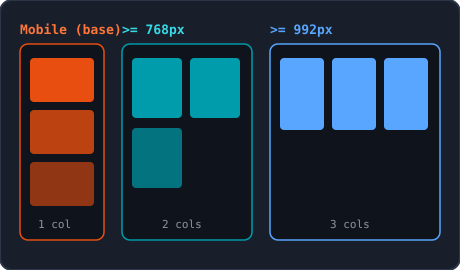
  <p class="caption">Trapsgewijs opschalen: basis -> 768px -> 992px</p>
</div>
</div>

---

## 3. Media Queries: Eén CSS-bestand & Flexbox

```css
/* 1. Reset + basisstijl  2. Mobiel (1 kolom) */
.nav { display: flex; flex-direction: column; gap: 0.5rem; }

/* 3. Tablet (>= 768px) */
@media (min-width: 768px) {
  .nav   { flex-direction: row; }
  .kaart { flex: 0 0 calc(50% - 0.5rem); } /* 2 kolommen met 1rem gap */
}

/* 4. Desktop (>= 992px) */
@media (min-width: 992px) {
  .container { max-width: 1140px; margin: 0 auto; }
  .kaart     { flex: 0 0 calc(33.333% - 0.667rem); } /* 3 kolommen */
}
```

> **Herhaal niets onnodig:** zet in `@media` alleen de eigenschappen die veranderen; kleuren en fonts staan al in de mobiele basis.

---

## 3. Media Queries: Afdrukstijlen met `@media print`

```css
@media print {
  .hoofd-nav, .actie-knop, footer { display: none; } /* Verberg overbodige UI */
  body { background-color: #ffffff; color: #000000; font-size: 12pt; }
  .kaart { border: none; box-shadow: none; }
}
```

<div class="grid-2">
<div class="card card-accent">

#### Richtlijnen voor print

- Verberg navigatie, knoppen en footers
- Zet achtergrond wit en tekst zwart (inktbesparing!)
- Optioneel: toon URL achter links via `a::after { content: " (" attr(href) ")"; }`

</div>
<div class="card card-cyan">

#### Testen zonder printer

- Open afdrukvoorbeeld via `Ctrl + P` (`Cmd + P` op macOS)
- Of in Chrome DevTools -> **Rendering** -> *Emulate CSS media type: print*

</div>
</div>

---

## Samenvatting & Best Practices

<div class="grid-2">
<div class="card card-accent">

#### Positionering & Media Queries

- **Positionering:** `relative` ouder + `absolute` kind; geef `sticky` altijd `top: 0` (zonder `overflow: hidden`); `z-index` werkt enkel op niet-`static`
- **Media Queries:** altijd `<meta name="viewport">`, bouw **mobile-first** met `min-width` in 1 centraal CSS-bestand en voorzie `@media print`

</div>
<div class="card card-cyan">

#### Flexbox in een notendop

- `display: flex` beïnvloedt alleen **directe kinderen**
- `justify-content` = **hoofdas**, `align-items` = **dwarsas** (draaien mee bij `column`)
- Gebruik `gap` voor tussenruimte, `flex-wrap: wrap` voor meerdere rijen en `flex: <grow> <shrink> <basis>` op items

</div>
</div>

---

<!-- _class: lead -->

# Vragen & Aan de Slag!

<p class="subtitle">&lt;Flexibele, responsieve lay-outs onder de knie in Week 5 /&gt;</p>

<div class="meta-box">
  <strong>Volgende stap:</strong> Bouw de labo-opdrachten met positionering, Flexbox en mobile-first media queries
</div>

