<!-- _class: lead -->

# Week 5: CSS Positioning, Flexbox & Media Queries

<p class="subtitle">&lt;Exact placement, flexible alignment, and responsive scaling /&gt;</p>

<div class="meta-box">
  <strong>Thomas More Hogeschool</strong> - Applied Computer Science (ITF)<br>
  <strong>Course:</strong> Web Essentials | <strong>Module:</strong> Week 5
</div>

---

## Agenda

<div class="grid-2">
<div class="card card-accent">

#### Positioning & Flexbox

1. **Positioning** - `static`, `relative`, `absolute`, `fixed`, `sticky` & `z-index`
2. **Flexbox (in depth)** - Container vs. items, axes, distribution & growth

</div>
<div class="card card-cyan">

#### Responsive Web Design

3. **Media Queries** - Viewport meta tag, mobile-first (`min-width`), breakpoints & `@media print`

</div>
</div>

---

## 1. Positioning: `static` vs. `relative`

<div class="split-2-1">
<div>

```css
.announcement {
  position: relative;
  top: 18px;          /* Shifts relative to its own original position */
  left: 26px;
}
```

- **`static` (default):** normal flow; `top`/`left`/`z-index` have **no** effect
- **`relative`:** shifts relative to itself, while **original space stays reserved**
- **Main purpose:** positioning context (*reference frame*) for `absolute` children

</div>
<div class="img-box">
  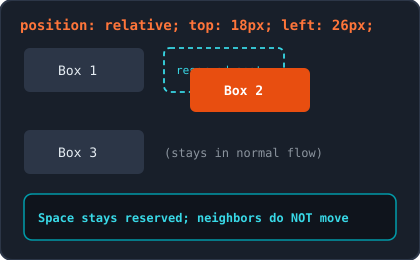
  <p class="caption">Original spot remains reserved in the document flow</p>
</div>
</div>

---

## 1. Positioning: `absolute` & The Golden Combination

<div class="split-2-1">
<div>

```css
.card  { position: relative; width: 320px; } /* 1. Parent as context */
.badge { position: absolute; top: 12px; right: 12px; } /* 2. Child */
```

- **Leaves document flow:** takes up no physical space (neighbors shift over)
- **Shrinks to content:** unless you set `width` (or `left: 0; right: 0;`)
- **Golden rule:** give the parent `position: relative` (without `top`/`left`), otherwise the child aligns to `<body>`

</div>
<div class="img-box">
  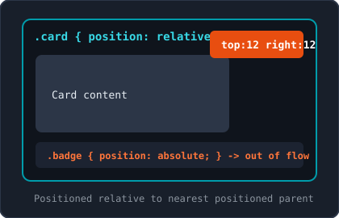
  <p class="caption">Golden combination: relative parent + absolute child</p>
</div>
</div>

---

## 1. Positioning: `fixed` vs. `sticky`

<div class="split-2-1">
<div>

- **`fixed`:** always relative to the **viewport** and stays pinned while scrolling (fixed navbar, help button)
  - Leaves flow: compensate with `padding-top` on `body`
- **`sticky`:** normal flow until threshold (requires `top: 0;`!), then sticks **inside its parent**
  - **Pitfall:** fails when an ancestor has `overflow: hidden`!

</div>
<div class="img-box">
  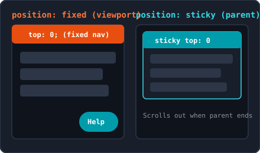
  <p class="caption">fixed relative to screen vs. sticky inside parent container</p>
</div>
</div>

---

## 1. Positioning: `z-index`, Emmet & Overview

```css
.background { position: absolute; z-index: 1; }
.foreground { position: absolute; z-index: 10; } /* Active only on non-static! */
```

| Value | Document Flow | Reference Point | Typical Use Case |
| :--- | :--- | :--- | :--- |
| `static` | Normal space | None (`top`/`z-index` ignored) | Default elements |
| `relative` | Keeps space | Itself | Parent context for `absolute` |
| `absolute` | Leaves flow | Nearest positioned ancestor | Badges, close buttons, overlays |
| `fixed` | Leaves flow | Viewport (screen) | Fixed navbar, chat button |
| `sticky` | Until threshold | Viewport within parent | Sticky section headings |

> **Emmet & Tip:** `pos:r`, `pos:a`, `pos:f`, `pos:s`, `z10`. Keep `z-index` values modest (`1`, `10`, `100`; `-1` also works).

---

## 2. Flexbox: Mental Model (Container vs. Items)

<div class="split-2-1">
<div>

```html
<nav class="navigation"> <!-- 1. Flex container (display: flex;) -->
  <a href="#">Home</a>   <!-- 2. Flex item (direct child) -->
  <div>
    <span>Info</span>    <!-- NOT a flex item (grandchild!) -->
  </div>
</nav>
```

- `display: flex;` on the parent turns **direct children only** into flex items
- Grandchildren are unaffected by the outer flex context (unless their parent also gets `display: flex`)
- `inline-flex`: same behavior, but container takes content width only

</div>
<div class="img-box">
  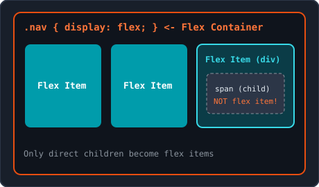
  <p class="caption">Only direct children become flex items</p>
</div>
</div>

---

## 2. Flexbox: Main Axis & Cross Axis

<div class="split-2-1">
<div>

### The Key Insight of Flexbox

- Flexbox is **1-dimensional**: arranges items along a single main line
- **Main Axis:** direction in which items are laid out -> controlled by **`justify-content`**
- **Cross Axis:** perpendicular to the main axis -> controlled by **`align-items`** & **`align-self`**
- **Remember:** properties bind to the **axes**, not to "horizontal" or "vertical"!

</div>
<div class="img-box">
  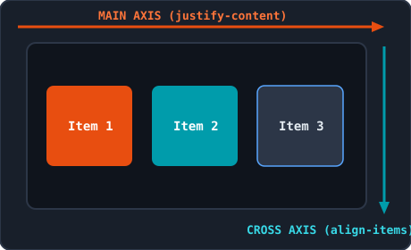
  <p class="caption">justify-content follows the main axis, align-items the cross axis</p>
</div>
</div>

---

## 2. Flexbox: Changing Direction (`flex-direction`)

<div class="split-2-1">
<div>

```css
.container {
  display: flex;
  flex-direction: column; /* Main axis becomes vertical! */
}
```

- `row` (default): left -> right
- `row-reverse`: right -> left
- `column`: top -> bottom
- `column-reverse`: bottom -> top
- **Result with `column`:** `justify-content` now controls **vertical**, `align-items` controls **horizontal**!

</div>
<div class="img-box">
  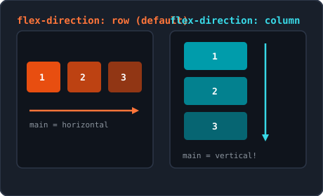
  <p class="caption">With flex-direction: column both axes rotate 90 degrees</p>
</div>
</div>

---

## 2. Flexbox: Distributing Along Main Axis (`justify-content`)

<div class="split-2-1">
<div>

- `flex-start` (default): packed at the start of the main axis
- `center`: grouped in the center
- `flex-end`: packed at the end of the main axis
- `space-between`: first at start, last at end, equal gaps between items
- `space-around`: equal left & right space per item (outer edges = half)
- `space-evenly`: all gaps before, between, and after items are equal

</div>
<div class="img-box">
  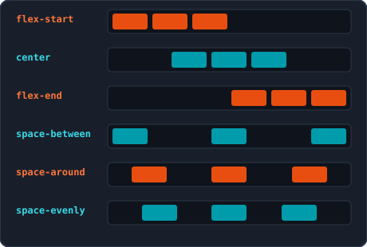
  <p class="caption">The 6 distribution options along the main axis</p>
</div>
</div>

---

## 2. Flexbox: Cross Axis (`align-items`) & `gap`

<div class="split-2-1">
<div>

```css
.row { display: flex; align-items: center; gap: 1rem; }
```

- **`stretch` (default):** items stretch to fill the full cross height
- **`center`:** centered along the cross axis
- **`flex-start` / `flex-end`:** aligned to start or end of cross axis
- **`baseline`:** aligns along text baselines
- **`gap` (`row-gap`, `column-gap`):** spacing **between** items only, never on outer edges

</div>
<div class="img-box">
  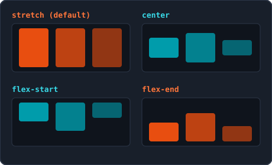
  <p class="caption">Aligning on the cross axis with align-items</p>
</div>
</div>

---

## 2. Flexbox: Navbar & Perfect 2D Centering

<div class="grid-2">
<div class="card card-accent">

#### Classic Navigation Bar

Logo left, links right, and cleanly centered vertically:

```css
.navbar {
  display: flex;
  justify-content: space-between;
  align-items: center;
}
.nav-links {
  display: flex;
  gap: 1.25rem;
}
```

</div>
<div class="card card-cyan">

#### Perfect 2D Centering

The classic centering challenge solved in 3 lines:

```css
.hero-banner {
  height: 240px;
  display: flex;
  justify-content: center; /* Main axis */
  align-items: center;     /* Cross axis */
}
```

</div>
</div>

---

## 2. Flexbox: Multi-Line Rows (`flex-wrap` & `align-content`)

<div class="split-2-1">
<div>

```css
.grid { display: flex; flex-wrap: wrap; gap: 1.25rem; }
```

- **`nowrap` (default):** forces everything onto 1 line (items shrink)
- **`wrap` / `wrap-reverse`:** wraps onto a new line when space runs out
- **`align-items` vs. `align-content`:**
  - `align-items`: aligns items **within 1 row**
  - `align-content`: distributes **multiple rows** relative to each other (`stretch`, `center`, `space-between`)

</div>
<div class="img-box">
  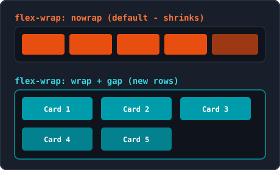
  <p class="caption">Wrapping onto new rows automatically with flex-wrap</p>
</div>
</div>

---

## 2. Flexbox: Items (`grow`, `shrink` & `basis`)

<div class="split-2-1">
<div>

- **`flex-grow` (default `0`):** share of remaining free space (`1` vs `2` = twice as much extra space)
- **`flex-shrink` (default `1`):** shrink ratio when tight (`0` prevents shrinking e.g. a logo!)
- **`flex-basis` (default `auto`):** ideal starting size before growing/shrinking (`200px`, `20rem`, `30%`)

</div>
<div class="img-box">
  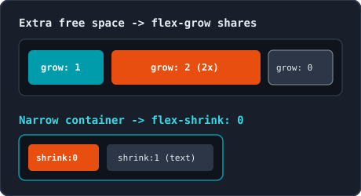
  <p class="caption">Distributing space with flex-grow and protecting with flex-shrink: 0</p>
</div>
</div>

---

## 2. Flexbox: Shorthand `flex`, `align-self` & `order`

```css
.item  { flex: 1 1 200px; }       /* <flex-grow> <flex-shrink> <flex-basis> */
.btn   { align-self: flex-start; }/* Overrides align-items for this single item */
.first { order: -1; }             /* Changes visual order (default = 0) */
```

<div class="grid-2">
<div class="card card-accent">

#### Common `flex` Shorthands

- `flex: 1;` (`1 1 0%`): all items get equal width
- `flex: auto;` (`1 1 auto`): grows/shrinks based on content
- `flex: 0 0 150px;`: fixed 150px width (never grows or shrinks)

</div>
<div class="card card-cyan">

#### `align-self` & `order` (WCAG)

- `align-self` overrides `align-items` for 1 child (e.g. keep button unstretched)
- **Watch out with `order`:** changes visual display only, not `Tab` order for screen readers!

</div>
</div>

---

## 2. Flexbox: Responsive Real-World Patterns

<div class="grid-2">
<div class="card card-accent">

#### Card Grid Without Media Queries

```css
.cards {
  display: flex;
  flex-wrap: wrap;
  gap: 1.25rem;
}
.card {
  flex: 1 1 220px; /* Min. ~220px, grows to fill */
}
```

- Cards wrap onto a new row automatically as the screen narrows

</div>
<div class="card card-cyan">

#### Asymmetric 2-Column Layout

```css
.layout  { display: flex; gap: 1.5rem; }
.main    { flex: 2 1 280px; } /* 2/3 space */
.sidebar {
  flex: 1 1 180px;            /* 1/3 space */
  display: flex; flex-direction: column;
}
.sidebar .btn { margin-top: auto; align-self: flex-start; }
```

</div>
</div>

---

## 3. Media Queries: Viewport & Syntax (`@media`)

```html
<!-- Required in <head>: otherwise mobile simulates ~980px and zooms way out -->
<meta name="viewport" content="width=device-width, initial-scale=1.0">
```

```css
@media (min-width: 768px) {
  /* Active once the viewport is at least 768px wide (breakpoint) */
  body { background-color: #f8f9fa; }
}
```

<div class="grid-2">
<div class="card card-accent">

#### Viewport Meta Tag

- `width=device-width`: sets screen width in CSS pixels
- `initial-scale=1.0`: starts at 100% zoom

</div>
<div class="card card-cyan">

#### Breakpoint

- Threshold at which an `@media` block activates
- Combinations work too: `(min-width: 768px) and (max-width: 991px)`

</div>
</div>

---

## 3. Media Queries: Mobile-First vs. Desktop-First

<div class="split-2-1">
<div>

- **Mobile-First (`min-width`):** write mobile base styles outside queries first, then expand at `768px`, `992px`, `1200px`
- **Why avoid `max-width` (desktop-first)?**
  - Many overrides needed for mobile
  - Heavier styles on slower mobile networks
  - Cleaner to scale from 1 column up to 3 columns
- Pick breakpoints based on **content**, not phone brands

</div>
<div class="img-box">
  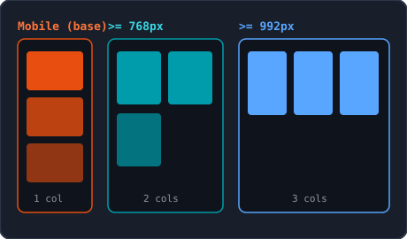
  <p class="caption">Progressive scaling: base -> 768px -> 992px</p>
</div>
</div>

---

## 3. Media Queries: Single Stylesheet & Flexbox

```css
/* 1. Reset + base  2. Mobile (1 column) */
.nav { display: flex; flex-direction: column; gap: 0.5rem; }

/* 3. Tablet (>= 768px) */
@media (min-width: 768px) {
  .nav  { flex-direction: row; }
  .card { flex: 0 0 calc(50% - 0.5rem); } /* 2 columns with 1rem gap */
}

/* 4. Desktop (>= 992px) */
@media (min-width: 992px) {
  .container { max-width: 1140px; margin: 0 auto; }
  .card      { flex: 0 0 calc(33.333% - 0.667rem); } /* 3 columns */
}
```

> **Avoid duplication:** inside `@media`, only repeat properties that actually change; colors and fonts already live in the mobile base.

---

## 3. Media Queries: Print Styles with `@media print`

```css
@media print {
  .main-nav, .action-btn, footer { display: none; } /* Hide unnecessary UI */
  body { background-color: #ffffff; color: #000000; font-size: 12pt; }
  .card { border: none; box-shadow: none; }
}
```

<div class="grid-2">
<div class="card card-accent">

#### Print Guidelines

- Hide navigation, buttons, and footers
- Set white background and black text (saves ink!)
- Optional: show link URLs via `a::after { content: " (" attr(href) ")"; }`

</div>
<div class="card card-cyan">

#### Testing Without a Printer

- Open print preview with `Ctrl + P` (`Cmd + P` on macOS)
- Or Chrome DevTools -> **Rendering** -> *Emulate CSS media type: print*

</div>
</div>

---

## Summary & Best Practices

<div class="grid-2">
<div class="card card-accent">

#### Positioning & Media Queries

- **Positioning:** `relative` parent + `absolute` child; always give `sticky` `top: 0` (no `overflow: hidden`); `z-index` only works on non-`static`
- **Media Queries:** always include `<meta name="viewport">`, build **mobile-first** with `min-width` in 1 stylesheet, and add `@media print`

</div>
<div class="card card-cyan">

#### Flexbox in a Nutshell

- `display: flex` affects **direct children** only
- `justify-content` = **main axis**, `align-items` = **cross axis** (they swap with `column`)
- Use `gap` for spacing, `flex-wrap: wrap` for multi-line rows, and `flex: <grow> <shrink> <basis>` on items

</div>
</div>

---

<!-- _class: lead -->

# Questions & Let's Get Started!

<p class="subtitle">&lt;Mastering flexible, responsive layouts in Week 5 /&gt;</p>

<div class="meta-box">
  <strong>Next step:</strong> Build the lab exercises using positioning, Flexbox, and mobile-first media queries
</div>

