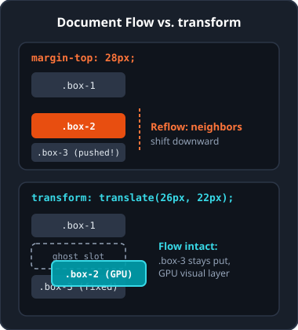
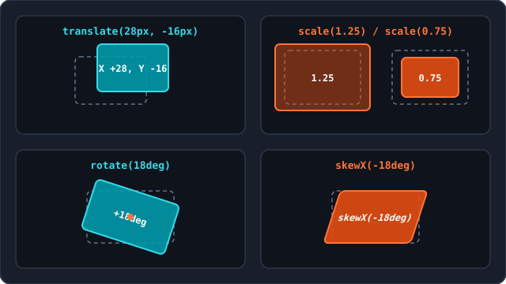
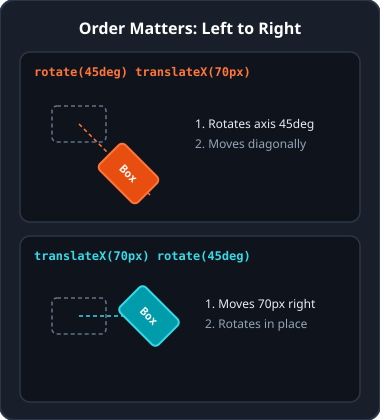
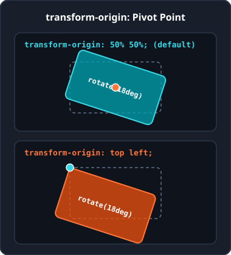
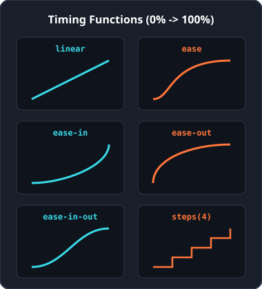
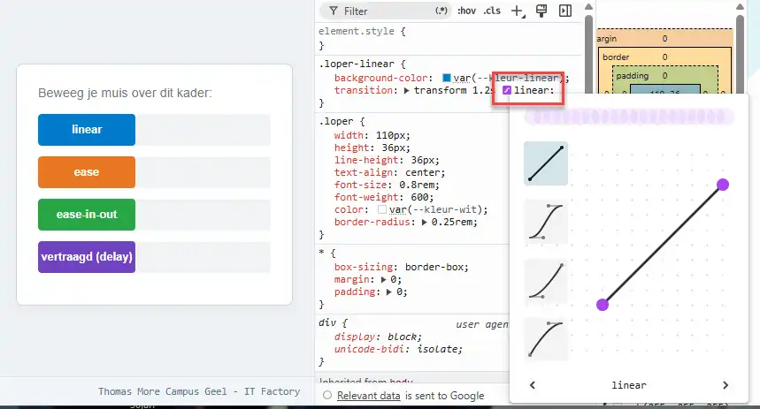
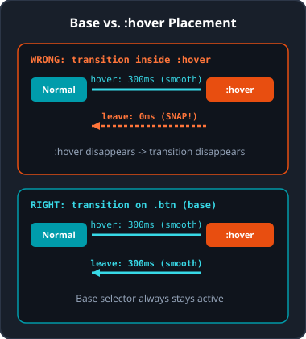
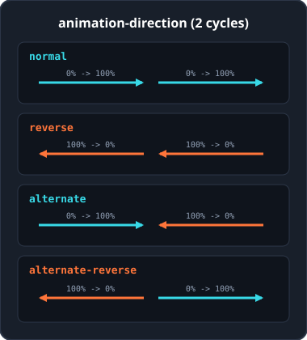
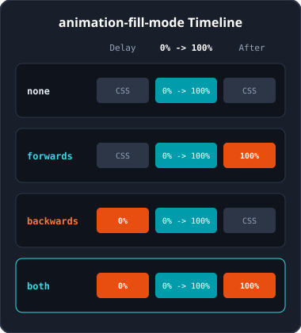

<!-- _class: lead -->

# Week 6: 2D-transformaties, transities en animaties

<p class="subtitle">&lt;Elementen vervormen, vloeiend overvloeien en animeren met CSS /&gt;</p>

<div class="meta-box">
  <strong>Thomas More Hogeschool</strong> - Toegepaste Informatica (ITF)<br>
  <strong>Vak:</strong> Web Essentials | <strong>Module:</strong> Week 6
</div>

---

## Overzicht van Week 6

<div class="grid-3">

<div class="card card-accent">

<span class="badge">Deel 1</span>

### 2D-transformaties

- `translate()`, `scale()`, `rotate()`, `skew()`
- Meerdere methoden combineren
- Ankerpunt met `transform-origin`

</div>

<div class="card card-cyan">

<span class="badge badge-cyan">Deel 2</span>

### CSS-transities

- Overgang tussen toestanden (`:hover`)
- Duur, vertraging en timingfuncties
- `transition`-shorthand en interacties

</div>

<div class="card">

<span class="badge badge-outline">Deel 3</span>

### CSS-animaties

- Tijdlijnen met `@keyframes`
- Herhaling, richting en `fill-mode`
- `prefers-reduced-motion`

</div>

</div>

---

<!-- _class: lead -->

<span class="badge">Deel 1</span>

# 2D-transformaties

<p class="subtitle">Verplaatsen, schalen, draaien en schuin trekken zonder de documentstroom te verstoren</p>

---

## Wat is een 2D-transformatie?

<div class="split-2-1">

<div>

- **Documentstroom blijft intact:** het element behoudt zijn gereserveerde plaats op de pagina; buren schuiven niet mee.
- **GPU-versneld:** de browser tekent het getransformeerde element als een aparte visuele laag.
- **Vier basismethoden:** `translate()`, `scale()`, `rotate()` en `skew()`.

```css
selector {
  transform: methode(waarde);
}
```

</div>

<div class="img-box">



</div>

</div>

---

## Elementen verplaatsen: `translate()`

<div class="grid-2">

<div class="card">

### Assen en richtingen

- `translate(x, y)`: verplaatst over X en Y.
- Positief: naar rechts (X) of omlaag (Y).
- Negatief: naar links (X) of omhoog (Y).
- Eén argument `translate(20px)` verschuift enkel horizontaal (`Y = 0`).

```css
.blok { transform: translate(20px, 10px); }
.knop { transform: translateX(1.5rem); }
.kaart { transform: translateY(-8px); }
```

</div>

<div class="card card-cyan">

### Percentages & centreren

Percentages verwijzen naar de **eigen afmetingen** van het element, niet naar het ouderelement.

```css
.gecentreerd {
  position: absolute;
  top: 50%;
  left: 50%;
  transform: translate(-50%, -50%);
}
```

Ideaal om elementen met onbekende breedte of hoogte exact te centreren.

</div>

</div>

---

## Schalen en spiegelen: `scale()`

<div class="grid-2">

<div class="card">

### Vergroten en verkleinen

- `> 1`: vergroten (`1.15` = 15% groter).
- `0` tot `1`: verkleinen (`0.8` = 20% kleiner).
- `1`: oorspronkelijke grootte (100%).

```css
.knop:hover { transform: scale(1.15); }
.banner     { transform: scale(1.2, 0.8); }
.balk       { transform: scaleX(1.5); }
.kolom      { transform: scaleY(0.7); }
```

</div>

<div class="card card-accent">

### Spiegelen met negatieve waarden

Een negatieve factor keert het element visueel om langs de gekozen as.

```css
/* Horizontale spiegeling */
.icoon-terug {
  transform: scaleX(-1);
}
```

Let op: ook tekst of pijlen binnen het element worden mee gespiegeld.

</div>

</div>

---

## Elementen draaien: `rotate()`

<div class="grid-2">

<div class="card">

### Graden en omwentelingen

- Positief: draaien **met de klok mee**.
- Negatief: draaien **tegen de klok in**.
- `deg`: `360deg` is één volledige cirkel.
- `turn`: `1turn` is een volledige cirkel (`0.25turn` = `90deg`).

```css
.badge { transform: rotate(15deg); }
.label { transform: rotate(-0.25turn); }
```

</div>

<div class="card card-accent">

### Vergeet de eenheid niet

Enkel `0` mag zonder eenheid (`rotate(0)`). Alle andere hoeken vereisen `deg` of `turn`.

```css
/* FOUT: genegeerd door browser */
.fout { transform: rotate(45); }

/* GOED */
.goed { transform: rotate(45deg); }
```

</div>

</div>

---

## Schuin trekken (`skew()`) & overzicht

<div class="split-1-2">

<div class="card">

### Parallellogram-effect

`skewX()`, `skewY()` en `skew(x, y)` vervormen hoeken langs de assen.

```css
.actielabel {
  transform: skewX(-12deg);
}
.actielabel span {
  display: inline-block;
  transform: skewX(12deg);
}
```

Met tegengestelde hoek zet je de binnenste tekst weer recht.

</div>

<div class="img-box">



</div>

</div>

---

## Meerdere transformaties combineren

<div class="split-2-1">

<div>

### Scheiden met een spatie

Plaats meerdere methoden na elkaar met een **spatie**, nooit met een komma of aparte `transform`-regels.

```css
/* GOED: één regel met spaties */
.kaart:hover {
  transform: translateY(-6px) scale(1.05) rotate(2deg);
}
```

### Volgorde bepaalt het resultaat

Transformaties werken van **links naar rechts** en draaien het lokale assenstelsel mee: `rotate()` voor `translateX()` verplaatst diagonaal.

</div>

<div class="img-box">



</div>

</div>

---

## Het ankerpunt verleggen: `transform-origin`

<div class="split-2-1">

<div>

Standaard draait en schaalt elk element rond zijn exacte middelpunt (`50% 50%` of `center center`).

- **Sleutelwoorden:** `top`, `bottom`, `left`, `right`, `center`.
- **Lengtes of percentages:** `0 0`, `100% 100%`, `20px 50px`.

```css
.uithangbord {
  transform-origin: top left;
  transform: rotate(15deg);
}
.pilaar:hover {
  transform-origin: bottom center;
  transform: scaleY(1.3);
}
```

</div>

<div class="img-box">



</div>

</div>

---

## 2D-transformaties: valkuilen & Emmet

<div class="grid-2">

<div class="card card-accent">

### Veelgemaakte fouten & tips

- **Komma's gebruiken:** schrijf spaties tussen methoden.
- **Twee `transform`-regels:** de tweede overschrijft de eerste volledig.
- **Geen eenheid bij `rotate`/`skew`:** `45` werkt niet, `45deg` wel.
- **Zweefeffect:** gebruik `transform: translateY(-4px)` i.p.v. negatieve `margin-top`.

</div>

<div>

### Emmet in PhpStorm

| Sneltoets | Resultaat |
| :--- | :--- |
| `trf` + TAB | `transform: ;` |
| `trf:t` + TAB | `transform: translate();` |
| `trf:tx` / `trf:ty` | `translateX()` / `translateY()` |
| `trf:r` + TAB | `transform: rotate();` |
| `trf:sc` + TAB | `transform: scale();` |
| `trfo` + TAB | `transform-origin: ;` |

</div>

</div>

---

<!-- _class: lead -->

<span class="badge badge-cyan">Deel 2</span>

# CSS-transities

<p class="subtitle">Stijlwijzigingen geleidelijk en soepel laten verlopen bij gebruikersinteractie</p>

---

## Wat is een CSS-transitie?

<div class="grid-2">

<div class="card">

### Overgang tussen twee toestanden

Zonder `transition` springt een stijl in 0ms over. Met een transitie berekent de browser tussenstappen bij:

- `:hover` (cursor over element)
- `:focus` en `:focus-visible` (toetsenbord/klik)
- `:active` (knop ingedrukt)
- Dynamisch toegevoegde of verwijderde CSS-klasse

</div>

<div class="card card-cyan">

### Wel of niet animeerbaar?

- **Wel animeerbaar:** meetbare waarden zoals kleuren, lengtes, `opacity`, `transform`, `box-shadow`.
- **Niet animeerbaar:** discrete waarden zoals `display: none` naar `block` of `font-family`.
- **Prestatietip:** `transform` en `opacity` draaien direct op de GPU zonder pagina-herberekening.

</div>

</div>

---

## De transitie-eigenschappen (1/2)

<div class="grid-2">

<div class="card">

### `transition-property`

Bepaalt **welke** eigenschap vloeiend verandert (scheid meerdere met komma's).

```css
.kaart {
  transition-property: background-color, transform;
}
```

Beperk `all`: dit controleert onnodig veel eigenschappen en kan toekomstige stijlen ongewild mee animeren.

</div>

<div class="card">

### `transition-duration` & `delay`

- `transition-duration`: duur in `s` of `ms` (zonder duur of `0s` is er geen overgang).
- `transition-delay`: wachttijd voor de start (standaard `0s`).

```css
.tooltip {
  transition-duration: 300ms;
  transition-delay: 200ms;
}
```

</div>

</div>

---

## Snelheidsverloop: `transition-timing-function`

<div class="split-2-1">

<div>

| Waarde | Snelheidsverloop |
| :--- | :--- |
| `ease` | Traag begin, sneller midden, zacht einde (standaard) |
| `linear` | Volledig constante snelheid |
| `ease-in` | Start traag en versnelt naar het einde |
| `ease-out` | Start snel en remt zacht af |
| `ease-in-out` | Traag begin, sneller midden, traag einde |
| `steps(n)` | Vaste discrete sprongen |

</div>

<div class="img-box">



</div>

</div>

---

## Eigen curves & DevTools-editor

<div class="split-1-2">

<div class="card card-cyan">

### `cubic-bezier(x1, y1, x2, y2)`

Voor volledige controle definieer je een eigen Bézier-kromme als timingfunctie.

- Inspecteer een element in Chrome of Firefox DevTools.
- Klik op het kromme-icoontje naast de timingfunctie om de curve live visueel af te stellen.

</div>

<div class="img-box">



</div>

</div>

---

## De `transition`-shorthand

<div class="grid-2">

<div class="card">

### Syntaxis en minimale vorm

Volgorde: `eigenschap duur timing vertraging`.

```css
.knop {
  transition: background-color 300ms ease 50ms;
}
/* Enkel duur = all 300ms ease 0s */
.snel { transition: 300ms; }
```

**Gouden regel:** 1e tijdseenheid = `duration`, 2e tijdseenheid = `delay`.

</div>

<div class="card card-cyan">

### Meerdere eigenschappen

Scheid afzonderlijke transities met een komma voor verschillende tijden per eigenschap.

```css
.kaart {
  transition:
    background-color 200ms ease,
    transform 350ms ease-out;
}
```

Vuistregel voor knoppen: `150ms` tot `350ms`.

</div>

</div>

---

## Basistoestand vs. `:hover` & ouder-element

<div class="split-2-1">

<div>

### Altijd op de basisklasse

Zet `transition` op `.knop`, niet enkel op `.knop:hover`. Anders klapt het element bij het verlaten abrupt terug in 0ms.

### Reageren via een ouder-element

```css
.kaart .actieknop {
  transition: background-color 250ms ease, transform 250ms ease;
}
.kaart:hover .actieknop {
  background-color: #0056b3;
  transform: scale(1.05);
}
```

</div>

<div class="img-box">



</div>

</div>

---

## Toegankelijkheid, fouten & Emmet (transities)

<div class="grid-2">

<div class="card">

### `prefers-reduced-motion`

Respecteer gebruikers met evenwichtsgevoeligheid via de systeemvoorkeur:

```css
@media (prefers-reduced-motion: reduce) {
  * {
    transition-duration: 0.01ms !important;
  }
}
```

Veelgemaakte fouten: eenheid vergeten (`300` i.p.v. `300ms`), of `display: none` proberen te animeren.

</div>

<div>

### Emmet in PhpStorm

| Sneltoets | Resultaat |
| :--- | :--- |
| `trs` + TAB | `transition: ;` |
| `trsp` + TAB | `transition-property: ;` |
| `trsdu` + TAB | `transition-duration: ;` |
| `trstf` + TAB | `transition-timing-function: ;` |
| `trsde` + TAB | `transition-delay: ;` |

</div>

</div>

---

<!-- _class: lead -->

<span class="badge">Deel 3</span>

# CSS-animaties

<p class="subtitle">Zelfstandig lopende tijdlijnen met meerdere tussenstappen en volledige regie</p>

---

## Transitie vs. animatie & bouwstenen

<div class="grid-2">

<div class="card">

### Wanneer wat gebruiken?

- **Transitie:** vereist een toestandswijziging (`:hover`, `:focus`) en beweegt van staat A naar staat B.
- **Animatie:** start automatisch bij het laden, ondersteunt meerdere tussenstappen en kan oneindig herhalen.

</div>

<div class="card card-accent">

### De twee bouwstenen

1. **Tijdlijn (`@keyframes`):** legt vast welke stijlen op welk moment gelden.
2. **Toewijzing (`animation-*`):** koppelt de tijdlijn aan één of meer HTML-elementen.

Eén `@keyframes`-definitie kan je op meerdere elementen hergebruiken.

</div>

</div>

---

## De tijdlijn definiëren: `@keyframes`

<div class="grid-2">

<div class="card">

### Eenvoudig met `from` en `to`

`from` komt overeen met `0%` en `to` met `100%`.

```css
@keyframes oplichten {
  from { opacity: 0.5; }
  to   { opacity: 1; }
}
```

</div>

<div class="card card-cyan">

### Percentages & rustpunten

Groepeer percentages met een komma om een stijl tijdelijk vast te houden.

```css
@keyframes knipperen {
  0%, 100% { opacity: 1; }
  40%, 60% { opacity: 0.2; }
}
```

Tussen `40%` en `60%` blijft `opacity` constant op `0.2`.

</div>

</div>

---

## Naam, duur, herhaling & vertraging

<div class="grid-2">

<div class="card">

### Minimale vereisten & herhaling

- `animation-name`: exacte naam van `@keyframes` (hoofdlettergevoelig).
- `animation-duration`: duur in `s` of `ms` (verplicht, standaard `0s`).
- `animation-iteration-count`: aantal (`1`, `2.5`, `3`) of `infinite`.

```css
.laadicoon {
  animation-name: draaien;
  animation-duration: 1s;
  animation-iteration-count: infinite;
}
```

</div>

<div class="card card-accent">

### `animation-timing-function` & `delay`

- Timingfuncties (`ease`, `linear`, `ease-in-out`, `steps(n)`) werken net als bij transities.
- `animation-delay`: wachttijd **enkel vóór de eerste start**, nooit tussen herhalingen onderling.

Wil je een pauze tussen herhalingen? Bouw dan een rustpunt in binnen `@keyframes`.

</div>

</div>

---

## Afspeelrichting: `animation-direction`

<div class="split-2-1">

<div>

| Waarde | Looprichting per cyclus |
| :--- | :--- |
| `normal` | Van `0%` naar `100%` (standaard) |
| `reverse` | Omgekeerd van `100%` naar `0%` |
| `alternate` | `0%` naar `100%`, daarna terug naar `0%` |
| `alternate-reverse` | `100%` naar `0%`, daarna terug naar `100%` |

Combineer `infinite` met `alternate` voor schokvrije heen-en-weer-animaties zonder terugsprong.

</div>

<div class="img-box">



</div>

</div>

---

## Toestand voor en na: `animation-fill-mode`

<div class="split-2-1">

<div>

| Waarde | Tijdens delay | Na afloop |
| :--- | :--- | :--- |
| `none` | Basis-CSS | Basis-CSS (standaard) |
| `forwards` | Basis-CSS | Blijft op `100%` staan |
| `backwards` | Neemt `0%` aan | Basis-CSS |
| `both` | Neemt `0%` aan | Blijft op `100%` staan |

Gebruik `forwards` als een inschuivend element na afloop op zijn eindpositie moet blijven staan.

</div>

<div class="img-box">



</div>

</div>

---

## Pauzeren, `animation`-shorthand & spinner

<div class="grid-2">

<div class="card">

### `animation-play-state` & shorthand

Volgorde: `naam duur timing delay count direction fill`. (1e tijd = duur, 2e = delay).

```css
.status-bol {
  animation: pulseren 1.5s ease-in-out 200ms infinite alternate both;
}
.status-bol:hover {
  animation-play-state: paused;
}
```

</div>

<div class="card card-cyan">

### Praktijkvoorbeeld: spinner

```css
@keyframes spin {
  from { transform: rotate(0deg); }
  to   { transform: rotate(360deg); }
}

.spinner {
  width: 40px; height: 40px;
  border: 4px solid #2c3647;
  border-top-color: #009cab;
  border-radius: 50%;
  animation: spin 0.8s linear infinite;
}
```

</div>

</div>

---

## Toegankelijkheid, fouten & Emmet (animaties)

<div class="grid-2">

<div class="card">

### `prefers-reduced-motion` & valkuilen

```css
@media (prefers-reduced-motion: reduce) {
  * {
    animation-duration: 0.01ms !important;
    animation-iteration-count: 1 !important;
  }
}
```

- Vergeten `animation-duration` in te stellen.
- Typfout of hoofdletterverschil in keyframenaam.
- `forwards` vergeten bij eenmalige animaties.

</div>

<div>

### Emmet in PhpStorm

| Sneltoets | Resultaat |
| :--- | :--- |
| `@kf` + TAB | `@keyframes identifier { }` |
| `anim` + TAB | `animation: ;` |
| `animn` / `animdur` | `animation-name` / `duration` |
| `animic` + TAB | `animation-iteration-count: ;` |
| `animdir` + TAB | `animation-direction: ;` |
| `animfm` + TAB | `animation-fill-mode: ;` |
| `animps` + TAB | `animation-play-state: ;` |

</div>

</div>

