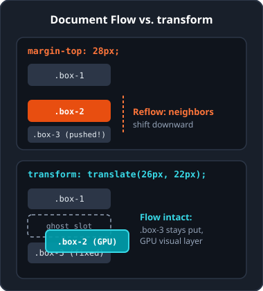
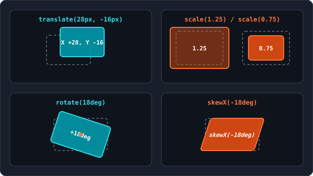
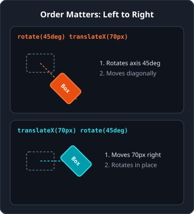
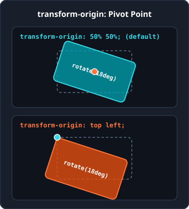
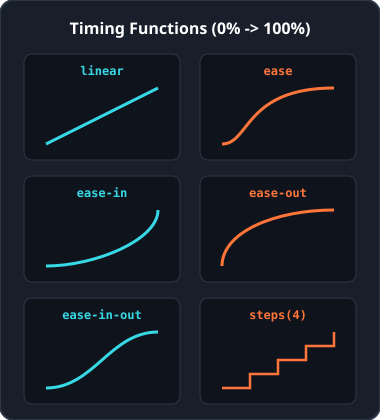
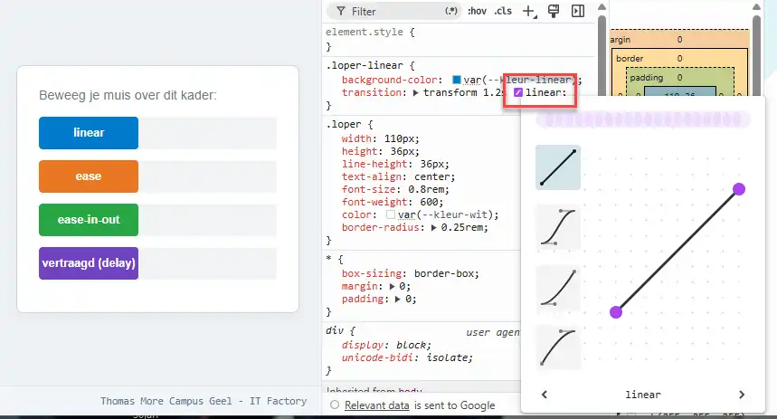
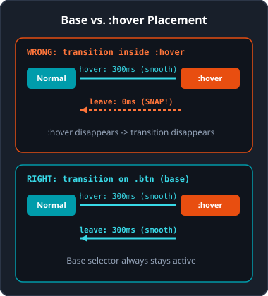
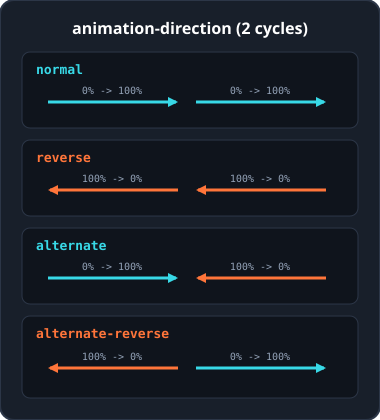
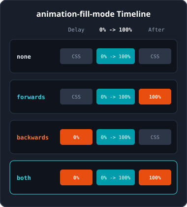

<!-- _class: lead -->

# Week 6: 2D Transforms, Transitions, and Animations

<p class="subtitle">&lt;Distort elements, create smooth transitions, and animate with CSS /&gt;</p>

<div class="meta-box">
  <strong>Thomas More Hogeschool</strong> - Applied Computer Science (ITF)<br>
  <strong>Course:</strong> Web Essentials | <strong>Module:</strong> Week 6
</div>

---

## Overview of Week 6

<div class="grid-3">

<div class="card card-accent">

<span class="badge">Part 1</span>

### 2D Transforms

- `translate()`, `scale()`, `rotate()`, `skew()`
- Combining multiple methods
- Pivot point with `transform-origin`

</div>

<div class="card card-cyan">

<span class="badge badge-cyan">Part 2</span>

### CSS Transitions

- Transitioning between states (`:hover`)
- Duration, delay, and timing functions
- `transition` shorthand and interactions

</div>

<div class="card">

<span class="badge badge-outline">Part 3</span>

### CSS Animations

- Timelines with `@keyframes`
- Iteration, direction, and `fill-mode`
- `prefers-reduced-motion`

</div>

</div>

---

<!-- _class: lead -->

<span class="badge">Part 1</span>

# 2D Transforms

<p class="subtitle">Translate, scale, rotate, and skew without disrupting the document flow</p>

---

## What is a 2D transform?

<div class="split-2-1">

<div>

- **Document flow stays intact:** the element keeps its reserved slot on the page; neighboring elements do not shift.
- **GPU-accelerated:** the browser draws the transformed element as a separate visual layer.
- **Four core methods:** `translate()`, `scale()`, `rotate()`, and `skew()`.

```css
selector {
  transform: method(value);
}
```

</div>

<div class="img-box">



</div>

</div>

---

## Moving elements: `translate()`

<div class="grid-2">

<div class="card">

### Axes and directions

- `translate(x, y)`: moves along X and Y.
- Positive: right (X) or down (Y).
- Negative: left (X) or up (Y).
- One argument `translate(20px)` moves horizontally only (`Y = 0`).

```css
.block { transform: translate(20px, 10px); }
.btn   { transform: translateX(1.5rem); }
.card  { transform: translateY(-8px); }
```

</div>

<div class="card card-cyan">

### Percentages & centering

Percentages refer to the element's **own dimensions**, not to the parent element.

```css
.centered {
  position: absolute;
  top: 50%;
  left: 50%;
  transform: translate(-50%, -50%);
}
```

Ideal for centering elements of unknown width or height accurately.

</div>

</div>

---

## Scaling and mirroring: `scale()`

<div class="grid-2">

<div class="card">

### Enlarging and shrinking

- `> 1`: enlarge (`1.15` = 15% larger).
- `0` to `1`: shrink (`0.8` = 20% smaller).
- `1`: original size (100%).

```css
.btn:hover { transform: scale(1.15); }
.banner    { transform: scale(1.2, 0.8); }
.bar       { transform: scaleX(1.5); }
.column    { transform: scaleY(0.7); }
```

</div>

<div class="card card-accent">

### Mirroring with negative values

A negative factor visually flips the element along the chosen axis.

```css
/* Horizontal mirror */
.icon-back {
  transform: scaleX(-1);
}
```

Note: text or arrows inside the element are mirrored along with it.

</div>

</div>

---

## Rotating elements: `rotate()`

<div class="grid-2">

<div class="card">

### Degrees and turns

- Positive: rotate **clockwise**.
- Negative: rotate **counter-clockwise**.
- `deg`: `360deg` is one full circle.
- `turn`: `1turn` is one full circle (`0.25turn` = `90deg`).

```css
.badge { transform: rotate(15deg); }
.label { transform: rotate(-0.25turn); }
```

</div>

<div class="card card-accent">

### Do not forget the unit

Only `0` can be written without a unit (`rotate(0)`). All other angles require `deg` or `turn`.

```css
/* WRONG: ignored by browser */
.wrong { transform: rotate(45); }

/* RIGHT */
.right { transform: rotate(45deg); }
```

</div>

</div>

---

## Skewing (`skew()`) & overview

<div class="split-1-2">

<div class="card">

### Parallelogram effect

`skewX()`, `skewY()`, and `skew(x, y)` slant corners along the axes.

```css
.promo-label {
  transform: skewX(-12deg);
}
.promo-label span {
  display: inline-block;
  transform: skewX(12deg);
}
```

Use the opposite angle on inner text to keep it straight and readable.

</div>

<div class="img-box">



</div>

</div>

---

## Combining multiple transforms

<div class="split-2-1">

<div>

### Separate with a space

List multiple methods one after another separated by a **space**, never with a comma or separate `transform` declarations.

```css
/* RIGHT: single rule with spaces */
.card:hover {
  transform: translateY(-6px) scale(1.05) rotate(2deg);
}
```

### Order determines the result

Transforms run from **left to right** and rotate the local coordinate system too: `rotate()` before `translateX()` moves diagonally.

</div>

<div class="img-box">



</div>

</div>

---

## Moving the pivot point: `transform-origin`

<div class="split-2-1">

<div>

By default, every element rotates and scales around its exact center (`50% 50%` or `center center`).

- **Keywords:** `top`, `bottom`, `left`, `right`, `center`.
- **Lengths or percentages:** `0 0`, `100% 100%`, `20px 50px`.

```css
.signboard {
  transform-origin: top left;
  transform: rotate(15deg);
}
.pillar:hover {
  transform-origin: bottom center;
  transform: scaleY(1.3);
}
```

</div>

<div class="img-box">



</div>

</div>

---

## 2D transforms: pitfalls & Emmet

<div class="grid-2">

<div class="card card-accent">

### Common mistakes & tips

- **Using commas:** separate methods with spaces instead.
- **Two `transform` rules:** the second completely overwrites the first.
- **Missing unit on `rotate`/`skew`:** `45` fails, `45deg` works.
- **Hover lift effect:** use `transform: translateY(-4px)` instead of negative `margin-top`.

</div>

<div>

### Emmet in PhpStorm

| Shortcut | Output |
| :--- | :--- |
| `trf` + TAB | `transform: ;` |
| `trf:t` + TAB | `transform: translate();` |
| `trf:tx` / `trf:ty` | `translateX()` / `translateY()` |
| `trf:r` + TAB | `transform: rotate();` |
| `trf:sc` + TAB | `transform: scale();` |
| `trfo` + TAB | `transform-origin: ;` |

</div>

</div>

---

<!-- _class: lead -->

<span class="badge badge-cyan">Part 2</span>

# CSS Transitions

<p class="subtitle">Making style changes flow gradually and smoothly on user interaction</p>

---

## What is a CSS transition?

<div class="grid-2">

<div class="card">

### Smooth switch between two states

Without `transition`, styles snap in 0ms. With a transition, the browser interpolates intermediate steps on:

- `:hover` (pointer over element)
- `:focus` and `:focus-visible` (keyboard or click focus)
- `:active` (button pressed down)
- Dynamically added or removed CSS class

</div>

<div class="card card-cyan">

### Animatable or not?

- **Animatable:** measurable values such as colors, lengths, `opacity`, `transform`, `box-shadow`.
- **Not animatable:** discrete values such as `display: none` to `block` or `font-family`.
- **Performance tip:** `transform` and `opacity` run directly on the GPU without recalculating page layout.

</div>

</div>

---

## Transition properties (1/2)

<div class="grid-2">

<div class="card">

### `transition-property`

Controls **which** property transitions smoothly (separate multiple with commas).

```css
.card {
  transition-property: background-color, transform;
}
```

Limit `all`: it tracks dozens of properties unnecessarily and can unintentionally animate future styles.

</div>

<div class="card">

### `transition-duration` & `delay`

- `transition-duration`: length in `s` or `ms` (without duration or at `0s`, no transition happens).
- `transition-delay`: wait time before starting (default `0s`).

```css
.tooltip {
  transition-duration: 300ms;
  transition-delay: 200ms;
}
```

</div>

</div>

---

## Speed curve: `transition-timing-function`

<div class="split-2-1">

<div>

| Value | Speed progression |
| :--- | :--- |
| `ease` | Slow start, faster middle, soft end (default) |
| `linear` | Completely constant speed |
| `ease-in` | Starts slow and accelerates toward the end |
| `ease-out` | Starts fast and decelerates gently |
| `ease-in-out` | Slow start, faster middle, slow end |
| `steps(n)` | Fixed discrete jumps |

</div>

<div class="img-box">



</div>

</div>

---

## Custom curves & DevTools editor

<div class="split-1-2">

<div class="card card-cyan">

### `cubic-bezier(x1, y1, x2, y2)`

For full control, define your own Bézier curve as a timing function.

- Inspect an element in Chrome or Firefox DevTools.
- Click the curve icon next to the timing function to tune the curve visually live.

</div>

<div class="img-box">



</div>

</div>

---

## The `transition` shorthand

<div class="grid-2">

<div class="card">

### Syntax and minimal form

Order: `property duration timing delay`.

```css
.btn {
  transition: background-color 300ms ease 50ms;
}
/* Duration only = all 300ms ease 0s */
.fast { transition: 300ms; }
```

**Golden rule:** 1st time unit = `duration`, 2nd time unit = `delay`.

</div>

<div class="card card-cyan">

### Multiple properties

Separate individual transitions with a comma for different timings per property.

```css
.card {
  transition:
    background-color 200ms ease,
    transform 350ms ease-out;
}
```

Rule of thumb for buttons: `150ms` to `350ms`.

</div>

</div>

---

## Base state vs. `:hover` & parent interaction

<div class="split-2-1">

<div>

### Always on the base class

Place `transition` on `.btn`, not only on `.btn:hover`. Otherwise the element snaps back in 0ms when leaving.

### Triggering via a parent element

```css
.card .action-btn {
  transition: background-color 250ms ease, transform 250ms ease;
}
.card:hover .action-btn {
  background-color: #0056b3;
  transform: scale(1.05);
}
```

</div>

<div class="img-box">



</div>

</div>

---

## Accessibility, mistakes & Emmet (transitions)

<div class="grid-2">

<div class="card">

### `prefers-reduced-motion`

Respect users with vestibular sensitivity via the OS preference:

```css
@media (prefers-reduced-motion: reduce) {
  * {
    transition-duration: 0.01ms !important;
  }
}
```

Common mistakes: forgetting the unit (`300` instead of `300ms`), or trying to transition `display: none`.

</div>

<div>

### Emmet in PhpStorm

| Shortcut | Output |
| :--- | :--- |
| `trs` + TAB | `transition: ;` |
| `trsp` + TAB | `transition-property: ;` |
| `trsdu` + TAB | `transition-duration: ;` |
| `trstf` + TAB | `transition-timing-function: ;` |
| `trsde` + TAB | `transition-delay: ;` |

</div>

</div>

---

<!-- _class: lead -->

<span class="badge">Part 3</span>

# CSS Animations

<p class="subtitle">Self-running timelines with multiple keyframes and full playback control</p>

---

## Transition vs. animation & building blocks

<div class="grid-2">

<div class="card">

### When to use which?

- **Transition:** requires a state change (`:hover`, `:focus`) and moves from state A to state B.
- **Animation:** starts automatically on load, supports multiple intermediate steps, and can loop infinitely.

</div>

<div class="card card-accent">

### The two building blocks

1. **Timeline (`@keyframes`):** defines which styles apply at which moment.
2. **Assignment (`animation-*`):** binds the timeline to one or more HTML elements.

One `@keyframes` definition can be reused across multiple elements.

</div>

</div>

---

## Defining the timeline: `@keyframes`

<div class="grid-2">

<div class="card">

### Simple with `from` and `to`

`from` matches `0%` and `to` matches `100%`.

```css
@keyframes glow-in {
  from { opacity: 0.5; }
  to   { opacity: 1; }
}
```

</div>

<div class="card card-cyan">

### Percentages & pause steps

Group percentages with a comma to hold a style steady for part of the cycle.

```css
@keyframes blink {
  0%, 100% { opacity: 1; }
  40%, 60% { opacity: 0.2; }
}
```

Between `40%` and `60%`, `opacity` stays constant at `0.2`.

</div>

</div>

---

## Name, duration, iteration & delay

<div class="grid-2">

<div class="card">

### Minimum requirements & loops

- `animation-name`: exact `@keyframes` name (case-sensitive).
- `animation-duration`: duration in `s` or `ms` (required, defaults to `0s`).
- `animation-iteration-count`: count (`1`, `2.5`, `3`) or `infinite`.

```css
.loader-icon {
  animation-name: spin;
  animation-duration: 1s;
  animation-iteration-count: infinite;
}
```

</div>

<div class="card card-accent">

### `animation-timing-function` & `delay`

- Timing functions (`ease`, `linear`, `ease-in-out`, `steps(n)`) work just like in transitions.
- `animation-delay`: wait time **only before the first start**, never between repeated loops.

Need a pause between loops? Build a holding keyframe range inside `@keyframes`.

</div>

</div>

---

## Playback direction: `animation-direction`

<div class="split-2-1">

<div>

| Value | Direction per cycle |
| :--- | :--- |
| `normal` | From `0%` to `100%` (default) |
| `reverse` | Backwards from `100%` to `0%` |
| `alternate` | `0%` to `100%`, then back to `0%` |
| `alternate-reverse` | `100%` to `0%`, then back to `100%` |

Combine `infinite` with `alternate` for smooth back-and-forth loops without a jump cut.

</div>

<div class="img-box">



</div>

</div>

---

## State before and after: `animation-fill-mode`

<div class="split-2-1">

<div>

| Value | During delay | After finish |
| :--- | :--- | :--- |
| `none` | Base CSS | Base CSS (default) |
| `forwards` | Base CSS | Stays at `100%` |
| `backwards` | Applies `0%` | Base CSS |
| `both` | Applies `0%` | Stays at `100%` |

Use `forwards` when a sliding element should stay in its final position once the animation finishes.

</div>

<div class="img-box">



</div>

</div>

---

## Pausing, `animation` shorthand & spinner

<div class="grid-2">

<div class="card">

### `animation-play-state` & shorthand

Order: `name duration timing delay count direction fill`. (1st time = duration, 2nd = delay).

```css
.status-dot {
  animation: pulse 1.5s ease-in-out 200ms infinite alternate both;
}
.status-dot:hover {
  animation-play-state: paused;
}
```

</div>

<div class="card card-cyan">

### Practical example: spinner

```css
@keyframes spin {
  from { transform: rotate(0deg); }
  to   { transform: rotate(360deg); }
}

.spinner {
  width: 40px; height: 40px;
  border: 4px solid #2c3647;
  border-top-color: #009cab;
  border-radius: 50%;
  animation: spin 0.8s linear infinite;
}
```

</div>

</div>

---

## Accessibility, mistakes & Emmet (animations)

<div class="grid-2">

<div class="card">

### `prefers-reduced-motion` & pitfalls

```css
@media (prefers-reduced-motion: reduce) {
  * {
    animation-duration: 0.01ms !important;
    animation-iteration-count: 1 !important;
  }
}
```

- Forgetting to set `animation-duration`.
- Typo or case mismatch in keyframe name.
- Forgetting `forwards` on one-shot animations.

</div>

<div>

### Emmet in PhpStorm

| Shortcut | Output |
| :--- | :--- |
| `@kf` + TAB | `@keyframes identifier { }` |
| `anim` + TAB | `animation: ;` |
| `animn` / `animdur` | `animation-name` / `duration` |
| `animic` + TAB | `animation-iteration-count: ;` |
| `animdir` + TAB | `animation-direction: ;` |
| `animfm` + TAB | `animation-fill-mode: ;` |
| `animps` + TAB | `animation-play-state: ;` |

</div>

</div>

